<div align="center">

# Cassin

**Ghi từ vựng như ghi vở, nhớ lâu như thuộc bài.**

Web app học tiếng Anh: ôn từ vựng bằng flashcard theo hộp Leitner, nạp từ bằng tay, bằng file CSV hoặc quét thẳng từ một đoạn văn, và luyện ngữ pháp bằng trắc nghiệm.


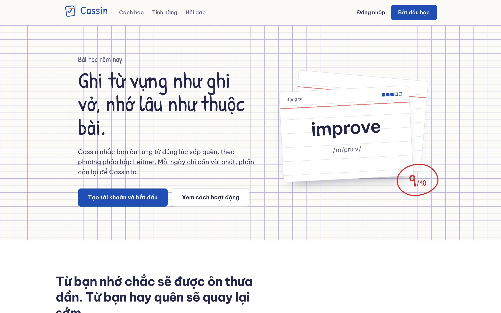

</div>

## Mục lục

- [Giới thiệu](#giới-thiệu)
- [Tính năng](#tính-năng)
- [Ảnh demo](#ảnh-demo)
- [Công nghệ](#công-nghệ)
- [Kiến trúc](#kiến-trúc)
- [Chạy dự án](#chạy-dự-án)
- [Chạy test](#chạy-test)
- [API](#api)
- [Tài liệu kỹ thuật](#tài-liệu-kỹ-thuật)
- [Hướng phát triển](#hướng-phát-triển)

## Giới thiệu

Học từ vựng hay hỏng ở hai chỗ: **nạp từ** thì mất công (tra từng từ, chép tay), còn **ôn** thì không đều (ôn hết mỗi ngày thì ngợp, không ôn thì quên).

Cassin giải quyết cả hai:

- **Nạp từ nhanh**: gõ tay một từ nhiều nghĩa, nhập hàng loạt từ file CSV, hoặc dán một đoạn tiếng Anh để hệ thống tự tìm những từ bạn chưa học.
- **Ôn đúng lúc sắp quên**: mỗi nghĩa của một từ là một thẻ, nằm trong một trong 5 hộp Leitner. Nhớ thì lên hộp, khoảng cách ôn giãn dần 1 → 2 → 4 → 7 → 15 ngày; quên thì về hộp 1.

## Tính năng

| Nhóm | Tính năng |
|---|---|
| **Tài khoản** | Đăng ký, đăng nhập bằng JWT; sửa hồ sơ, đổi mật khẩu; phân quyền người học / quản trị |
| **Sổ từ & bộ từ** | Một từ nhiều nghĩa (loại từ, nghĩa, tối đa 5 câu ví dụ); bộ từ là nhãn chủ đề, một từ nằm được trong nhiều bộ; bộ có sẵn của hệ thống và bộ cá nhân |
| **Nhập CSV** | Xem trước trước khi nhập, báo **mọi** lỗi kèm số dòng và cột, nhập theo kiểu tất cả hoặc không gì cả, bỏ qua từ đã có |
| **Quét đoạn văn** | Dán đoạn tiếng Anh → tìm từ chưa học, đưa về dạng gốc (*running, ran* → *run*), nhận cả thành ngữ / cụm động từ (*gave up* → *give up*), cắt sẵn câu ví dụ từ đoạn văn |
| **Thư viện** | Duyệt kho từ hệ thống, thêm vào bộ của mình bằng một chạm |
| **Ôn thẻ Leitner** | Hàng đợi thẻ đến hạn + thẻ mới, phím tắt, biểu đồ 5 hộp, chuỗi ngày học liên tiếp |
| **Ngữ pháp** | Chủ đề theo trình độ CEFR, lý thuyết, bài trắc nghiệm, lịch sử làm bài |
| **Quản trị** | Thống kê tổng quan, quản lý bộ từ hệ thống, chủ đề ngữ pháp và câu hỏi |

## Ảnh demo

### 1. Đăng ký và trang Hôm nay

Đăng ký xong là vào thẳng trang **Hôm nay**: số thẻ cần ôn, phân bố thẻ trong 5 hộp, chuỗi ngày học và các bộ từ.

| Đăng ký | Hôm nay |
|---|---|
| 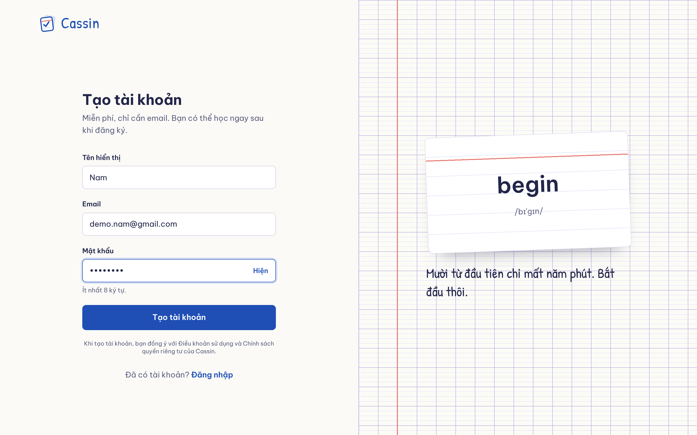 | 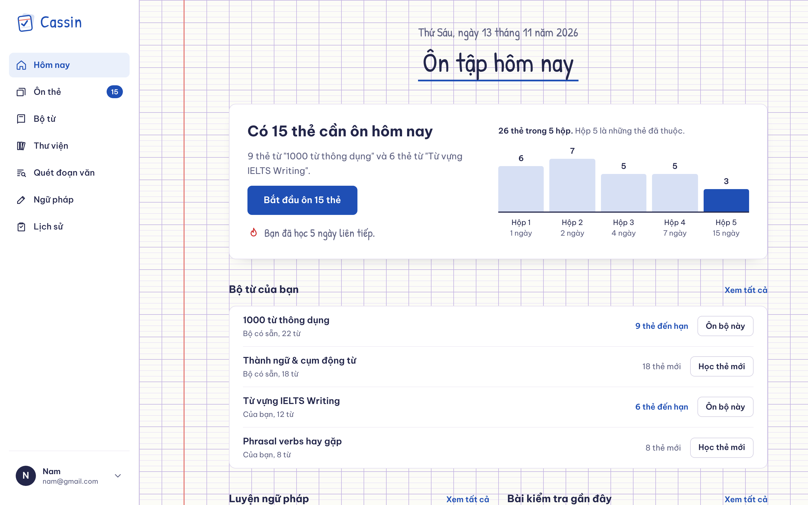 |

### 2. Thêm từ mới vào bộ

Một từ có nhiều nghĩa, mỗi nghĩa là một thẻ ôn riêng. Từ đích trong câu ví dụ được đánh dấu bằng `[ ]` để dùng cho bài luyện **Điền từ**.

| Chi tiết bộ từ | Thêm từ nhiều nghĩa |
|---|---|
| 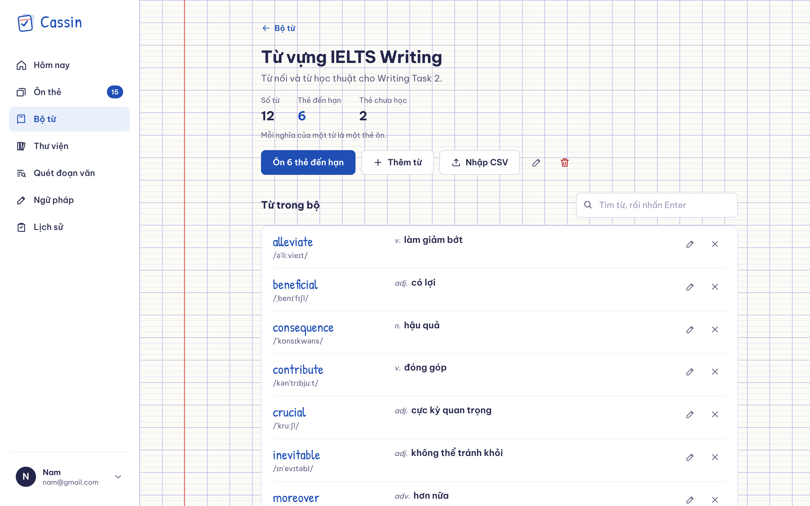 | 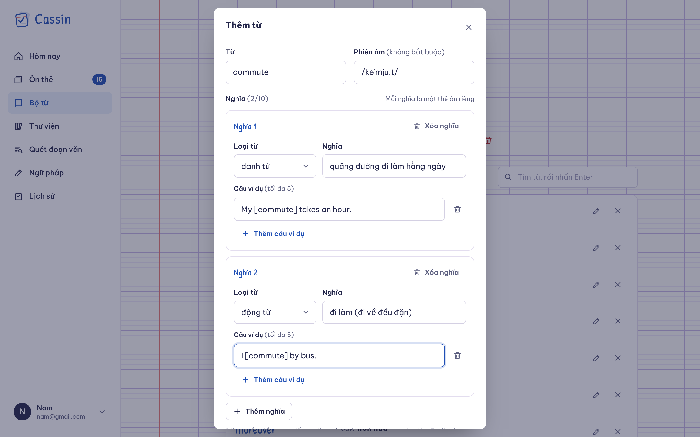 |

### 3. Nhập từ bằng file CSV

Chọn file là hệ thống kiểm tra ngay (chưa ghi gì). File lỗi thì liệt kê **tất cả** lỗi một lần; file đúng thì báo trước sẽ thêm bao nhiêu từ, rồi mới nhập.

| File có lỗi | Xem trước file đúng |
|---|---|
| 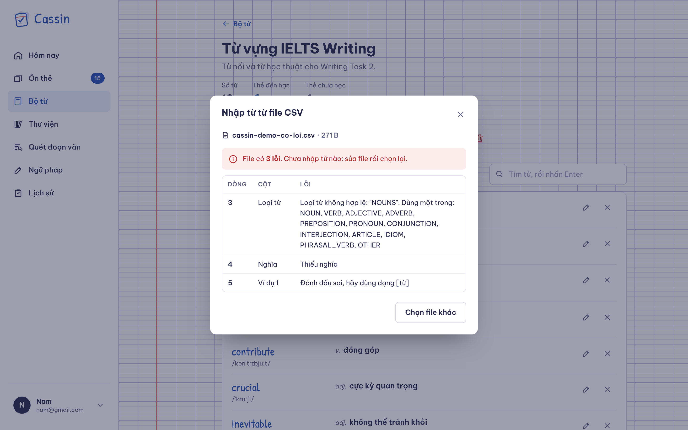 | 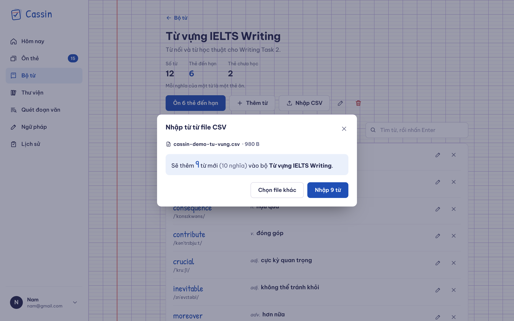 |

### 4. Quét đoạn văn tìm từ mới

Dán một đoạn tiếng Anh, Cassin trả về những từ bạn chưa học. Thành ngữ và cụm động từ được nhận nguyên cụm, kèm câu gốc trong đoạn văn làm ví dụ.

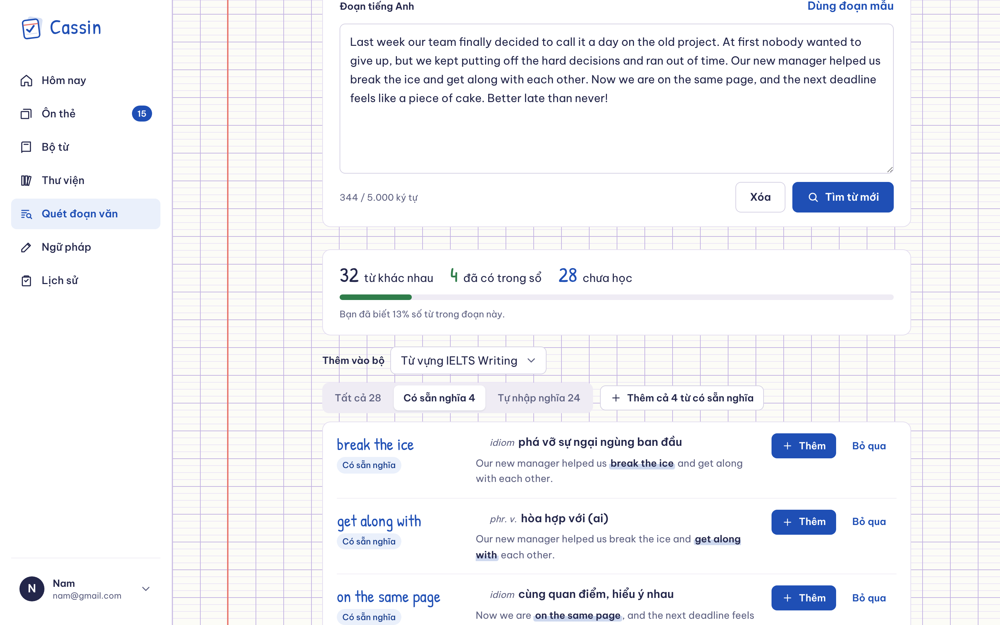

### 5. Ôn thẻ Leitner

Mặt trước là từ và phiên âm, mặt sau là nghĩa, câu ví dụ và các nghĩa khác của cùng từ. `Space` lật thẻ, `1` Quên (về hộp 1), `2` Nhớ (lên hộp sau).

| Mặt trước | Mặt sau |
|---|---|
| 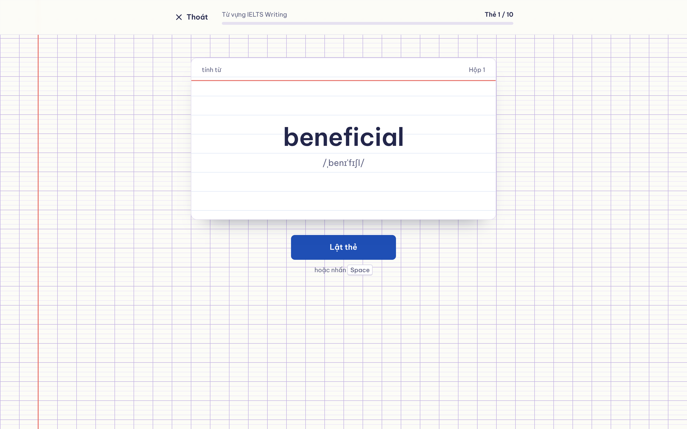 | 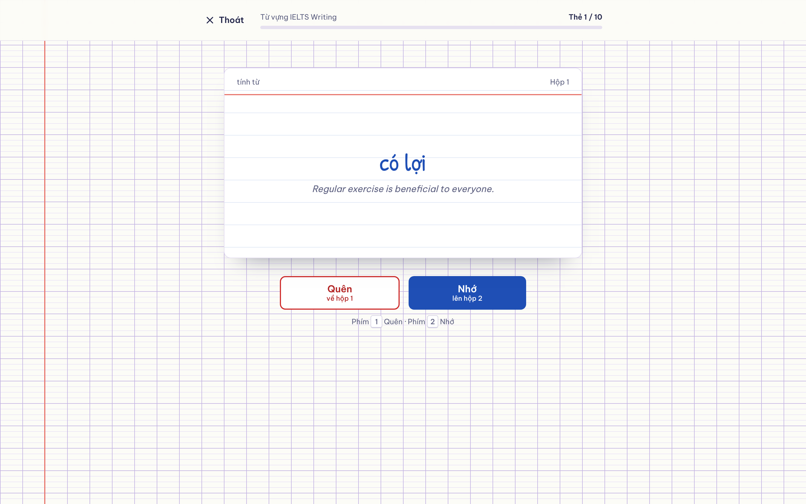 |

## Công nghệ

| Phần | Công nghệ |
|---|---|
| **Backend** | Java 21, Spring Boot 4.1 (Web MVC, Data JPA, Validation, Security), JJWT 0.13, Apache Commons CSV, Lombok |
| **Database** | PostgreSQL, Flyway (13 migration), Hibernate `ddl-auto: validate` |
| **Frontend** | Angular 22 (standalone component, signals, `rxResource`, OnPush), Tailwind CSS 4 + SCSS, TypeScript 6 |
| **Test** | JUnit 5, Mockito, AssertJ (backend); Vitest (frontend) |

## Kiến trúc

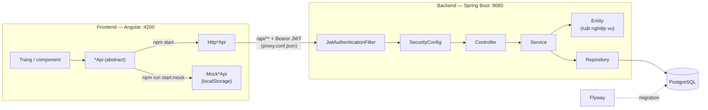

- **Backend chia theo tính năng** (`auth`, `user`, `vocab`, `scan`, `grammar`, `quiz`, `practice`, `report`, `admin`, `common`), mỗi package tự có controller, service, repository, entity, DTO.
- **Luật nghiệp vụ nằm trong entity** (`Word.replaceSenses`, `CardProgress.review`...), service chỉ điều phối và đổi lỗi sang mã HTTP. Test luật không cần Spring hay database.
- **Mọi lỗi trả cùng một dạng** `{ code, message, fieldErrors }`; FE đọc `code` để hiện lỗi đúng ô nhập.
- **Frontend có chế độ mock**: cùng hợp đồng API, cùng luật và mã lỗi với backend, chạy được giao diện mà không cần backend.

```
cassin/
├── backend/
│   ├── docs/                         Tài liệu kỹ thuật từng luồng
│   ├── src/main/java/com/cassin/     auth · user · vocab · scan · grammar · quiz · practice · report · admin · common
│   ├── src/main/resources/
│   │   ├── application.yml
│   │   └── db/migration/             V1 → V13 (Flyway)
│   └── src/test/java/com/cassin/
├── frontend/
│   └── src/app/                      core (api, mock, auth, models) · shared/ui · layout · features
└── docs/images/                      Ảnh trong README
```

## Chạy dự án

### Cách nhanh: chỉ xem giao diện (không cần backend)

Cần **Node.js 22.22.3+ hoặc 24.15+**.

```bash
cd frontend
npm install
npm run start:mock
```

Mở http://localhost:4200, đăng nhập bằng tài khoản mẫu:

| Vai trò | Email | Mật khẩu |
|---|---|---|
| Học viên | `nam@gmail.com` | `12345678` |
| Quản trị | `admin@cassin.local` | `admin-dev-123` |

Dữ liệu mock lưu trong `localStorage` của trình duyệt. Muốn làm lại từ đầu: menu tài khoản → **Đặt lại dữ liệu mẫu**.

### Chạy đầy đủ (backend + database)

**Yêu cầu:** JDK 21, Maven 3.9+, PostgreSQL 16, Node.js 22.22.3+ hoặc 24.15+.

#### 1. Tạo database (một lần)

Mở `psql` bằng tài khoản `postgres`:

```bash
psql -U postgres
```

```sql
CREATE USER cassin WITH PASSWORD 'cassin';
CREATE DATABASE cassin OWNER cassin;
```

Bảng và dữ liệu mẫu (bộ từ hệ thống, thành ngữ, chủ đề ngữ pháp) do **Flyway tự tạo** khi backend khởi động lần đầu.

#### 2. Chạy backend

```bash
cd backend
mvn spring-boot:run
```

API chạy ở http://localhost:8080. Cấu hình bằng biến môi trường (để trống thì dùng giá trị mặc định cho máy dev):

| Biến | Mặc định | Ý nghĩa |
|---|---|---|
| `DB_URL` | `jdbc:postgresql://localhost:5432/cassin` | Chuỗi kết nối database |
| `DB_USERNAME` / `DB_PASSWORD` | `cassin` / `cassin` | Tài khoản database |
| `JWT_SECRET` | khóa dev có sẵn | Khóa ký JWT, base64, tối thiểu 32 byte. **Bắt buộc đặt khi deploy** |
| `ADMIN_EMAIL` / `ADMIN_PASSWORD` | trống | Đặt **cả hai** thì lúc khởi động tạo tài khoản quản trị (mật khẩu 8–72 byte) |

Ví dụ tạo admin trên Windows (PowerShell):

```powershell
$env:ADMIN_EMAIL = "admin@cassin.local"
$env:ADMIN_PASSWORD = "admin-dev-123"
mvn spring-boot:run
```

#### 3. Chạy frontend

```bash
cd frontend
npm install
npm start
```

Mở http://localhost:4200. `ng serve` chuyển mọi request `/api/*` sang `http://localhost:8080` (xem `frontend/proxy.conf.json`), nên không cần cấu hình CORS. Tài khoản học viên thì tự đăng ký.

#### File mẫu để thử

| Tính năng | Thử với |
|---|---|
| Nhập CSV | Bấm **Tải file mẫu** trong hộp thoại **Nhập CSV**. Định dạng: `term,phonetic,part_of_speech,definition,example_1..example_5` |
| Quét đoạn văn | Bấm **Dùng đoạn mẫu** trên trang **Quét đoạn văn** |

## Chạy test

```bash
cd backend && mvn test      # JUnit 5 + Mockito: luật entity, service, xử lý lỗi
cd frontend && npm test     # Vitest
```

Backend có test cho từng module: `vocab` (Leitner, từ nhiều nghĩa, nhập CSV, đánh dấu `[ ]`), `scan` (tách câu, đưa về dạng gốc, quét), `grammar`, `quiz`, `practice`, `report`, `common`.

## API

Mọi endpoint (trừ `/api/auth/**`) cần header `Authorization: Bearer <token>`; `/api/admin/**` cần vai trò `ADMIN`.

| Nhóm | Endpoint chính |
|---|---|
| Xác thực | `POST /api/auth/register`, `POST /api/auth/login` |
| Tài khoản | `GET/PUT /api/me`, `PUT /api/me/password` |
| Bộ từ | `GET/POST /api/decks`, `GET/PUT/DELETE /api/decks/{id}`, `POST/DELETE /api/decks/{id}/words/{wordId}` |
| Nhập CSV | `POST /api/decks/{id}/import?dryRun=true\|false` (multipart, tối đa 1MB / 500 dòng) |
| Từ | `GET/POST /api/words`, `GET/PUT/DELETE /api/words/{id}` |
| Thư viện | `GET /api/library` |
| Quét đoạn văn | `POST /api/scan` |
| Ôn thẻ | `GET /api/review-queue`, `POST /api/senses/{id}/review`, `GET /api/review/stats` |
| Luyện tập | `GET /api/practice/fill-blank`, `GET /api/practice/sentence-build`, `POST /api/practice/answers`, `/api/mistakes` |
| Ngữ pháp & trắc nghiệm | `GET /api/grammar/topics`, `POST /api/grammar/topics/{id}/quiz-attempts`, `POST /api/quiz-attempts/{id}/submit` |
| Báo lỗi nội dung | `/api/reports`, `/api/admin/reports` |
| Quản trị | `/api/admin/**` (thống kê, bộ từ hệ thống, ngữ pháp) |

Lỗi luôn trả cùng một dạng:

```json
{ "code": "VALIDATION_ERROR", "message": "Dữ liệu không hợp lệ", "fieldErrors": { "email": "Email không hợp lệ" } }
```

## Tài liệu kỹ thuật

Mỗi luồng chính có một tài liệu giải thích luồng chạy, thuật toán, lý do thiết kế, giới hạn đã biết và câu hỏi ôn tập:

| Luồng | Tài liệu |
|---|---|
| Đăng ký, đăng nhập, JWT | [`backend/docs/auth.md`](backend/docs/auth.md) |
| Thêm từ mới vào bộ | [`backend/docs/word-create.md`](backend/docs/word-create.md) |
| Nhập từ bằng file CSV | [`backend/docs/word-import.md`](backend/docs/word-import.md) |
| Quét đoạn văn tìm từ mới | [`backend/docs/text-scan.md`](backend/docs/text-scan.md) |
| Ôn thẻ Leitner | [`backend/docs/review-leitner.md`](backend/docs/review-leitner.md) |
| Cấu trúc frontend, chế độ mock | [`frontend/README.md`](frontend/README.md) |

## Hướng phát triển

- Giao diện cho bài luyện **Điền từ / Xếp câu**, **Sổ lỗi sai** và **báo lỗi nội dung** (backend đã có API).
- Refresh token và thu hồi token; giới hạn số lần đăng nhập sai.
- Optimistic locking cho việc sửa từ.
- Gợi ý nghĩa cho từ mới khi quét đoạn văn; ưu tiên từ theo độ phổ biến / CEFR.
- Nhắc ôn qua email khi có thẻ đến hạn.

---

<div align="center">
Làm bởi <b>HoanNam</b> · <a href="https://github.com/HoHoanNam/cassin">github.com/HoHoanNam/cassin</a>
</div>
