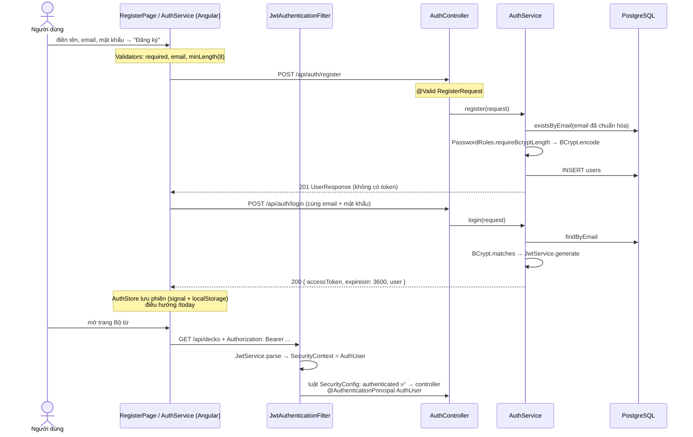

# Đăng ký, đăng nhập và xác thực bằng JWT — luồng thực thi & lý do thiết kế

Tài liệu đi kèm package `com.cassin.auth`, `common/SecurityConfig.java` (backend) và `core/auth/*`, `features/auth/*` (frontend).
Đọc phần **1–2** để nắm toàn cảnh, phần **3–5** để hiểu từng luồng và **lý do** chọn cách làm, phần **6–8** khi sửa code hoặc ôn phỏng vấn.

**Mục lục**

1. [Bài toán](#1-bài-toán)
2. [Luồng thực thi từ đầu đến cuối](#2-luồng-thực-thi-từ-đầu-đến-cuối)
3. [Đăng ký](#3-đăng-ký)
4. [Đăng nhập và cấp token](#4-đăng-nhập-và-cấp-token)
5. [Mỗi request sau đó — filter và luật bảo mật](#5-mỗi-request-sau-đó--filter-và-luật-bảo-mật)
6. [Các quyết định thiết kế và lý do](#6-các-quyết-định-thiết-kế-và-lý-do)
7. [Giới hạn đã biết và hướng mở rộng](#7-giới-hạn-đã-biết-và-hướng-mở-rộng)
8. [Test, file liên quan, câu hỏi ôn tập](#8-test-file-liên-quan-câu-hỏi-ôn-tập)

---

## 1. Bài toán

Mỗi người học có sổ từ, bộ từ và tiến độ ôn **riêng**. Hệ thống cần:

| Yêu cầu | Cách đáp ứng |
|---|---|
| Biết request này của ai | JWT trong header `Authorization: Bearer <token>` |
| Không lưu mật khẩu gốc | Băm bằng BCrypt (có muối ngẫu nhiên) |
| Phân quyền người học / quản trị | `Role` (`USER`, `ADMIN`) nằm trong token; `/api/admin/**` chỉ cho `ADMIN` |
| Một email chỉ một tài khoản | Chuẩn hóa email + `UNIQUE` trong DB |
| Báo lỗi dễ hiểu, đúng ô nhập | Mọi lỗi trả cùng dạng `ErrorResponse { code, message, fieldErrors }` |

Ba endpoint công khai và một quy ước cho mọi endpoint còn lại:

| Endpoint | Trả về | Ghi chú |
|---|---|---|
| `POST /api/auth/register` | `201` + `UserResponse` | **Không** kèm token |
| `POST /api/auth/login` | `200` + `LoginResponse { accessToken, tokenType, expiresIn, user }` | |
| Mọi `/api/**` khác | — | Cần token; thiếu / hỏng → `401` |
| `/api/admin/**` | — | Cần token `ADMIN`; là `USER` → `403` |

---

## 2. Luồng thực thi từ đầu đến cuối



**Ba tầng, ba trách nhiệm:**

| Tầng | Làm gì | Không làm gì |
|---|---|---|
| `AuthController` | Nhận request, `@Valid`, trả mã HTTP | Không có logic |
| `AuthService` | Chuẩn hóa email, kiểm tra trùng, băm, so mật khẩu, gọi `JwtService` | Không biết token nằm ở header nào |
| `JwtService` | Nơi **duy nhất** biết khóa bí mật: tạo và đọc token | Không truy vấn DB |
| `JwtAuthenticationFilter` | Đọc header, dựng `AuthUser`, ghi vào `SecurityContext` | **Không chặn** request nào |
| `SecurityConfig` | Luật: ai được gọi đường dẫn nào → `401` / `403` | Không đọc token |

---

## 3. Đăng ký

### 3.1 Ba lớp kiểm tra

```
Lớp 1 — FE (Angular Validators)      : trống? sai dạng email? mật khẩu < 8?   → báo ngay, không gửi request
Lớp 2 — BE DTO (@Valid RegisterRequest): @NotBlank, @Email, @Size            → 400 VALIDATION_ERROR + fieldErrors
Lớp 3 — BE service + DB              : email trùng, mật khẩu > 72 byte        → 409 EMAIL_TAKEN / 400 PASSWORD_TOO_LONG
```

Lớp 1 chỉ là **trải nghiệm**: ai cũng gọi API trực tiếp được (Postman, curl), nên lớp 2–3 mới là bảo vệ thật.

```java
public record RegisterRequest(
  @NotBlank @Email @Size(max = 255)              String email,
  @NotBlank @Size(min = 8, max = 72)             String password,
  @NotBlank @Size(max = 100)                     String displayName) {}
```

### 3.2 Chuẩn hóa email — trước khi kiểm tra trùng

```java
String email = User.normalizeEmail(request.email());   // strip() + toLowerCase(Locale.ROOT)
if (userRepository.existsByEmail(email)) throw ... 409 EMAIL_TAKEN
```

| Không chuẩn hóa | Hậu quả |
|---|---|
| `An@Gmail.com` và `an@gmail.com` | `UNIQUE` trong PostgreSQL phân biệt hoa thường → **hai** tài khoản cho một người |
| `" an@gmail.com"` (dính dấu cách khi copy) | Đăng ký được, sau đó gõ đúng email lại không đăng nhập được |

`normalizeEmail` là method `static` của `User`, dùng chung cho **đăng ký, đăng nhập, `AdminBootstrap`** → không bao giờ có hai nơi chuẩn hóa khác nhau.
`Locale.ROOT`: tránh lỗi đổi chữ theo ngôn ngữ máy (máy cài tiếng Thổ Nhĩ Kỳ đổi `I` → `ı`).

### 3.3 Mật khẩu: BCrypt và giới hạn 72 byte

```
"matkhau123"  ──BCrypt.encode──▶  $2a$10$N9qo8uLOickgx2ZMRZoMye.IjZAgcfl7p92ldGxad68LJZdL17lhW
                                   │   │  └──────── muối (22 ký tự) ─────┘└──── băm (31 ký tự) ──┘
                                   │   └─ cost = 10 → 2^10 vòng lặp
                                   └─ phiên bản thuật toán
```

| Tính chất | Ý nghĩa |
|---|---|
| **Một chiều** | Không giải ngược được. Đăng nhập = băm lại mật khẩu vừa nhập rồi so |
| **Có muối ngẫu nhiên** | Hai người cùng mật khẩu `12345678` → hai chuỗi băm khác nhau; bảng tra sẵn (rainbow table) vô dụng |
| **Cố ý chậm** (cost 10) | ~100ms mỗi lần: người dùng không thấy, kẻ dò mật khẩu thử hàng tỷ lần thì thấy |
| **Giới hạn 72 BYTE** | Bản Spring Security mới **ném lỗi** khi quá 72 byte |

**Vì sao cần `PasswordRules` khi DTO đã có `@Size(max = 72)`?** `@Size` đếm **ký tự**, BCrypt đếm **byte**:

| Mật khẩu | Ký tự | Byte (UTF-8) | `@Size(max=72)` | BCrypt |
|---|---|---|---|---|
| `matkhau` | 7 | 7 | ✅ | ✅ |
| `mậtkhẩu` | 7 | 11 | ✅ | ✅ |
| 40 chữ có dấu | 40 | ~100 | ✅ | ❌ ném lỗi → **500** |

`PasswordRules.requireBcryptLength` đo byte **trước** khi băm → `400 PASSWORD_TOO_LONG` kèm câu hướng dẫn, thay vì `500`.

### 3.4 Đăng ký xong thì đăng nhập luôn — ở FE

Backend trả `201 UserResponse` **không có token**. FE tự gọi tiếp login:

```ts
register(request) {
  return this.api.register(request)
    .pipe(switchMap(() => this.login({ email: request.email, password: request.password })));
}
```

| Cách | Ưu | Nhược |
|---|---|---|
| **Đăng ký trả 201 + user, FE gọi login** (đang dùng) | Mỗi endpoint một việc; cấp token chỉ ở **một** chỗ (`login`) | 2 request |
| Đăng ký trả luôn token | 1 request | Hai nơi cấp token; sau này thêm "xác minh email trước khi dùng" phải sửa cả hai |

Người dùng không thấy khác biệt: bấm "Đăng ký" một lần là vào thẳng `/today`.

### 3.5 Hai người đăng ký cùng email ĐÚNG CÙNG LÚC

```
A: existsByEmail → false ─┐
B: existsByEmail → false ─┘  (chưa ai lưu)
A: INSERT users → ✅
B: INSERT users → ❌ UNIQUE (V1: email VARCHAR(255) NOT NULL UNIQUE)
                 → DataIntegrityViolationException → GlobalExceptionHandler → 409 DATA_CONFLICT
```

`existsByEmail` lo trường hợp thường (cho câu báo đẹp `EMAIL_TAKEN`), `UNIQUE` trong DB lo trường hợp đua nhau. **Kiểm tra trong code không bao giờ thay được ràng buộc trong DB.**

### 3.6 Lỗi hiện đúng ô

```
400 { code: "VALIDATION_ERROR", fieldErrors: { "email": "Email không hợp lệ" } }
      → RegisterPage: form.get("email").setErrors({ server: message })  → hiện dưới ô Email

409 { code: "EMAIL_TAKEN" }
      → RegisterPage: emailTaken = true                                  → "Email này đã được đăng ký" dưới ô Email
```

FE đọc **`code`**, không đọc `message`: đổi câu chữ ở backend không làm hỏng giao diện.

---

## 4. Đăng nhập và cấp token

### 4.1 Kiểm tra email + mật khẩu

```java
User user = userRepository.findByEmail(email)
    .filter(u -> passwordEncoder.matches(request.password(), u.getPasswordHash()))
    .orElseThrow(() -> new BusinessException(UNAUTHORIZED, "INVALID_CREDENTIALS",
                                             "Email hoặc mật khẩu không đúng"));
```

**Sai email hay sai mật khẩu đều trả CÙNG MỘT lỗi.** Báo riêng "email không tồn tại" thì kẻ xấu thử lần lượt sẽ dò ra email nào đã đăng ký (user enumeration).

`passwordEncoder.matches(gốc, băm)`: lấy muối nằm sẵn trong chuỗi băm, băm lại mật khẩu vừa nhập, so hai kết quả.

`LoginRequest` chỉ có `@NotBlank`, không `@Email` / `@Size`: email sai dạng thì đằng nào cũng không tìm thấy user, kiểm tra thêm chỉ làm lộ luật.

### 4.2 Token gồm những gì

```
eyJhbGciOiJIUzI1NiJ9 . eyJzdWIiOiI1IiwiZW1haWwiOi4uLn0 . SflKxwRJSMeKKF2QT4fwpMeJf36POk6yJV
└──── header ──────┘   └──────────── payload ─────────┘   └─────────── signature ──────────┘
   thuật toán HS256       base64, AI CŨNG ĐỌC ĐƯỢC            HMAC-SHA256(header.payload, khóa bí mật)
```

| Claim | Giá trị | Dùng để |
|---|---|---|
| `sub` | id người dùng | `AuthUser.id` |
| `email` | email | hiển thị, log |
| `role` | `USER` / `ADMIN` | phân quyền `/api/admin/**` |
| `iat`, `exp` | lúc cấp, lúc hết hạn (+1 giờ) | JJWT tự kiểm tra hạn |

- **Không bao giờ để mật khẩu** (hay gì bí mật) trong payload: chỉ mã hóa base64, không mã hóa bảo mật.
- Sửa **một ký tự** trong payload (vd `"role":"USER"` → `"ADMIN"`) là chữ ký sai ngay → token bị từ chối.
- Khóa đọc từ `cassin.jwt.secret` (biến môi trường `JWT_SECRET`), tối thiểu 32 byte; ngắn hơn thì JJWT ném lỗi **ngay lúc khởi động**.

### 4.3 FE giữ phiên

```ts
setSession(response) {
  session = { token, expiresAt: Date.now() + expiresIn * 1000, user };
  signal.set(session); localStorage.setItem('cassin.session', ...);
}
```

| Thành phần | Việc |
|---|---|
| `AuthStore` | Nơi duy nhất giữ phiên (signal). Đọc lại từ `localStorage` khi tải trang; hết hạn thì bỏ |
| `authInterceptor` | Gắn `Authorization: Bearer <token>` vào mọi request tới API Cassin (không gắn cho domain khác) |
| `errorInterceptor` | API trả `401` (trừ chính `/auth/*`) → xóa phiên, về `/login?returnUrl=...&reason=expired` |
| `authGuard` / `guestGuard` / `adminGuard` | Chưa đăng nhập → `/login`; đã đăng nhập mà vào `/login` → `/today`; không phải admin → `/today` |
| `LoginPage.safeReturnUrl` | Chỉ quay về đường dẫn nội bộ (`/...`, không phải `//...`) → chặn **open redirect** |

Guard chỉ là trải nghiệm. Bảo vệ thật là API trả `401` / `403`.

---

## 5. Mỗi request sau đó — filter và luật bảo mật

```
Request ──▶ JwtAuthenticationFilter ──▶ luật SecurityConfig ──▶ Controller
            (đọc token, GHI danh tính)   (cho qua / 401 / 403)   (@AuthenticationPrincipal AuthUser)
```

**Filter KHÔNG tự chặn.** Có token hợp lệ thì ghi `AuthUser` + quyền `ROLE_<role>` vào `SecurityContext`; token hỏng / hết hạn thì xóa context và **vẫn cho đi tiếp**. Việc chặn là của luật:

```java
.requestMatchers("/api/auth/**", "/error").permitAll()
.requestMatchers("/api/admin/**").hasRole("ADMIN")      // khớp quyền "ROLE_ADMIN"
.anyRequest().authenticated()
```

| Tình huống | Kết quả |
|---|---|
| Không có token / token hỏng / hết hạn, gọi `/api/decks` | `401 UNAUTHORIZED` |
| Token `USER`, gọi `/api/admin/stats` | `403 FORBIDDEN` |
| Gọi `/api/auth/login` không có token | cho qua |

Vài chi tiết hay bị hỏi:

- **`/error` phải `permitAll`**: lỗi 500 được Spring chuyển nội bộ sang `/error`; khóa nó thì nhận `401` thay cho lỗi thật.
- **Filter không gắn `@Component`**: Spring Boot tự đăng ký mọi `Filter` là bean vào server → filter chạy **hai lần**. Filter được `new` trong `SecurityConfig`.
- **`401` / `403` viết JSON bằng tay** (`writeError`): lỗi xảy ra trong filter, **trước** controller, nên `GlobalExceptionHandler` không bắt được. Vẫn trả đúng dạng `ErrorResponse`.
- **CSRF tắt**: CSRF khai thác **cookie** tự gửi kèm. Cassin gửi token trong **header**, trình duyệt không tự gửi → tắt được. Chuyển token sang cookie thì phải bật lại.
- **`STATELESS`**: không tạo session trên server; mỗi request tự chứng minh danh tính.
- `AuthUser(id, email, role)` là **record**, không phải entity: dựng từ token, **không truy vấn DB** ở mỗi request.

---

## 6. Các quyết định thiết kế và lý do

| # | Quyết định | Lý do | Đánh đổi |
|---|---|---|---|
| 1 | **JWT stateless** thay vì session | Không lưu gì trên server, dễ chạy nhiều instance | Không thu hồi token trước hạn được (xem phần 7) |
| 2 | Token **1 giờ**, không refresh token | Đơn giản; token lộ chỉ dùng được tối đa 1 giờ | Hết giờ phải đăng nhập lại |
| 3 | **BCrypt** | Có muối, cố ý chậm, chuẩn của Spring Security | ~100ms mỗi lần đăng nhập |
| 4 | Kiểm tra mật khẩu theo **byte** | BCrypt giới hạn 72 byte, chữ có dấu tốn 2–3 byte | Thêm một class nhỏ |
| 5 | **Chuẩn hóa email** ở một hàm dùng chung | Tránh hai tài khoản cho một email | — |
| 6 | `existsByEmail` **+** `UNIQUE` | Câu báo đẹp cho trường hợp thường; DB chặn trường hợp đua | Trường hợp đua nhận mã chung `DATA_CONFLICT` |
| 7 | Sai email / sai mật khẩu **cùng một lỗi** | Chống dò email | Người dùng không biết mình sai chỗ nào |
| 8 | Đăng ký **không** trả token | Một nơi duy nhất cấp token | FE gọi 2 request |
| 9 | Filter **chỉ ghi danh tính**, luật chặn nằm ở `SecurityConfig` | Một nơi đọc luật phân quyền của cả app | — |
| 10 | Mọi lỗi cùng dạng **`ErrorResponse`**, FE đọc `code` | FE xử lý một kiểu JSON; đổi câu chữ không hỏng giao diện | Phải tự viết JSON cho `401` / `403` |
| 11 | `AdminBootstrap` tạo admin từ biến môi trường, **không** tự nâng quyền email đã có | Tránh ai đó đăng ký trước đúng email admin rồi chờ được nâng quyền | Muốn nâng phải sửa DB |
| 12 | Phiên ở **`localStorage`** | Tải lại trang không bị đăng xuất | Đọc được bằng JavaScript nếu trang bị XSS (xem phần 7) |

---

## 7. Giới hạn đã biết và hướng mở rộng

| Giới hạn | Vì sao | Hướng xử lý |
|---|---|---|
| **Không thu hồi được token** (đăng xuất chỉ xóa ở FE; đổi mật khẩu / bị hạ quyền thì token cũ vẫn dùng được tới hết hạn) | Stateless: server không lưu token | Access token ngắn (5–15 phút) + refresh token lưu DB, thu hồi được; hoặc danh sách đen theo `jti` |
| **`role` trong token cũ** | Hạ `ADMIN` → `USER` trong DB nhưng token vẫn ghi `ADMIN` tới hết giờ | Như trên, hoặc kiểm tra role từ DB cho `/api/admin/**` |
| **Chênh lệch thời gian khi dò email**: email không tồn tại → bỏ qua BCrypt → trả lời nhanh hơn ~100ms | `filter(...)` chỉ chạy khi tìm thấy user | Vẫn gọi `matches` với một chuỗi băm giả khi không tìm thấy user |
| **Đăng ký vẫn lộ email đã tồn tại** (`EMAIL_TAKEN`) | Đánh đổi có chủ đích: người dùng cần biết vì sao không đăng ký được | Luồng xác minh qua email ("nếu email hợp lệ, chúng tôi đã gửi thư") |
| **Không giới hạn số lần đăng nhập sai** | Chưa làm | Rate limit theo IP + email (Bucket4j), khóa tạm sau N lần sai |
| **Token ở `localStorage`** | Đánh đổi để giữ phiên khi tải lại trang | Cookie `HttpOnly` + `SameSite` (phải bật lại CSRF) |
| **Chưa xác minh email** | Chưa làm | Gửi link xác minh, cột `email_verified_at` |
| `JwtService` gọi `Instant.now()` thay vì `Clock` | — | Inject `Clock` như các service khác để test được hạn token |

---

## 8. Test, file liên quan, câu hỏi ôn tập

### File

| File | Vai trò |
|---|---|
| `auth/AuthController.java` | `POST /api/auth/register`, `POST /api/auth/login` |
| `auth/AuthService.java` | Đăng ký, đăng nhập |
| `auth/JwtService.java`, `auth/JwtProperties.java` | Tạo / đọc token; cấu hình `cassin.jwt.*` |
| `auth/JwtAuthenticationFilter.java` | Đọc header → `SecurityContext` |
| `auth/AuthUser.java` | Người đang đăng nhập (record, không phải entity) |
| `auth/dto/RegisterRequest.java`, `LoginRequest.java`, `LoginResponse.java` | Hợp đồng API |
| `common/SecurityConfig.java` | Luật `permitAll` / `hasRole` / `authenticated`, `401` / `403` |
| `common/PasswordConfig.java`, `common/PasswordRules.java` | `BCryptPasswordEncoder`, giới hạn 72 byte |
| `common/GlobalExceptionHandler.java` | `BusinessException`, `VALIDATION_ERROR`, `DATA_CONFLICT`... |
| `user/User.java` | `normalizeEmail`, `Role` |
| `user/AdminBootstrap.java` | Tạo tài khoản admin lúc khởi động |
| `db/migration/V1__create_users.sql` | Bảng `users`, `email UNIQUE` |
| FE `core/auth/auth.service.ts` | `login`, `register` (= register + login), `logout` |
| FE `core/auth/auth.store.ts` | Phiên đăng nhập (signal + `localStorage`) |
| FE `core/auth/http.interceptors.ts` | Gắn token; `401` → về trang đăng nhập |
| FE `core/auth/auth.guards.ts` | `authGuard`, `guestGuard`, `adminGuard` |
| FE `features/auth/register-page.*`, `login-page.*` | Form, lỗi theo ô, `safeReturnUrl` |

### Test

| Test | Kiểm tra |
|---|---|
| `PasswordRulesTest` | Chữ không dấu 1 byte / ký tự; chữ có dấu nhiều byte hơn; đúng 72 byte qua; dưới 72 ký tự nhưng quá 72 byte bị chặn; chính BCrypt cũng từ chối mật khẩu dài |

Chưa có test cho `AuthService` và luật `SecurityConfig`. Nên thêm:
`register_duplicateEmail_isConflict`, `register_normalizesEmail`, `login_wrongPassword_andUnknownEmail_sameError`, và một test `@WebMvcTest` cho `401` / `403`.

### Câu hỏi ôn tập

1. Vì sao không lưu mật khẩu gốc? BCrypt "giải" mật khẩu thế nào khi đăng nhập?
2. Hai người cùng mật khẩu `12345678` thì chuỗi băm có giống nhau không? Vì sao?
3. DTO đã có `@Size(max = 72)`, vì sao vẫn cần `PasswordRules`?
4. Vì sao phải chuẩn hóa email **trước** khi kiểm tra trùng? Không chuẩn hóa thì sao?
5. Hai người đăng ký cùng email đúng cùng lúc — code nào chặn, và trả mã lỗi gì?
6. Vì sao sai email và sai mật khẩu trả cùng một lỗi?
7. Payload JWT có bị mã hóa không? Sửa `"role":"USER"` thành `"ADMIN"` thì điều gì xảy ra?
8. `JwtAuthenticationFilter` có chặn request không? Vậy `401` do đâu trả ra?
9. Vì sao tắt được CSRF? Khi nào phải bật lại?
10. Người dùng bị hạ quyền admin, token cũ còn dùng được không? Sửa thế nào?
11. Vì sao `401` / `403` không đi qua `GlobalExceptionHandler`?
12. `safeReturnUrl` chặn tấn công gì?
