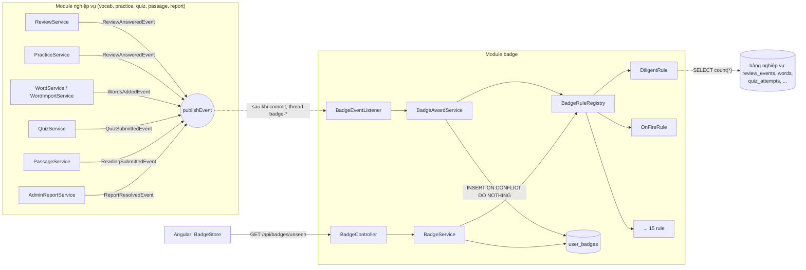
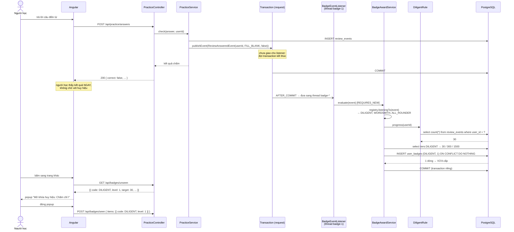

# Huy hiệu (Badge): kiến trúc, luồng thực thi và luật từng huy hiệu

Tài liệu cho package `badge/*`, các sự kiện `*Event` ở các module nghiệp vụ, migration `V18__create_badges.sql` (backend) và `core/state/badge.store.ts`, `features/badges/*` (frontend).
Thiết kế hình vẽ huy hiệu (bảng màu, khung, cấp Đồng / Bạc / Vàng) nằm ở `docs/badges/README.md`, tài liệu này không nhắc lại.

Đọc phần **1–3** để nắm toàn cảnh, phần **4–7** để hiểu phần lõi và **lý do** chọn cách làm, phần **8–9** khi thêm huy hiệu mới, phần **10–12** khi sửa code hoặc ôn phỏng vấn.

**Mục lục**

1. [Bài toán và mô hình huy hiệu](#1-bài-toán-và-mô-hình-huy-hiệu)
2. [Kiến trúc: module nghiệp vụ không biết gì về huy hiệu](#2-kiến-trúc-module-nghiệp-vụ-không-biết-gì-về-huy-hiệu)
3. [Luồng thực thi từ đầu đến cuối](#3-luồng-thực-thi-từ-đầu-đến-cuối)
4. [Dữ liệu: ba bảng, không lưu tiến độ](#4-dữ-liệu-ba-bảng-không-lưu-tiến-độ)
5. [Phần lõi: Trigger, Rule, Registry, Award](#5-phần-lõi-trigger-rule-registry-award)
6. [Listener: AFTER_COMMIT, @Async và REQUIRES_NEW](#6-listener-after_commit-async-và-requires_new)
7. [API đọc huy hiệu và popup "Mở khóa"](#7-api-đọc-huy-hiệu-và-popup-mở-khóa)
8. [Sự kiện và luật của 15 huy hiệu](#8-sự-kiện-và-luật-của-15-huy-hiệu)
9. [Thêm một huy hiệu mới](#9-thêm-một-huy-hiệu-mới)
10. [Các quyết định thiết kế và lý do](#10-các-quyết-định-thiết-kế-và-lý-do)
11. [Giới hạn đã biết và hướng mở rộng](#11-giới-hạn-đã-biết-và-hướng-mở-rộng)
12. [Test, file liên quan, câu hỏi ôn tập](#12-test-file-liên-quan-câu-hỏi-ôn-tập)

---

## 1. Bài toán và mô hình huy hiệu

Người học cần một lý do nhìn thấy được để quay lại mỗi ngày. Huy hiệu ghi nhận **việc đã làm** (ôn bao nhiêu lượt, giữ chuỗi bao nhiêu ngày, đọc bao nhiêu bài), không cho điểm thưởng hay đổi quà.

Hai loại huy hiệu:

| Loại | Số cấp | Ví dụ | Ý nghĩa |
|---|---|---|---|
| `TIERED` | 3: I (Đồng) → II (Bạc) → III (Vàng) | Chăm chỉ: 30 / 300 / 1500 lượt | Mốc tăng dần, luôn có mục tiêu kế tiếp |
| `SPECIAL` | 1 | Cú đêm: ôn thẻ sau 23 giờ | Khoảnh khắc đặc biệt. Có thể **bí mật**: chưa đạt thì che tên |

15 huy hiệu, 9 danh mục (category):

| # | Mã | Tên | Danh mục | Loại | Mốc | Đơn vị |
|---|---|---|---|---|---|---|
| 1 | `DILIGENT` | Chăm chỉ | REVIEW | TIERED | 30 / 300 / 1500 | lượt |
| 2 | `ON_FIRE` | Lửa bền | STREAK | TIERED | 3 / 14 / 60 | ngày liên tiếp |
| 3 | `MEMORY_KEEPER` | Nhớ lâu | MASTERY | TIERED | 5 / 50 / 300 | nghĩa |
| 4 | `COLLECTOR` | Nhà sưu tầm | COLLECTION | TIERED | 20 / 100 / 300 | từ |
| 5 | `PERFECTIONIST` | Điểm tuyệt đối | QUIZ | TIERED | 1 / 5 / 20 | bài |
| 6 | `GRAMMARIAN` | Nhà ngữ pháp | QUIZ | TIERED | 3 / 6 / 10 | chủ đề |
| 7 | `BOOKWORM` | Mọt sách | READING | TIERED | 3 / 10 / 30 | bài |
| 8 | `SELF_RELIANT` | Tự lực | READING | TIERED | 1 / 5 / 15 | bài |
| 9 | `WORDSMITH` | Thợ rèn câu | PRACTICE | TIERED | 30 / 300 / 1000 | câu |
| 10 | `SHARP_EYE` | Mắt tinh | COMMUNITY | TIERED | 1 / 5 / 20 | báo lỗi |
| 11 | `ALL_ROUNDER` | Đa năng | SPECIAL | SPECIAL | 3 | kiểu |
| 12 | `NEVER_GIVE_UP` | Không bỏ cuộc | SPECIAL | SPECIAL | 1 | nghĩa |
| 13 | `COMEBACK` | Trở lại | SPECIAL | SPECIAL | 1 | lần |
| 14 | `NIGHT_OWL` | Cú đêm | SPECIAL | SPECIAL, **bí mật** | 1 | lần |
| 15 | `EARLY_BIRD` | Chim sớm | SPECIAL | SPECIAL, **bí mật** | 1 | lần |

**Ba khái niệm** đi suốt tài liệu:

| Khái niệm | Là gì | Lưu ở đâu |
|---|---|---|
| **Tiến độ** (progress) | Con số hiện tại của chỉ số, vd "đã trả lời 312 lượt" | **Không lưu.** Tính lúc cần bằng một câu `COUNT` trên bảng nghiệp vụ |
| **Mốc** (target) | Con số cần đạt cho mỗi cấp, vd cấp II = 300 | `badge_tiers` (seed trong V18) |
| **Đã đạt** (earned) | Người X đạt cấp N của huy hiệu Y lúc T | `user_badges`. Ghi rồi thì **giữ mãi** |

Cấp hiện tại = cấp cao nhất có dòng trong `user_badges`. Tiến độ có thể **giảm** (đứt chuỗi ngày, xóa từ, quên một nghĩa ở hộp 5) nhưng cấp đã đạt không bao giờ mất.

---

## 2. Kiến trúc: module nghiệp vụ không biết gì về huy hiệu



**Một chiều phụ thuộc duy nhất:** module nghiệp vụ chỉ import đúng một interface của badge là `BadgeTrigger`, để record sự kiện của mình `implements BadgeTrigger`. Ngoài ra không gọi service, không đọc bảng, không biết có bao nhiêu huy hiệu.

| Tầng | Làm gì | Không làm gì |
|---|---|---|
| Service nghiệp vụ (`ReviewService`...) | Làm việc của mình, rồi `publisher.publishEvent(new XxxEvent(...))` | Không biết huy hiệu nào tồn tại, không chờ kết quả xét |
| `BadgeEventListener` | Nhận **mọi** `BadgeTrigger` sau commit, chuyển sang thread riêng, nuốt lỗi | Không có luật |
| `BadgeAwardService` | Với mỗi rule quan tâm sự kiện: tính tiến độ, cấp mọi cấp đã đủ mốc | Không biết luật cụ thể |
| `BadgeRule` (15 bean) | **Toàn bộ luật** của một huy hiệu: nghe sự kiện nào, đếm cái gì | Không ghi DB, không biết cấp / mốc |
| `BadgeService` + `BadgeController` | Đọc danh sách, che huy hiệu bí mật, popup, đánh dấu đã xem | **Không cấp** huy hiệu. Không có endpoint "cấp huy hiệu" |

---

## 3. Luồng thực thi từ đầu đến cuối

Ví dụ: người học trả lời câu điền từ thứ 30, đạt **Chăm chỉ cấp I**.



Ba điểm cần nhớ:

1. **Request của người học không chờ huy hiệu.** Response trả về trước, huy hiệu xét ở thread `badge-*`.
2. **Chỉ xét khi việc học đã lưu thật** (AFTER_COMMIT). Rollback thì không có huy hiệu "ma".
3. **FE không được báo đẩy (push).** FE tự hỏi `unseen` mỗi lần chuyển trang. Lần hỏi đó luôn tới sau vài trăm mili giây, đủ cho thread huy hiệu chạy xong.

---

## 4. Dữ liệu: ba bảng, không lưu tiến độ

```
badge_definitions 1 ──< badge_tiers 1 ──< user_badges >── 1 users
(15 huy hiệu)           (35 cấp: mốc)      (cấp mỗi người đã đạt)
```

### 4.1 `badge_definitions`: danh mục cố định

| Cột | Ràng buộc | Ghi chú |
|---|---|---|
| `code` | PK, `CHECK (code ~ '^[A-Z][A-Z0-9_]*$')` | Mã ổn định, FE dùng mã để chọn hình vẽ |
| `kind` | `TIERED` / `SPECIAL` | |
| `name`, `description`, `unit` | | Tiếng Việt, hiện thẳng lên giao diện |
| `category` | CHECK 9 giá trị | Khớp enum `BadgeCategory` |
| `secret` | `CHECK (NOT secret OR kind = 'SPECIAL')` | Chỉ huy hiệu một cấp mới được bí mật: huy hiệu có cấp luôn hiện mốc kế tiếp |
| `sort_order` | `UNIQUE` | Thứ tự trên trang Thành tích |

### 4.2 `badge_tiers`: mốc từng cấp

PK `(badge_code, level)`, `level BETWEEN 1 AND 3`, `target > 0`.

Cuối V18 có một khối `DO $$ ... $$` **tự kiểm dữ liệu seed**. Seed sai thì migration dừng, không để dữ liệu lệch lọt vào DB:

| Kiểm tra | Vì sao |
|---|---|
| `TIERED` có đúng cấp `{1, 2, 3}`, `SPECIAL` đúng `{1}` | Thiếu cấp thì FE vẽ thiếu, "cấp tối đa" sai |
| Mốc **tăng ngặt** theo cấp | `BadgeAwardService` dừng ở cấp đầu tiên chưa đạt (`break`), dựa trên giả định này |

### 4.3 `user_badges`: chỉ ghi việc ĐÃ ĐẠT

```sql
PRIMARY KEY (user_id, badge_code, level),
FOREIGN KEY (badge_code, level) REFERENCES badge_tiers (badge_code, level),
CHECK (seen_at IS NULL OR seen_at >= earned_at)
```

| Cột / ràng buộc | Vì sao |
|---|---|
| PK `(user, code, level)` | Một người, một cấp, một dòng. Kết hợp `ON CONFLICT DO NOTHING` để cấp trùng không lỗi |
| FK tới `badge_tiers` (khóa ghép) | Không cấp được cấp không tồn tại (vd "Đa năng cấp 2") |
| `seen_at` NULL | Chưa xem popup. `GET /unseen` đọc đúng các dòng này |
| Index một phần `WHERE seen_at IS NULL` | Chỉ chứa dòng chưa xem (rất ít) → câu `unseen` rẻ dù bảng lớn |
| Index `(badge_code, level)` | Postgres không tự tạo index cho phía tham chiếu của FK |

### 4.4 Vì sao không lưu tiến độ?

| Cách | Ưu | Nhược |
|---|---|---|
| **Lưu bộ đếm** (`user_badge_progress.count += 1` mỗi sự kiện) | Đọc nhanh | Lệch dữ liệu: sự kiện mất (thread pool đầy, lỗi) thì đếm sai **mãi mãi**. Dữ liệu có từ trước khi có huy hiệu không được tính. Phải xử lý giảm (xóa từ, đứt chuỗi) |
| **Tính lại từ bảng nghiệp vụ** (cách đang dùng) | Luôn đúng, **tự chữa lành**: mất một sự kiện thì lần sau đếm lại vẫn đúng. Người học cũ có sẵn 500 lượt sẽ nhận cấp ngay ở lượt kế tiếp | Mỗi lần xét là một câu `COUNT`, nhưng câu nào cũng đi theo index có `user_id` đứng đầu |

### 4.5 Huy hiệu giả cho test: `db/testdata/R__test_badges.sql`

`src/test/resources/db/testdata/R__test_badges.sql` thêm 3 huy hiệu `TEST_TIERED`, `TEST_SECRET`, `TEST_DISABLED`. Chỉ nạp ở profile `it`, nhờ `spring.flyway.locations: classpath:db/migration,classpath:db/testdata` trong `application-it.yml`.

| Câu hỏi | Trả lời |
|---|---|
| Sao không để `BadgeBaseIT` dùng rule giả mượn mã thật (`DILIGENT`)? | Context của test vẫn quét mọi `@Component`, nên có cả `DiligentRule` thật. Hai rule cùng mã → `BadgeRuleRegistry` dừng app |
| Sao là `R__` chứ không phải `V1000__`? | `R__` (repeatable) không có số phiên bản, luôn chạy sau mọi `V__`. Đặt `V1000` thì sau này thêm `V19` thật sẽ "nhỏ hơn bản đã chạy" và Flyway báo lỗi trên DB giữ lại giữa các lần chạy |

---

## 5. Phần lõi: Trigger, Rule, Registry, Award

### 5.1 `BadgeTrigger`: hợp đồng duy nhất với module khác

```java
public interface BadgeTrigger {
  Long userId();   // người NHẬN huy hiệu, không nhất thiết là người thao tác
}

// ở module practice
public record ReviewAnsweredEvent(Long userId, PracticeMode mode, boolean correct) implements BadgeTrigger { ... }
```

`userId` là **người nhận**: admin xử lý báo lỗi thì `ReportResolvedEvent.userId()` là **người đã báo**, không phải admin.

### 5.2 `BadgeRule`: luật của MỘT huy hiệu

```java
public interface BadgeRule {
  String code();                                    // "DILIGENT", phải có trong badge_definitions
  Set<Class<? extends BadgeTrigger>> triggers();    // loại sự kiện có thể làm tiến độ đổi
  long progress(Long userId);                       // con số hiện tại, thường MỘT câu COUNT

  default boolean listensTo(BadgeTrigger event) {   // rule có thể override để lọc kỹ hơn
    return triggers().stream().anyMatch(type -> type.isInstance(event));
  }
}
```

Một rule điển hình:

```java
@Component
@RequiredArgsConstructor
public class WordsmithRule implements BadgeRule {
  private final JdbcClient jdbc;

  public String code() { return "WORDSMITH"; }
  public Set<Class<? extends BadgeTrigger>> triggers() { return Set.of(ReviewAnsweredEvent.class); }

  @Override  // lượt lật thẻ không đổi con số này → khỏi truy vấn
  public boolean listensTo(BadgeTrigger event) {
    return event instanceof ReviewAnsweredEvent answered && !answered.isFlashcard();
  }

  public long progress(Long userId) {
    return jdbc.sql("""
            select count(*) from review_events
            where user_id = :userId and mode in ('FILL_BLANK', 'SENTENCE_BUILD')
            """)
        .param("userId", userId).query(Long.class).single();
  }
}
```

**Rule không biết mốc, không biết cấp, không ghi DB.** Đổi mốc chỉ sửa dữ liệu, đổi cách đếm chỉ sửa một class.

**Vì sao `JdbcClient` mà không thêm method vào repository của module khác?**

| Thêm `countByUserIdAndModeIn` vào `ReviewEventRepository` | `JdbcClient` ngay trong rule |
|---|---|
| Module `practice` phải chứa method chỉ phục vụ huy hiệu | `practice` không đổi |
| Luật nằm ở rule, câu đếm nằm ở repository: đọc phải mở 2 file | Luật + câu SQL trong **một file** |
| Nhiều phase cùng sửa một repository → khó tách commit | Mỗi huy hiệu một file độc lập |

Đánh đổi: rule phụ thuộc **tên bảng / cột** của module khác. Chấp nhận được vì rule chỉ **đọc**, và integration test của mỗi huy hiệu sẽ vỡ ngay nếu schema đổi.

Ngoại lệ có chủ đích: `OnFireRule` gọi `StudyDayRepository.currentStreak(...)`, một `default` method dùng lại đúng hàm `ReviewService.streak`. Lý do: con số trên huy hiệu Lửa bền **phải khớp** với chuỗi ngày ở trang Ôn tập, nên dùng chung một hàm thay vì viết lại luật bằng SQL.

### 5.3 `BadgeRuleRegistry`: "có rule thì mới bật"

```java
public BadgeRuleRegistry(ObjectProvider<BadgeRule> rules, BadgeDefinitionRepository definitionRepository) {
  this.byCode = rules.orderedStream().collect(Collectors.toUnmodifiableMap(BadgeRule::code, identity()));
}
```

| Hành vi | Vì sao |
|---|---|
| Huy hiệu có trong DB nhưng **chưa có bean rule** = chưa bật: API không trả, listener không xét | Làm từng danh mục một mà không cần cờ bật / tắt trong DB, không cần migration mới |
| Hai rule **trùng mã** → `toUnmodifiableMap` ném lỗi lúc khởi động | Không âm thầm ghi đè rule này bằng rule kia |
| Rule có mã **không có trong DB** (gõ sai `"DILIGEN"`) → `verifyCodesExist()` (lúc `ApplicationReadyEvent`) dừng app | Lỗi lộ ra khi khởi động, thay vì huy hiệu lặng lẽ không bao giờ được cấp |
| `ObjectProvider` thay vì `List<BadgeRule>` | Luôn trả stream, kể cả khi chưa có rule nào (trạng thái Phase 0) |

### 5.4 `BadgeAwardService`: cấp mọi cấp đã đủ mốc

```java
@Transactional(propagation = Propagation.REQUIRES_NEW)
public List<Awarded> evaluate(BadgeTrigger event) {
  for (BadgeRule rule : registry.listeningTo(event)) awarded.addAll(evaluate(rule, event.userId()));
}

public List<Awarded> evaluate(BadgeRule rule, Long userId) {
  long progress = rule.progress(userId);
  for (BadgeTier tier : tierRepository.findByCode(rule.code())) {        // cấp 1, 2, 3
    if (progress < tier.getTarget()) break;                              // mốc tăng dần → các cấp sau cũng chưa
    if (userBadgeRepository.award(userId, rule.code(), tier.level(), now) == 1) awarded.add(...);
  }
}
```

```sql
-- UserBadgeRepository.award
insert into user_badges (user_id, badge_code, level, earned_at)
values (:userId, :code, :level, :earnedAt)
on conflict do nothing          -- trả 1 nếu VỪA cấp, 0 nếu đã có
```

| Tình huống | Kết quả |
|---|---|
| Tiến độ 30, chưa có gì | Cấp I (`1 dòng`) |
| Tiến độ 350, đã có cấp I | Cấp I `0 dòng` (bỏ qua), cấp II `1 dòng` |
| Nhập CSV 120 từ một lần (0 → 120) | Cấp I và II cùng lúc. Popup chỉ hiện cấp II (phần 7.2) |
| Hai sự kiện của cùng người xét **song song** | Cả hai thấy tiến độ ≥ 30, cả hai `INSERT`; một bên được `1`, bên kia `0`. Không lỗi trùng khóa, không cấp hai lần |
| Gọi lại `evaluate` bao nhiêu lần | Kết quả như nhau (idempotent) |

`ON CONFLICT DO NOTHING` là cú pháp riêng của PostgreSQL, giống `StudyDayRepository.markStudied`. Nó thay cho cặp "SELECT kiểm tra rồi INSERT", vốn có race condition giữa hai bước.

---

## 6. Listener: AFTER_COMMIT, @Async và REQUIRES_NEW

```java
@Async(AsyncConfig.BADGE_EXECUTOR)
@TransactionalEventListener(phase = TransactionPhase.AFTER_COMMIT, fallbackExecution = true)
public void on(BadgeTrigger event) {
  try {
    awardService.evaluate(event);
  } catch (RuntimeException ex) {
    log.error("Không xét được huy hiệu cho sự kiện {}", event, ex);
  }
}
```

Mỗi dòng giải quyết một vấn đề:

| Thành phần | Không có thì | Có thì |
|---|---|---|
| `@TransactionalEventListener(AFTER_COMMIT)` | `@EventListener` thường chạy **ngay lúc** `publishEvent`, khi dữ liệu chưa commit. Phần sau của service lỗi → rollback, nhưng huy hiệu đã cấp ("huy hiệu ma") | Chỉ chạy khi transaction của việc học đã commit |
| `fallbackExecution = true` | Sự kiện phát **ngoài** transaction bị bỏ qua im lặng | Vẫn được xử lý (chạy ngay) |
| `@Async("badgeExecutor")` | Request của người học chờ thêm 3–5 câu `COUNT` | Response trả về ngay, xét ở thread `badge-*` |
| `try / catch` + log | Lỗi huy hiệu (vd câu SQL sai) văng lên. Ở chế độ đồng bộ (test) sẽ thành 500 cho một hành động **đã commit** | Lỗi huy hiệu không bao giờ ảnh hưởng việc học |

### 6.1 Vì sao `evaluate` phải là `REQUIRES_NEW`?

Đây là chỗ dễ sai nhất của module.

```
Thread request: ──[ TX của PracticeService ]── COMMIT ── afterCommit() ──▶ listener chạy ở đây
                                                          │
                                  (TX đã commit nhưng resource vẫn còn gắn vào thread
                                   cho tới khi cleanup sau afterCommit)
```

| Propagation | Khi listener chạy **đồng bộ** (test, `cassin.badge.async=false`) | Khi chạy `@Async` |
|---|---|---|
| `REQUIRED` | **Nhập vào transaction đã commit** → các `INSERT user_badges` không bao giờ được commit. Huy hiệu **mất im lặng**, không có lỗi nào | Thread mới, không có TX → mở TX mới, chạy đúng |
| `REQUIRES_NEW` | Luôn mở TX mới → commit đúng | Như trên, đúng |

`REQUIRED` chỉ "chạy đúng nhờ may mắn" khi có `@Async`, nên chọn `REQUIRES_NEW` để đúng trong cả hai trường hợp.

### 6.2 Thread pool riêng: `AsyncConfig`

```java
@Bean(name = "badgeExecutor")
Executor badgeExecutor(@Value("${cassin.badge.async:true}") boolean async) {
  if (!async) return new SyncTaskExecutor();          // test: chạy ngay trên thread gọi
  ThreadPoolTaskExecutor executor = new ThreadPoolTaskExecutor();
  executor.setThreadNamePrefix("badge-");
  executor.setCorePoolSize(2); executor.setMaxPoolSize(4); executor.setQueueCapacity(500);
  executor.setRejectedExecutionHandler((task, pool) -> log.warn("Hàng đợi huy hiệu đầy, bỏ qua một sự kiện"));
  executor.setWaitForTasksToCompleteOnShutdown(true);
  ...
}
```

| Lựa chọn | Lý do |
|---|---|
| Pool **riêng**, đặt tên `badge-*` | Không tranh thread với việc khác; nhìn log biết ngay dòng nào của huy hiệu |
| Hàng đợi đầy → **bỏ** sự kiện + log, không chặn | Huy hiệu là phần phụ. Bỏ một sự kiện không sai dữ liệu vì tiến độ đếm lại từ bảng (phần 4.4): lượt học sau sẽ cấp bù |
| `cassin.badge.async=false` ở `application-it.yml` | Integration test gọi API xong là kiểm được huy hiệu ngay, không phải `sleep` hay poll |
| Chờ task xong khi tắt app (tối đa 10 giây) | Deploy lại không cắt ngang giữa lúc đang cấp |

---

## 7. API đọc huy hiệu và popup "Mở khóa"

| Method | Path | Trả |
|---|---|---|
| `GET` | `/api/badges` | Mọi huy hiệu **đã bật**, theo `sort_order`, kèm tiến độ và các cấp |
| `GET` | `/api/badges/unseen` | Các cấp vừa đạt, chưa xem popup |
| `POST` | `/api/badges/seen` | `204`. Đánh dấu đã xem |

Tất cả cần đăng nhập (`anyRequest().authenticated()`), chỉ đọc huy hiệu của chính người gọi (`@AuthenticationPrincipal`). **Không có endpoint cấp huy hiệu**: chỉ server tự cấp.

### 7.1 `GET /api/badges`

```json
[
  {
    "code": "DILIGENT", "kind": "TIERED", "name": "Chăm chỉ",
    "description": "Trả lời thẻ khi ôn tập và luyện tập.", "unit": "lượt",
    "category": "REVIEW", "secret": false,
    "level": 1, "progress": 42,
    "tiers": [
      { "level": 1, "target": 30,   "earnedAt": "2026-11-25T14:02:11Z" },
      { "level": 2, "target": 300,  "earnedAt": null },
      { "level": 3, "target": 1500, "earnedAt": null }
    ]
  },
  {
    "code": "NIGHT_OWL", "kind": "SPECIAL", "name": "???",
    "description": "Huy hiệu bí mật. Cứ học đi, rồi sẽ biết.", "unit": "",
    "category": "SPECIAL", "secret": true,
    "level": 0, "progress": 0,
    "tiers": [ { "level": 1, "target": 1, "earnedAt": null } ]
  }
]
```

| Luật | Cách làm |
|---|---|
| Chỉ trả huy hiệu đã có rule | `filter(def -> registry.isEnabled(def.getCode()))` |
| `level` | Cấp cao nhất trong `user_badges`, `0` = chưa đạt |
| `progress` | `rule.progress(userId)`, **không chặn trên** (đạt 1600 / 1500 vẫn trả 1600) |
| Bí mật chưa đạt | Tên `???`, mô tả gợi ý, `unit ""`, `progress 0`, `target 1`, **không gọi `progress()`** → không lộ luật qua con số |
| Bí mật đã đạt | Hiện đầy đủ như huy hiệu thường |

Mỗi request đọc: toàn bộ định nghĩa (15 dòng), toàn bộ cấp (35 dòng, một câu), huy hiệu của người đó (một câu), và mỗi huy hiệu đã bật một câu `COUNT`. Không có N+1 theo số người.

### 7.2 `GET /api/badges/unseen`: chỉ cấp cao nhất

```java
mine.stream()
    .filter(ub -> ub.getSeenAt() == null)
    // có cấp cao hơn (đã xem hay chưa) thì cấp này không cần popup riêng
    .filter(ub -> mine.stream().noneMatch(o -> o.badgeCode().equals(ub.badgeCode()) && o.level() > ub.level()))
    .sorted(comparing(UserBadge::getEarnedAt).thenComparing(UserBadge::badgeCode))
```

| `user_badges` của người học | `unseen` trả | Vì sao |
|---|---|---|
| Chăm chỉ I (chưa xem), II (chưa xem) | Chăm chỉ **II** | Nhảy hai cấp một lúc: chúc mừng một lần, ở cấp cao nhất |
| Chăm chỉ I (chưa xem), II (**đã xem**) | (rỗng) | Đã xem cấp cao hơn thì cấp thấp không còn ý nghĩa |
| Chăm chỉ II (chưa xem), Nhà sưu tầm I (chưa xem) | Cả hai, cũ trước | Mỗi huy hiệu một popup, theo thứ tự đạt được |

`EarnedBadgeResponse` mang `level`, `target`, `maxLevel` để popup viết được "Chăm chỉ · Cấp II / III · 300 lượt".

### 7.3 `POST /api/badges/seen`

```json
{ "items": [ { "code": "DILIGENT", "level": 2 }, { "code": "COLLECTOR", "level": 1 } ] }
```

```sql
update user_badges set seen_at = :now
where user_id = :userId and badge_code = :code and level <= :level and seen_at is null
```

| Luật | Vì sao |
|---|---|
| Xem cấp N = xem mọi cấp ≤ N | Khớp luật "chỉ popup cấp cao nhất": xem II thì I cũng tính là đã xem |
| Mã / cấp lạ → cập nhật 0 dòng, không lỗi | Idempotent: FE gọi lại (mạng chập chờn) không sao |
| `@Size(max = 50)` danh sách, `@Min(1) @Max(3)` cấp | Chặn body khổng lồ, chặn cấp vô lý → `400` |
| `seen_at >= earned_at` (CHECK) | Dữ liệu không thể "xem trước khi đạt" |

### 7.4 Frontend: hỏi khi chuyển trang, không polling

```
AppShell khởi tạo         → badgeStore.check()
Router NavigationEnd      → badgeStore.check()
check():
  đang hỏi dở hoặc popup đang mở → bỏ qua
  GET /unseen → lọc các "mã:cấp" đã đóng trong phiên (dismissed) → đưa vào hàng đợi
popup: "Tiếp" qua từng huy hiệu → "Đóng" → POST /seen tất cả, thêm vào dismissed
```

| Quyết định | Lý do |
|---|---|
| Hỏi `unseen` thay vì để mỗi API (nộp bài, ôn thẻ...) trả kèm huy hiệu mới | Không sửa DTO và component của các module đang chạy ổn. Huy hiệu cấp **sau** commit nên có thể chậm hơn response. Đăng nhập máy khác vẫn thấy popup chưa xem |
| Hỏi lúc **chuyển trang**, không polling theo giờ | Học xong người dùng luôn quay về một trang trong khung → popup hiện đúng lúc, không tốn request thừa |
| Tập `dismissed` trong `BadgeStore` | Đóng popup rồi chuyển trang ngay: `check()` có thể chạy **trước khi** `POST /seen` xong → server vẫn trả lại mã đó. Lọc ở FE để popup không bật lại |
| Lỗi `unseen` / `seen` → im lặng | Huy hiệu là phần phụ, không làm phiền người học |

Chế độ mock (`MockBadgeApi`) chạy cùng logic cấp / che / unseen trên `localStorage`, để FE dựng được trước khi có BE.

---

## 8. Sự kiện và luật của 15 huy hiệu

### 8.1 Năm sự kiện

| Sự kiện (package) | Phát ở | Khi nào | KHÔNG phát khi |
|---|---|---|---|
| `ReviewAnsweredEvent(userId, mode, correct)` (`practice`) | `ReviewService.review` (FLASHCARD), `PracticeService.check` (FILL_BLANK, SENTENCE_BUILD) | Ngay sau khi ghi `review_events` | Lượt bị `409` (đã ôn hôm nay), `400` (câu không hợp lệ) |
| `WordsAddedEvent(userId, count)` (`vocab`) | `WordService.createWord` (count 1), `WordImportService.importWords` | Tạo từ / nhập CSV thật có ≥ 1 từ mới. **Một sự kiện cho cả file** | `dryRun`, file không có từ mới, từ hệ thống do admin thêm |
| `QuizSubmittedEvent(userId, topicId, score, total)` (`quiz`) | `QuizService.submit` | Nộp bài thành công | Nộp lần 2 (`409`), dữ liệu sai (`400`) |
| `ReadingSubmittedEvent(userId, passageId, score, total, correctWithoutHints)` (`passage`) | `PassageService.submit` | Nộp bài đọc thành công | Nộp lại (`409`), lựa chọn sai bài (`400`) |
| `ReportResolvedEvent(userId = người báo, reportId)` (`report`) | `AdminReportService.review` | Admin chuyển báo lỗi sang `RESOLVED` | `REJECTED` |

Sự kiện là `record` nên `equals` so theo từng field. Unit test kiểm được đúng sự kiện bằng `verify(publisher).publishEvent(new ReviewAnsweredEvent(USER_ID, FLASHCARD, true))`.

Các method tiện của sự kiện, dùng trong `listensTo` để rule **không truy vấn khi biết chắc con số không đổi**:

| Method | Dùng ở |
|---|---|
| `ReviewAnsweredEvent.isFlashcard()` | Lửa bền, Nhớ lâu, Không bỏ cuộc, Trở lại, Cú đêm, Chim sớm (chỉ lật thẻ); Thợ rèn câu (ngược lại) |
| `QuizSubmittedEvent.isPerfect()` | Điểm tuyệt đối |
| `ReadingSubmittedEvent.isPerfectWithoutHints()` | Tự lực |

### 8.2 Bảng luật

| Huy hiệu | Nghe | Lọc thêm (`listensTo`) | Tiến độ = |
|---|---|---|---|
| Chăm chỉ | ReviewAnswered | — | `count(*) review_events` (mọi chế độ, **sai cũng tính**) |
| Lửa bền | ReviewAnswered | chỉ FLASHCARD | `StudyDayRepository.currentStreak(userId, today)`: chuỗi **hiện tại** |
| Nhớ lâu | ReviewAnswered | chỉ FLASHCARD | `count(*) card_progresses where box = 5` |
| Thợ rèn câu | ReviewAnswered | trừ FLASHCARD | `count(*) review_events where mode in (FILL_BLANK, SENTENCE_BUILD)` |
| Nhà sưu tầm | WordsAdded | — | `count(*) words where owner_id = :userId` |
| Điểm tuyệt đối | QuizSubmitted | chỉ bài đúng hết | `count(*) quiz_attempts where submitted_at is not null and score = total` |
| Nhà ngữ pháp | QuizSubmitted | — | `count(distinct topic_id) quiz_attempts where submitted_at is not null` |
| Mọt sách | ReadingSubmitted | — | `count(distinct passage_id) reading_attempts where submitted_at is not null` |
| Tự lực | ReadingSubmitted | chỉ đúng hết, không gợi ý | `count(distinct passage_id)` lượt `score = total` và `NOT EXISTS reading_answers.hints_used > 0` |
| Mắt tinh | ReportResolved | — | `count(*) content_reports where reporter_id = :userId and status = 'RESOLVED'` |
| Đa năng | ReviewAnswered | — | `count(distinct mode) review_events` (0 → 3) |
| Không bỏ cuộc | ReviewAnswered | chỉ FLASHCARD | `count(*) card_progresses where box = 5 and lapse_count >= 3` |
| Trở lại | ReviewAnswered | chỉ FLASHCARD | số cặp ngày học liền nhau cách nhau ≥ 8 ngày (`lag()`) |
| Cú đêm | ReviewAnswered | chỉ FLASHCARD | lượt lật thẻ có giờ địa phương ∈ {23, 0, 1, 2, 3} |
| Chim sớm | ReviewAnswered | chỉ FLASHCARD | lượt lật thẻ có giờ địa phương ∈ {4, 5} |

Một lượt lật thẻ phát **một** sự kiện, và 9 rule nghe nó. Sau lọc `listensTo` thì còn tối đa 8 câu `COUNT`, tất cả chạy ở thread `badge-*`, không làm chậm request.

### 8.3 Các quyết định "đếm cái gì" đáng nhớ

| Huy hiệu | Quyết định | Lý do |
|---|---|---|
| Chăm chỉ | Câu **sai** vẫn tính | Thưởng sự chăm chỉ, không phải độ chính xác |
| Lửa bền | Chuỗi **hiện tại**, không phải dài nhất từng có | Khớp con số ở trang Ôn tập; tiến độ phản ánh mục tiêu thật cho cấp kế tiếp. Cấp đã đạt vẫn giữ khi đứt chuỗi |
| Lửa bền, Trở lại | Chỉ lượt **lật thẻ** | Chỉ `ReviewService.review` ghi `study_days`. Luyện điền từ không làm "hôm nay có học" |
| Nhớ lâu | Nghĩa **đang** ở hộp 5 | Quên lại thì về hộp 1, tiến độ giảm 1 (cấp giữ nguyên) |
| Nhà sưu tầm | Chỉ từ **của mình** (`owner_id`) | Từ hệ thống không phải người học tự sưu tầm |
| Điểm tuyệt đối | Đếm theo **lượt** | Mỗi lượt là 10 câu bốc ngẫu nhiên trong chủ đề, làm lại là đề khác |
| Nhà ngữ pháp, Mọt sách | Đếm theo chủ đề / bài **khác nhau** | Thưởng học **rộng**; làm lại một bài đọc vẫn là đúng bài đó |
| Mắt tinh | Chỉ báo lỗi được xác nhận | Báo sai không được thưởng, tránh spam báo lỗi |
| Trở lại | Hiệu hai ngày học ≥ **8** | Học 1/11 rồi 9/11 → nghỉ trọn 7 ngày (2–8/11). Ngày học đầu tiên có `lag() = null` nên không bao giờ tính là "trở lại" |
| Cú đêm / Chim sớm | Hai khung **không chồng nhau**: 23:00–03:59 / 04:00–05:59 | 2 giờ sáng là thức khuya, không phải dậy sớm |

### 8.4 Giờ địa phương: Cú đêm và Chim sớm

`reviewed_at` lưu mốc tuyệt đối (`timestamptz`). Muốn biết "mấy giờ" phải chọn múi giờ:

```sql
-- ReviewHourRule (lớp cha chung của NightOwlRule, EarlyBirdRule)
select count(*) from review_events
where user_id = :userId and mode = 'FLASHCARD'
  and cast(extract(hour from reviewed_at at time zone :zone) as integer) in (:hours)
-- :zone = clock.getZone().getId() = "Asia/Ho_Chi_Minh"
-- :hours = List.of(23, 0, 1, 2, 3)  → JdbcClient tự bung thành (?, ?, ?, ?, ?)
```

Múi giờ lấy từ bean `Clock` (`TimeConfig.APP_ZONE`), **cùng múi giờ** với `study_days` và thống kê theo ngày. Người dùng ở múi giờ khác sẽ bị lệch, giống mọi tính năng theo ngày khác của Cassin (phần 11).

### 8.5 Trở lại: hàm cửa sổ `lag()`

```sql
select count(*) from (
  select study_date - lag(study_date) over (order by study_date) as gap
  from study_days where user_id = :userId
) d
where d.gap >= 8
```

| `study_date` | `lag(study_date)` | `gap` |
|---|---|---|
| 01/11 | null | null |
| 08/11 | 01/11 | 7 (nghỉ 6 ngày, chưa đạt) |
| 17/11 | 08/11 | **9** → đạt |

`date - date` trong PostgreSQL ra số nguyên ngày.

---

## 9. Thêm một huy hiệu mới

Ví dụ: "Người khởi đầu", tạo bộ thẻ đầu tiên.

| Bước | Việc | File |
|---|---|---|
| 1 | Seed định nghĩa + cấp. **Migration mới** (V18 đã chạy thì không sửa được, Flyway kiểm checksum) | `V19__badge_first_deck.sql` |
| 2 | Nếu chưa có sự kiện phù hợp: tạo `record DeckCreatedEvent(Long userId) implements BadgeTrigger` trong module của nó, và `publisher.publishEvent(...)` trong service | `vocab/DeckCreatedEvent.java`, `DeckService` |
| 3 | Viết rule `@Component implements BadgeRule`: `code()`, `triggers()`, `progress()`, override `listensTo` nếu lọc được | `badge/rule/FirstDeckRule.java` |
| 4 | FE: thêm mã vào `BadgeCode`, danh mục mock và hình vẽ (glyph) | `badge.models.ts`, `mock-badge-catalog.ts`, `badge-glyphs.ts` |
| 5 | Test: unit test service có `verify(publisher)`; integration test đi từ API tới `user_badges` (dùng `BadgeClient`) | `*ServiceTest`, `badge/FirstDeckBadgeIT.java` |

**Không phải sửa:** `BadgeAwardService`, `BadgeEventListener`, `BadgeService`, `BadgeController`, `BadgeRuleRegistry`. Đó là mục tiêu của thiết kế (Open / Closed).

Sai sót thường gặp và nơi bắt được:

| Sai | Bị bắt ở |
|---|---|
| Mã trong rule gõ sai | `verifyCodesExist()`: app không khởi động |
| Hai rule cùng mã | `toUnmodifiableMap`: app không khởi động |
| Mốc không tăng dần / thiếu cấp | Khối `DO $$` trong migration: migration dừng |
| Quên `publishEvent` | Integration test của huy hiệu: không đạt |
| Câu SQL sai cột | Integration test (rule chạy thật trên PostgreSQL) |

---

## 10. Các quyết định thiết kế và lý do

| # | Quyết định | Lý do | Đánh đổi |
|---|---|---|---|
| 1 | **Spring event** (`publishEvent`) thay vì service nghiệp vụ gọi thẳng `BadgeService` | Module nghiệp vụ không phụ thuộc badge (chỉ một interface đánh dấu); thêm / bỏ huy hiệu không đụng module khác | Luồng gián tiếp, khó lần theo hơn một lời gọi hàm (đọc phần 3) |
| 2 | **Không lưu tiến độ**, đếm lại từ bảng nghiệp vụ | Luôn đúng, tự chữa lành khi mất sự kiện, tính được cả dữ liệu cũ | Mỗi lần xét là vài câu `COUNT` (có index) |
| 3 | Chỉ lưu **việc đã đạt**, giữ mãi | Đứt chuỗi không mất huy hiệu: thân thiện với người học | Không có "huy hiệu bị thu hồi" |
| 4 | **AFTER_COMMIT** | Không cấp huy hiệu cho hành động bị rollback | Có độ trễ nhỏ giữa response và huy hiệu |
| 5 | **@Async** + pool riêng | Request không chờ; lỗi / chậm của huy hiệu không lan sang việc học | Cần chế độ đồng bộ cho test (`cassin.badge.async=false`) |
| 6 | **REQUIRES_NEW** | Đúng cả khi chạy đồng bộ lẫn bất đồng bộ (phần 6.1) | Thêm một transaction / sự kiện |
| 7 | `INSERT ... ON CONFLICT DO NOTHING` + PK ghép | Idempotent, không race condition, biết cấp nào vừa cấp (trả 1 / 0) | Câu native, riêng PostgreSQL |
| 8 | **Một bean rule = một huy hiệu**; "có rule mới bật" | Thêm huy hiệu không sửa lõi; làm từng danh mục một không cần cờ | Danh mục trong DB và rule trong code phải khớp (có kiểm lúc khởi động) |
| 9 | Rule dùng **`JdbcClient`** | Luật + câu đếm trong một file; module khác không phải thêm method cho huy hiệu | Phụ thuộc tên bảng / cột (integration test canh) |
| 10 | `listensTo` lọc theo nội dung sự kiện | Không truy vấn khi biết chắc con số không đổi | Thêm vài dòng ở rule |
| 11 | FE **hỏi `unseen`** lúc chuyển trang | Không sửa API cũ; hoạt động cả khi đổi máy | Popup hiện ở lần chuyển trang kế tiếp, không tức thì |
| 12 | Popup **chỉ cấp cao nhất**; xem cấp N = xem mọi cấp ≤ N | Nhảy nhiều cấp không bị chúc mừng nhiều lần | — |
| 13 | Huy hiệu **bí mật** che cả tiến độ | Giữ bất ngờ; không lộ luật qua con số | Người học không biết phải làm gì để đạt (đó là chủ ý) |
| 14 | Danh mục **seed trong migration** + tự kiểm | Dữ liệu cố định, có phiên bản cùng code; seed sai thì dừng ngay | Đổi tên / mốc phải viết migration mới |

---

## 11. Giới hạn đã biết và hướng mở rộng

| Giới hạn | Ghi chú | Hướng xử lý |
|---|---|---|
| Múi giờ cố định Asia/Ho_Chi_Minh | Ảnh hưởng Cú đêm, Chim sớm, Lửa bền, Trở lại | Thêm `users.time_zone`, truyền vào `ReviewHourRule` (`:zone`) và tính `today` theo người dùng |
| Sự kiện chỉ sống trong bộ nhớ | App tắt giữa lúc sự kiện đang chờ trong hàng đợi → mất; hàng đợi đầy → bỏ | Không sai dữ liệu: lần học kế tiếp đếm lại và cấp bù. Muốn chắc chắn: **Transactional Outbox** (ghi sự kiện vào bảng cùng transaction, job đọc và xử lý) |
| Người học cũ không học thêm thì không được cấp | Cấp chỉ xảy ra khi có sự kiện | Job chạy một lần gọi `BadgeAwardService.evaluate(rule, userId)` cho mọi người (method này đã có sẵn) |
| Popup chỉ hiện khi chuyển trang | Ở yên một trang (vd làm nhiều bài liên tiếp trong cùng trang) thì chưa thấy | Gọi `badgeStore.check()` sau các hành động chính, hoặc Server-Sent Events |
| `GET /api/badges` chạy 15 câu `COUNT` | Nhanh với dữ liệu hiện tại (có index) | Cache ngắn theo người dùng, hoặc gộp các câu đếm cùng bảng |
| Mỗi lượt lật thẻ → tối đa 8 câu `COUNT` | Chạy ở thread riêng | Bỏ qua rule khi người đó đã đạt cấp tối đa (cần đọc `user_badges` trước) |
| Lửa bền dùng chuỗi hiện tại | Người từng đạt 60 ngày rồi đứt sẽ thấy tiến độ nhỏ | Hiện thêm "kỷ lục" (chuỗi dài nhất) trên trang Thành tích |
| Không có thu hồi huy hiệu | Xóa hết từ vẫn giữ Nhà sưu tầm | Chủ ý. Nếu cần chống gian lận thì thêm cột `revoked_at` |

---

## 12. Test, file liên quan, câu hỏi ôn tập

### File (backend)

| File | Vai trò |
|---|---|
| `badge/event/BadgeTrigger.java` | Interface đánh dấu sự kiện, hợp đồng duy nhất với module khác |
| `badge/BadgeRule.java` | Hợp đồng của một luật: `code`, `triggers`, `progress`, `listensTo` |
| `badge/BadgeRuleRegistry.java` | Gom rule, "có rule mới bật", kiểm mã trùng / sai lúc khởi động |
| `badge/BadgeAwardService.java` | Tính tiến độ, cấp mọi cấp đủ mốc (`REQUIRES_NEW`) |
| `badge/BadgeEventListener.java` | `AFTER_COMMIT` + `@Async` + nuốt lỗi |
| `badge/AsyncConfig.java` | Pool `badge-*`, chế độ đồng bộ cho test |
| `badge/BadgeService.java` | Danh sách, che bí mật, `unseen`, `markSeen` |
| `badge/BadgeController.java` | `GET /api/badges`, `GET /unseen`, `POST /seen` |
| `badge/UserBadgeRepository.java` | `award` (`ON CONFLICT DO NOTHING`), `markSeen` (cấp ≤ N) |
| `badge/BadgeTierRepository.java` | `findAllOrdered`, `findByCode` |
| `badge/BadgeDefinition.java`, `BadgeTier.java`, `UserBadge.java` (+ `*Id`) | Entity, khóa ghép `@EmbeddedId` |
| `badge/dto/*` | `BadgeResponse`, `TierResponse`, `EarnedBadgeResponse`, `MarkSeenRequest`, `SeenBadgeItem` |
| `badge/rule/*Rule.java` | 15 rule; `ReviewHourRule` là lớp cha chung của Cú đêm và Chim sớm |
| `practice/ReviewAnsweredEvent.java` | Phát từ `ReviewService`, `PracticeService` |
| `vocab/WordsAddedEvent.java` | Phát từ `WordService`, `WordImportService` |
| `vocab/StudyDayRepository.java` | `currentStreak` (default method, dùng lại `ReviewService.streak`) |
| `quiz/QuizSubmittedEvent.java`, `passage/ReadingSubmittedEvent.java`, `report/ReportResolvedEvent.java` | Sự kiện của các module còn lại |
| `db/migration/V18__create_badges.sql` | 3 bảng, seed 15 + 35, khối tự kiểm |

### File (frontend)

| File | Vai trò |
|---|---|
| `core/models/badge.models.ts` | Kiểu dữ liệu, khớp DTO backend |
| `core/api/badge.api.ts`, `http/http-badge.api.ts`, `mock/mock-badge.api.ts` | API thật / mock |
| `core/state/badge.store.ts` | Hàng đợi popup, `check()`, `dismissed` |
| `layout/app-shell/app-shell.ts` | Gọi `check()` khi khởi động và mỗi `NavigationEnd` |
| `features/badges/achievements-page.*`, `badge-view.ts` | Trang Thành tích: lưới huy hiệu, lọc theo danh mục, thanh tiến độ |
| `features/badges/badge-unlock-dialog/*` | Popup "Mở khóa huy hiệu" |
| `shared/ui/badge-medal/*` | Vẽ huy hiệu (xem `docs/badges/README.md`) |

### Test

| Test | Kiểm tra |
|---|---|
| `BadgeBaseIT` | Phần lõi, bằng rule giả trên huy hiệu `TEST_*`: chỉ trả huy hiệu có rule, theo `sort_order`; nhảy 0 → 350 cấp đủ I và II, `unseen` chỉ trả II; sự kiện lặp lại không cấp trùng; xem cấp II là xem cả cấp I, gọi lại vẫn `204`; che bí mật tới khi đạt; tách biệt giữa người dùng; body sai → `400`, chưa đăng nhập → `401` |
| `DiligentBadgeIT` | 1 lật thẻ + 29 điền từ = 30 → cấp I, câu sai vẫn tính; lượt `409` không tính |
| `OnFireBadgeIT` | 3 ngày liền → cấp I, khớp `streakDays` của trang Ôn tập; bỏ một ngày: tiến độ về 1, cấp giữ nguyên |
| `MemoryKeeperBadgeIT` | Lịch Leitner thật (ngày 0, 2, 6, 13) đưa 5 nghĩa lên hộp 5 |
| `WordsmithBadgeIT` | 30 câu điền từ + xếp câu → cấp I; lượt lật thẻ chỉ tính cho Chăm chỉ |
| `CollectorBadgeIT` | Từ gõ tay + CSV đều tính, `dryRun` không; nhập 120 từ nhảy thẳng cấp II |
| `QuizBadgeIT` | Bài đầu đúng hết → Điểm tuyệt đối I; 3 chủ đề → Nhà ngữ pháp I; làm lại một chủ đề chỉ tính một |
| `ReadingBadgeIT` | 3 bài → Mọt sách I; đúng hết nhưng mở gợi ý thì không tính Tự lực; đọc lại một bài không tăng |
| `SharpEyeBadgeIT` | Báo lỗi bị từ chối không tính; được xác nhận → **người báo** nhận, admin không |
| `SpecialBadgeIT` | Đa năng (1 → 2 → 3 kiểu); Không bỏ cuộc (quên 3 lần rồi lên hộp 5); Trở lại (nghỉ 6 ngày chưa, 7 ngày thì đạt); Cú đêm 23:30 / Chim sớm 05:00, tên bị che tới khi đạt |
| `ReviewServiceTest`, `PracticeServiceTest`, `WordImportServiceTest`, `QuizServiceTest`, `PassageServiceTest`, `AdminReportServiceTest` | Mock `ApplicationEventPublisher`: phát **đúng** sự kiện khi thành công, **không** phát khi bị từ chối |

Hỗ trợ test: `support/BadgeClient` (`level`, `progress`, `unseenCodes` tìm theo **mã**, không theo vị trí), `MutableClock` (tua ngày / giờ thay vì `sleep`), `cassin.badge.async: false`.

### Câu hỏi ôn tập

1. Vì sao module nghiệp vụ chỉ phát sự kiện mà không gọi thẳng `BadgeService`? Module nào phụ thuộc module nào?
2. Vì sao không lưu tiến độ huy hiệu? "Tự chữa lành" nghĩa là gì trong thiết kế này?
3. `@EventListener` và `@TransactionalEventListener(AFTER_COMMIT)` khác nhau thế nào? "Huy hiệu ma" xảy ra khi nào?
4. `fallbackExecution = true` để làm gì?
5. Vì sao `BadgeAwardService.evaluate` là `REQUIRES_NEW`? Nếu là `REQUIRED` thì lỗi gì xảy ra, và vì sao lỗi đó chỉ lộ ra khi chạy đồng bộ?
6. Vì sao listener có `try / catch` nuốt lỗi? Có trường hợp nào nuốt lỗi là sai không?
7. Hàng đợi `@Async` đầy thì sự kiện bị bỏ. Vì sao điều đó không làm sai dữ liệu?
8. `INSERT ... ON CONFLICT DO NOTHING` giải quyết race condition nào? Vì sao không "SELECT kiểm tra rồi INSERT"?
9. Người học nhập 120 từ một lần: những dòng nào được ghi vào `user_badges`? Popup hiện gì?
10. "Có rule mới bật" là gì? Ba lỗi cấu hình nào khiến app không khởi động, và vì sao fail-fast tốt hơn?
11. Vì sao rule dùng `JdbcClient` mà không thêm method vào repository của module khác? Đánh đổi là gì?
12. `listensTo` dùng để làm gì? Cho ví dụ một rule override nó.
13. Huy hiệu bí mật được che thế nào? Vì sao không gọi `progress()` cho huy hiệu bí mật chưa đạt?
14. Vì sao FE hỏi `unseen` khi chuyển trang thay vì để API ôn thẻ trả kèm huy hiệu mới? Tập `dismissed` chống lỗi gì?
15. Vì sao `BadgeBaseIT` dùng huy hiệu `TEST_*` và migration `R__` thay vì `V1000__`?
16. Muốn thêm huy hiệu "Tạo bộ thẻ đầu tiên", phải tạo / sửa những file nào, và những file nào **không** phải sửa?
17. Cú đêm tính giờ theo múi giờ nào? Muốn hỗ trợ múi giờ từng người dùng thì sửa ở đâu?
