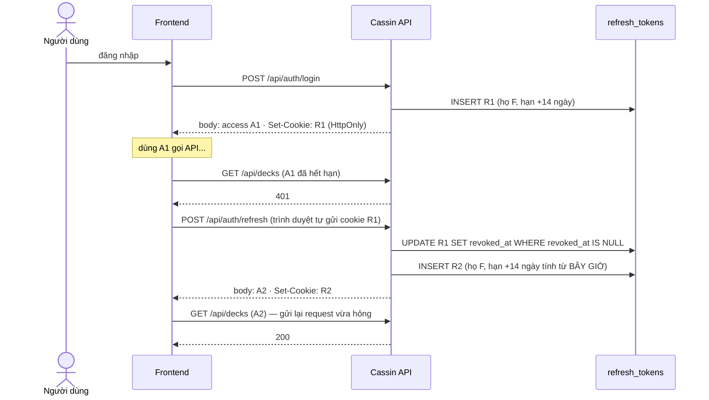

# Refresh token — xoay vòng, phát hiện token bị đánh cắp, thu hồi phiên

Tài liệu đi kèm `auth/RefreshToken*.java`, `auth/RefreshCookie.java`, `AuthService.refresh / logout`, `UserService.changePassword` và migration `V14__refresh_tokens.sql`.
Đọc phần **1–3** để nắm cơ chế, phần **4–7** để hiểu từng luồng và **lý do** chọn cách làm, phần **8–10** khi sửa code hoặc ôn phỏng vấn.
Phần đăng ký, đăng nhập, JWT và `SecurityConfig` nằm ở [`auth.md`](auth.md).

**Mục lục**

1. [Bài toán](#1-bài-toán)
2. [Hai loại token](#2-hai-loại-token)
3. [Luồng từ đầu đến cuối](#3-luồng-từ-đầu-đến-cuối)
4. [Họ token và xoay vòng — rotate](#4-họ-token-và-xoay-vòng--rotate)
5. [Phát hiện token bị đánh cắp](#5-phát-hiện-token-bị-đánh-cắp)
6. [Hai request cùng lúc](#6-hai-request-cùng-lúc)
7. [Thu hồi phiên: đăng xuất, đổi mật khẩu, dọn dẹp](#7-thu-hồi-phiên-đăng-xuất-đổi-mật-khẩu-dọn-dẹp)
8. [Các quyết định thiết kế và lý do](#8-các-quyết-định-thiết-kế-và-lý-do)
9. [Giới hạn đã biết và hướng mở rộng](#9-giới-hạn-đã-biết-và-hướng-mở-rộng)
10. [Test, file liên quan, câu hỏi ôn tập](#10-test-file-liên-quan-câu-hỏi-ôn-tập)

---

## 1. Bài toán

JWT là **stateless**: server không lưu token, chỉ kiểm chữ ký. Nhờ vậy mỗi request không cần truy vấn DB, nhưng có một cái giá:

| Muốn làm | Chỉ có JWT |
|---|---|
| Đăng xuất thật (token bị vô hiệu ngay) | ❌ Token còn dùng được tới khi hết hạn |
| Đổi mật khẩu → đá các thiết bị khác ra | ❌ Như trên |
| Hạ quyền admin → mất quyền ngay | ❌ `role` nằm trong token cũ |
| Token sống lâu để không phải đăng nhập lại liên tục | Token sống lâu = lộ ra thì nguy hiểm lâu |

Cách giải: **tách làm hai token**. Một token sống ngắn, không lưu, để gọi API. Một token sống dài, **có lưu trong DB**, chỉ dùng để xin token ngắn mới.

---

## 2. Hai loại token

| | Access token | Refresh token |
|---|---|---|
| Dùng để | Gọi mọi API (`/api/decks`, `/api/words`...) | **Chỉ** để xin access token mới (`POST /api/auth/refresh`) |
| Dạng | JWT (ký bằng HMAC, xem `auth.md`) | 43 ký tự ngẫu nhiên, không mang thông tin gì |
| Sống | `cassin.jwt.access-token-ttl` (mục tiêu 15 phút) | `cassin.refresh-token.ttl` = 14 ngày |
| Nằm ở | `localStorage`, gửi trong header `Authorization` | **Cookie HttpOnly**, trình duyệt tự gửi kèm |
| Server lưu? | Không | Có — chỉ lưu **SHA-256** trong bảng `refresh_tokens` |
| Thu hồi được? | Không (sống tới hết hạn) | Có |

Hình dung: access token là **thẻ ra vào** dùng liên tục nhưng 15 phút là hết hạn. Refresh token là **vé gửi xe**: đưa vé ra quầy thì được thẻ ra vào mới, và quầy **thu vé cũ, đưa vé mới**. Mỗi vé chỉ dùng được **một lần**.

> **Trạng thái hiện tại:** `access-token-ttl` = `15m`. Frontend đã tự refresh (interceptor gặp 401 → gọi `/api/auth/refresh` → gửi lại request), nên người dùng không bị đá ra khi access token hết hạn.

---

## 3. Luồng từ đầu đến cuối



### Refresh theo nhu cầu, không theo đồng hồ

Refresh **không** chạy mỗi 15 phút. Nó chỉ xảy ra khi người dùng thật sự gọi API mà access token đã hết hạn:

```
08:00  Đăng nhập → A1 (hết hạn 08:15), R1
08:14  Ôn thẻ          → A1 ✅
08:15 → 10:00  Không có request nào → KHÔNG refresh
10:00  Bấm "Nhớ"       → A1 hết hạn → 401 → refresh (R1 → A2 + R2) → gửi lại ✅
```

Dùng liên tục thì khoảng 15 phút refresh một lần; bỏ máy 13 ngày rồi quay lại thì chỉ cần **một** lần refresh.

### Khi nào phải đăng nhập lại

Mỗi lần refresh, token mới được hạn **14 ngày tính từ lúc refresh** (hạn trượt). Người mở app đều đặn không bao giờ bị đăng xuất. Phải đăng nhập lại khi:

| Trường hợp | Server trả |
|---|---|
| Không mở app quá 14 ngày → token mới nhất hết hạn | `401 REFRESH_EXPIRED` |
| Đăng xuất trên thiết bị đó | `401` ở lần refresh sau (họ đã bị thu hồi, cookie đã bị xóa) |
| Đổi mật khẩu ở thiết bị **khác** | `401 REFRESH_REUSED` |
| Phát hiện dùng lại token đã thu hồi (phần 5) | `401 REFRESH_REUSED` |
| Người dùng xóa cookie / dữ liệu trình duyệt | `401 REFRESH_INVALID` |

Không có gì chạy đúng lúc token hết hạn: người dùng chỉ biết mình bị đăng xuất ở **lần refresh kế tiếp**, khi FE nhận 401 rồi chuyển sang trang đăng nhập.

**Thu hồi không có hiệu lực tức thì với access token.** Sau khi họ bị thu hồi, access token đang có vẫn gọi API được tới khi hết hạn, vì JWT không tra DB. Đó là lý do access token phải ngắn.

---

## 4. Họ token và xoay vòng — rotate

### 4.1 Họ token

Mọi refresh token sinh ra từ **cùng một lần đăng nhập** có chung `family_id` (UUID):

```
refresh_tokens
id | token_hash | family_id | revoked_at
 1 | 3fa9...    | F1        | 3/11    ← R1 (laptop, đã xoay)
 2 | b71c...    | F1        | 10/11   ← R2 (đã xoay)
 3 | 09de...    | F1        | null    ← R3 (laptop, đang sống)
 4 | e5a2...    | F2        | null    ← điện thoại, họ khác
```

- `family_id` là **cột trong DB**, không phải tiền tố của token. R1, R2, R3 là chuỗi ngẫu nhiên hoàn toàn, nhìn vào không thấy liên quan. Client không bao giờ thấy `family_id`.
- Mỗi họ tại một thời điểm có **đúng một** token còn sống: token mới nhất.
- Họ = một phiên đăng nhập trên một thiết bị. Thu hồi họ F1 (đăng xuất laptop) không ảnh hưởng F2 (điện thoại).

### 4.2 Token gốc không bao giờ nằm trong DB

```
startSession(user)                                            (RefreshTokenService)
  1. 32 byte ngẫu nhiên (SecureRandom)  → Base64 URL, bỏ "=" → token gốc 43 ký tự
  2. SHA-256(token gốc)                 → 64 ký tự hex
  3. INSERT refresh_tokens (user, hash, family_id MỚI, expires_at = now + 14 ngày)
  4. trả token gốc → controller đặt vào cookie
```

Lộ DB (backup, SQL injection) thì kẻ xấu chỉ có hash, không dùng được. Dùng **SHA-256** chứ không dùng BCrypt như mật khẩu: token đã có 256 bit ngẫu nhiên nên không dò được bằng từ điển, và cần **tra cứu bằng index** (`WHERE token_hash = ?`). BCrypt mỗi lần băm ra một kết quả khác nên không tra cứu được.

`SecureRandom` chứ không phải `Random`: `Random` đoán được giá trị tiếp theo nếu biết vài giá trị trước.

### 4.3 `rotate(token)` — bảng quyết định

Kiểm tra theo **đúng thứ tự** này:

| # | Token gửi lên | Làm gì | Kết quả |
|---|---|---|---|
| 1 | Không có / rỗng / không tìm thấy | — | `401 REFRESH_INVALID` |
| 2 | Đã thu hồi **< 10 giây** **và** họ còn token sống | — | `409 REFRESH_RACE` (phần 6) |
| 3 | Đã thu hồi (mọi trường hợp còn lại) | **Thu hồi cả họ** | `401 REFRESH_REUSED` (phần 5) |
| 4 | Hết hạn | — | `401 REFRESH_EXPIRED` |
| 5 | Hợp lệ nhưng `revokeIfActive` đổi 0 dòng | — | `409 REFRESH_RACE` (phần 6) |
| 6 | Hợp lệ | Thu hồi token cũ, cấp token mới **cùng họ** | `200` + access token mới + cookie mới |

- Kiểm tra **đã thu hồi trước hết hạn**: token vừa bị đánh cắp vừa hết hạn thì vẫn phải khóa cả họ.
- Token mới nhận **hạn mới** (14 ngày từ bây giờ), không kế thừa hạn cũ.
- `findByTokenHashWithUser` dùng `join fetch t.user`: lấy luôn user trong một câu SQL để ký access token mới. `role` được đọc **từ DB lúc refresh**, nên người bị hạ quyền nhận access token mới đúng quyền.

---

## 5. Phát hiện token bị đánh cắp

Ý tưởng: **mỗi token chỉ dùng được một lần**. Nếu server thấy ai đó gửi lên một token **đã bị dùng rồi**, chắc chắn có hai bản sao của cùng một chuỗi token.

Giả sử kẻ xấu copy được R2 của Nam:

**Kịch bản A — kẻ trộm dùng trước**
```
Kẻ trộm gửi R2 → hợp lệ → thu hồi R2, cấp R3 cho KẺ TRỘM
Nam gửi R2     → R2 ĐÃ BỊ THU HỒI → "có bản sao!" → thu hồi CẢ HỌ (R3 của kẻ trộm cũng chết)
               → 401 REFRESH_REUSED → Nam đăng nhập lại bằng mật khẩu; kẻ trộm không có mật khẩu → mất quyền
```

**Kịch bản B — Nam dùng trước**
```
Nam gửi R2     → hợp lệ → thu hồi R2, cấp R3 cho Nam
Kẻ trộm gửi R2 → ĐÃ BỊ THU HỒI → thu hồi cả họ → kẻ trộm bị chặn (Nam cũng phải đăng nhập lại)
```

Server **không biết ai là người thật**. Nó chỉ biết có hai người dùng chung một chuỗi token, nên khóa hết.

**Vì sao phải giữ token đã thu hồi trong DB?** Xóa ngay thì lần gửi lại R2 chỉ còn là "token không tồn tại" (`REFRESH_INVALID`): kẻ trộm vẫn giữ được R3. Vì vậy job dọn dẹp chỉ xóa token **hết hạn**, không xóa token đã thu hồi mà còn hạn.

### Bẫy: transaction rollback hủy lệnh thu hồi

Nhánh 3 phải **thu hồi cả họ rồi mới ném 401**. Mặc định `@Transactional` rollback khi gặp `RuntimeException`, nên lệnh thu hồi bị hủy theo và kẻ trộm vẫn dùng R3 được.

```java
@Transactional(noRollbackFor = BusinessException.class)   // giữ lại lệnh thu hồi dù có ném 401
public Rotation rotate(String rawToken) { ... }
```

Và **bên gọi không được mở transaction**: `AuthService.refresh` không có `@Transactional`. Nếu có, `rotate` chạy chung transaction bên ngoài (propagation `REQUIRED`), exception đi ngang qua transaction ngoài sẽ đánh dấu rollback, `noRollbackFor` ở bên trong không cứu được.

Cả hai điều này đều có test chốt: `rotate_keepsFamilyRevocationWhenThrowing`, `refresh_mustNotOpenItsOwnTransaction`.

---

## 6. Hai request cùng lúc

Hai tab dùng **chung một cookie**. Access token hết hạn, cả hai tab cùng gửi refresh với R2.

### 6.1 Cả hai cùng đọc thấy R2 còn sống → compare-and-set

```sql
UPDATE refresh_tokens SET revoked_at = :now WHERE id = :id AND revoked_at IS NULL   -- revokeIfActive
```

PostgreSQL khóa dòng khi UPDATE. Request B chạy cùng câu sẽ **chờ** A commit, rồi kiểm tra lại điều kiện `revoked_at IS NULL` trên dữ liệu mới → không còn đúng → **đổi 0 dòng** → `409 REFRESH_RACE`, không cấp token nào. Đã thử với hai phiên psql: A đổi 1 dòng, B chờ 2 giây rồi đổi 0 dòng.

Đây là phép **so sánh rồi gán** (compare-and-set) trong một câu SQL. Không cần `SELECT ... FOR UPDATE`, không cần `@Version`.

### 6.2 B tới sau vài mili giây, R2 đã bị xoay → cửa sổ 10 giây

Nếu áp dụng phần 5 máy móc, B bị coi là kẻ trộm và người dùng bị đăng xuất oan. Nên nhánh 2 có thêm điều kiện:

```
R2 bị thu hồi < 10 giây  VÀ  họ vẫn còn token sống (existsByFamilyIdAndRevokedAtIsNull)
  → R2 vừa bị XOAY bởi tab kia → 409 REFRESH_RACE → FE thử lại (lúc này trình duyệt đã có cookie R3) ✅
```

Điều kiện "họ còn token sống" tách trường hợp này khỏi **đăng xuất / đổi mật khẩu**: khi đó cả họ bị thu hồi, không còn token sống → không phải chạy đua → `401`.

**Đánh đổi:** kẻ trộm gửi R2 trong vòng 10 giây sau khi Nam vừa refresh thì nhận 409 thay vì bị phát hiện. Nhưng 409 không cấp token nào, và lần thử sau quá 10 giây vẫn bị bắt.

### 6.3 Phía FE cần làm

| Server trả | FE làm |
|---|---|
| `200` từ `/refresh` | Lưu access token mới, gửi lại request vừa hỏng |
| `409 REFRESH_RACE` | Đợi ngắn (vài trăm ms), gọi `/refresh` **một lần nữa** |
| `401` từ `/refresh` | Xóa phiên, chuyển về trang đăng nhập |
| Nhiều request cùng gặp 401 trong một tab | Chỉ gọi `/refresh` **một lần**, các request khác chờ kết quả đó (`shareReplay`) |

---

## 7. Thu hồi phiên: đăng xuất, đổi mật khẩu, dọn dẹp

| Thao tác | Code | Phạm vi |
|---|---|---|
| Đăng xuất | `POST /api/auth/logout` → `endSession(cookie)` → `revokeFamily` | Họ của thiết bị đó. Luôn `204` + xóa cookie, kể cả khi không có cookie |
| Đổi mật khẩu | `PUT /api/me/password` → `revokeAll(userId)` rồi `startSession(user)` | **Mọi** họ của người dùng; thiết bị đang đổi nhận họ mới qua cookie nên không bị đăng xuất |
| Dọn dẹp | `RefreshTokenCleanup` 3:30 sáng mỗi ngày → `deleteExpired` | Chỉ token **hết hạn** |

**Đổi mật khẩu — thứ tự quan trọng, trong MỘT transaction:**

```
1–3. kiểm tra mật khẩu cũ, băm, lưu mật khẩu mới
4.   revokeAll(userId)           ← thu hồi TRƯỚC
5.   startSession(user)          ← mở phiên mới SAU (đảo lại thì phiên mới cũng bị thu hồi)
```

Response của `/api/me/password` đặt được cookie có `Path=/api/auth`: path chỉ quyết định cookie được **gửi đi** ở đâu, không giới hạn nơi **đặt** nó.

**Job dọn dẹp chạy ở mọi instance** khi deploy nhiều máy. Câu `DELETE` chạy hai lần vẫn đúng (lần sau xóa 0 dòng), nên chưa cần khóa phân tán (ShedLock). Phải có `@EnableScheduling` (`common/SchedulingConfig`), thiếu thì `@Scheduled` bị bỏ qua mà không báo lỗi.

### Cookie

```
Set-Cookie: cassin_refresh=<43 ký tự>; Path=/api/auth; Max-Age=1209600; HttpOnly; SameSite=Strict[; Secure]
```

| Thuộc tính | Để làm gì |
|---|---|
| `HttpOnly` | JavaScript không đọc được → script lạ chèn vào trang (XSS) không lấy được refresh token |
| `SameSite=Strict` | Request xuất phát từ trang khác không kèm cookie → chặn CSRF lên `/refresh`, `/logout` |
| `Path=/api/auth` | Chỉ gửi kèm refresh / logout, không đi theo mọi request |
| `Secure` | Chỉ gửi qua HTTPS. `REFRESH_COOKIE_SECURE=true` khi deploy; dev chạy `http://localhost` nên tắt |
| `Max-Age=0` | Xóa cookie (đăng xuất). Phải **cùng path**, khác path thì trình duyệt coi là cookie khác |

**CSRF vẫn tắt được** (`SecurityConfig`): các API dữ liệu dùng header `Authorization` (trình duyệt không tự gửi); cookie duy nhất có `SameSite=Strict` và chỉ tới `/api/auth`; `/refresh` trả token trong body mà trang khác không đọc được (same-origin policy).

**Cross-origin:** FE và API chạy cùng origin nhờ proxy (`proxy.conf.json` khi dev). Nếu deploy FE và API ở hai domain khác nhau thì phải bật CORS `allowCredentials`, FE gửi `withCredentials: true`, và `SameSite=Strict` phải đổi thành `None` + `Secure` (khi đó cần xem lại CSRF).

---

## 8. Các quyết định thiết kế và lý do

| # | Quyết định | Lý do | Đánh đổi |
|---|---|---|---|
| 1 | **Hai token**: access ngắn không lưu + refresh dài có lưu | Giữ được ưu điểm stateless cho mọi request, vẫn thu hồi được phiên | Thêm một bảng, một endpoint, FE phải xử lý 401 |
| 2 | Refresh token trong **cookie HttpOnly** | XSS không đọc được | Phải quan tâm CSRF, CORS |
| 3 | **Xoay vòng** mỗi lần refresh | Token bị lộ chỉ dùng được một lần; là nền tảng để phát hiện đánh cắp | Hai tab chạy đua (phần 6) |
| 4 | **Phát hiện dùng lại → thu hồi cả họ** | Không phân biệt được người thật / kẻ trộm, khóa cả hai là an toàn | Người thật cũng phải đăng nhập lại |
| 5 | Chỉ lưu **SHA-256** | Lộ DB không lộ token | — |
| 6 | **Compare-and-set** bằng UPDATE có điều kiện | Nguyên tử, không khóa trước, không cần `@Version` | Phải kiểm tra số dòng trả về |
| 7 | **Cửa sổ 10 giây + họ còn token sống** | Không đăng xuất oan khi mở nhiều tab | Kẻ trộm trong 10 giây đó nhận 409 thay vì bị phát hiện |
| 8 | `noRollbackFor` + bên gọi không có transaction | Lệnh thu hồi cả họ không bị rollback | Dễ bị phá nếu ai đó thêm `@Transactional` → có test chốt |
| 9 | **Hạn trượt** 14 ngày | Người dùng đều đặn không bị đăng xuất | Không có hạn tuyệt đối (phần 9) |
| 10 | Đổi mật khẩu = thu hồi mọi phiên + mở phiên mới, **một transaction** | Đá kẻ đang cầm phiên cũ, không đá người đang dùng | — |
| 11 | Giữ token đã thu hồi tới khi hết hạn | Còn nhận ra được lần dùng lại | Bảng lớn hơn; job dọn theo `expires_at` |
| 12 | Đọc `role` từ DB lúc refresh | Hạ quyền có hiệu lực sau tối đa một vòng access token | Một `join` mỗi lần refresh |

---

## 9. Giới hạn đã biết và hướng mở rộng

| Giới hạn | Ghi chú | Hướng xử lý |
|---|---|---|
| Access token sống tiếp tới hết hạn sau khi thu hồi | Bản chất của JWT stateless | Giữ TTL ngắn; cần tức thì thì thêm danh sách đen theo `jti` (tra Redis mỗi request) |
| **Không có hạn tuyệt đối** cho cả họ | Kẻ trộm refresh liên tục thì giữ phiên tới khi người thật refresh lại | Lưu thời điểm đăng nhập vào mỗi dòng, từ chối khi quá N ngày (vd 30) |
| ~~Chưa liệt kê / thu hồi từng thiết bị~~ | Đã có (V16) | Xem [sessions.md](sessions.md): `GET/DELETE /api/auth/sessions` |
| Chưa giới hạn số lần gọi `/refresh`, `/login` | — | Rate limit (Bucket4j) theo IP |
| Job dọn dẹp chạy ở mọi instance | Vô hại nhưng thừa | ShedLock khi có nhiều instance |
| ~~Hành vi SQL mới được thử tay~~ | Đã có `AuthFlowIT` (PostgreSQL thật) | Chạy: `mvn verify`, xem `backend/src/test/.../auth/AuthFlowIT.java` |
| ~~FE chưa tự refresh~~ | Đã xong, `access-token-ttl` = 15m | Interceptor: gặp 401 → refresh một lần → gửi lại; 409 → thử lại; 401 từ refresh → về trang đăng nhập |

---

## 10. Test, file liên quan, câu hỏi ôn tập

### File

| File | Vai trò |
|---|---|
| `db/migration/V14__refresh_tokens.sql` | Bảng `refresh_tokens`, unique `token_hash`, CHECK hạn > lúc tạo, `ON DELETE CASCADE`, index theo họ / user còn sống / hạn |
| `auth/RefreshToken.java` | Entity: `issue`, `isRevoked`, `isExpired`, `revokedWithin` |
| `auth/RefreshTokenRepository.java` | `findByTokenHashWithUser`, `existsByFamilyIdAndRevokedAtIsNull`, `revokeIfActive` (compare-and-set), `revokeFamily`, `revokeAllForUser`, `deleteExpired` |
| `auth/RefreshTokenService.java` | `startSession`, `rotate`, `endSession`, `revokeAll`, `deleteExpired`, `hash` |
| `auth/RefreshCookie.java` | Header `Set-Cookie` (đặt / xóa) |
| `auth/RefreshTokenCleanup.java`, `common/SchedulingConfig.java` | Job dọn token hết hạn, bật `@Scheduled` |
| `auth/dto/RefreshTokenProperties.java` | `cassin.refresh-token.ttl`, `cookie-secure` |
| `auth/dto/AuthTokens.java` | Kết quả service: body + refresh token (cho cookie) |
| `auth/AuthService.java` | `login` mở phiên, `refresh`, `logout` |
| `auth/AuthController.java` | `POST /api/auth/login`, `/refresh`, `/logout` |
| `user/UserService.java`, `user/UserController.java` | Đổi mật khẩu thu hồi mọi phiên, đặt cookie mới |
| `common/SecurityConfig.java` | Đăng ký `RefreshTokenProperties`; lý do vẫn tắt CSRF |

### Test

| Test | Kiểm tra |
|---|---|
| `RefreshTokenTest` | `issue` gán đúng họ / hạn; hết hạn đúng tại `expiresAt`; `revokedWithin` phân biệt vừa thu hồi với thu hồi lâu |
| `RefreshTokenServiceTest` | DB chỉ nhận hash; mỗi lần đăng nhập một họ mới; SHA-256 chuẩn; xoay vòng cùng họ, hạn mới; thiếu / lạ / hết hạn; dùng lại → thu hồi cả họ; vừa xoay → 409; vừa đăng xuất → 401; thua compare-and-set → 409; `noRollbackFor`; đăng xuất; thu hồi tất cả; dọn dẹp |
| `AuthServiceTest` | Đăng nhập: access token trong body, refresh token tách riêng; sai mật khẩu / email không mở phiên; refresh dùng `role` hiện tại; lỗi từ rotate đi thẳng ra; `refresh` không có `@Transactional`; đăng xuất |
| `RefreshCookieTest` | `HttpOnly`, `SameSite=Strict`, `Path=/api/auth`, `Max-Age`, `Secure` theo cấu hình; xóa cookie cùng path |
| `UserServiceTest` | Đổi mật khẩu: thu hồi tất cả **rồi** mở phiên mới; sai mật khẩu cũ thì không đụng phiên nào |

Thử tay với PowerShell (dùng `curl.exe`):

```powershell
curl.exe -i -c jar.txt -H "Content-Type: application/json" `
  -d '{\"email\":\"nam@gmail.com\",\"password\":\"12345678\"}' http://localhost:8080/api/auth/login
copy jar.txt jar-cu.txt
curl.exe -i -b jar.txt -c jar.txt -X POST http://localhost:8080/api/auth/refresh   # 200, cookie mới
curl.exe -i -b jar-cu.txt -X POST http://localhost:8080/api/auth/refresh           # < 10 giây: 409 REFRESH_RACE
# đợi hơn 10 giây
curl.exe -i -b jar-cu.txt -X POST http://localhost:8080/api/auth/refresh           # 401 REFRESH_REUSED
curl.exe -i -b jar.txt -X POST http://localhost:8080/api/auth/refresh              # cookie mới cũng chết: 401
```

### Câu hỏi ôn tập

1. JWT stateless gặp vấn đề gì khi cần đăng xuất, đổi mật khẩu, hạ quyền? Refresh token giải quyết thế nào?
2. Vì sao access token để trong header còn refresh token để trong cookie HttpOnly?
3. Refresh có chạy mỗi 15 phút không? Khi nào người dùng phải đăng nhập lại?
4. "Họ token" là gì? Nó có phải là tiền tố của token không?
5. Xoay vòng là gì? Vì sao nhờ nó mà phát hiện được token bị đánh cắp?
6. Kẻ trộm dùng R2 trước Nam, và ngược lại — chuyện gì xảy ra trong từng trường hợp?
7. Vì sao lưu SHA-256 mà không lưu token? Sao không dùng BCrypt?
8. Hai request cùng refresh một token — câu SQL nào chặn, và vì sao nó nguyên tử?
9. Cửa sổ 10 giây để làm gì? Vì sao cần thêm điều kiện "họ còn token sống"?
10. Vì sao `rotate` cần `noRollbackFor`, và vì sao `AuthService.refresh` không được có `@Transactional`?
11. Đổi mật khẩu: vì sao thu hồi tất cả **trước** rồi mới mở phiên mới?
12. Vì sao job dọn dẹp không xóa token đã thu hồi?
13. Sau khi thu hồi, access token còn dùng được bao lâu? Muốn chặn ngay thì làm gì?
