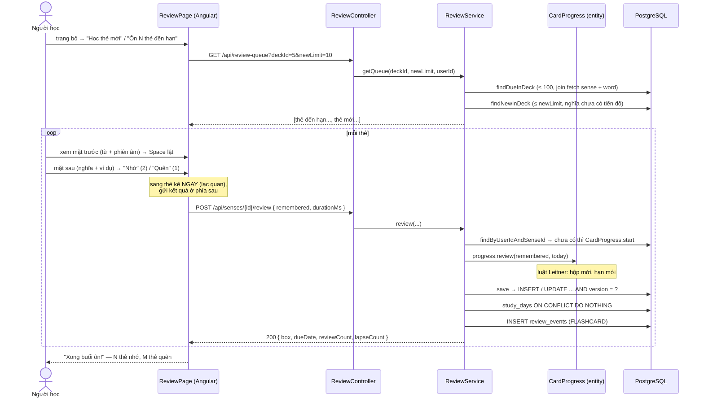

# Ôn thẻ theo hộp Leitner — luồng thực thi & thuật toán

Tài liệu đi kèm `vocab/CardProgress.java`, `vocab/ReviewService.java`, `vocab/ReviewController.java` (backend) và `features/review/*` (frontend).
Đọc phần **1–2** để nắm toàn cảnh, phần **3–5** để hiểu thuật toán và **lý do** chọn cách làm, phần **6–8** khi sửa code hoặc ôn phỏng vấn.

**Mục lục**

1. [Bài toán và thuật toán Leitner](#1-bài-toán-và-thuật-toán-leitner)
2. [Luồng thực thi từ đầu đến cuối](#2-luồng-thực-thi-từ-đầu-đến-cuối)
3. [Lấy hàng đợi ôn](#3-lấy-hàng-đợi-ôn)
4. [Chấm một thẻ — luật nằm trong entity](#4-chấm-một-thẻ--luật-nằm-trong-entity)
5. [Ghi đồng thời, ngày giờ, chuỗi ngày học](#5-ghi-đồng-thời-ngày-giờ-chuỗi-ngày-học)
6. [Các quyết định thiết kế và lý do](#6-các-quyết-định-thiết-kế-và-lý-do)
7. [Giới hạn đã biết và hướng mở rộng](#7-giới-hạn-đã-biết-và-hướng-mở-rộng)
8. [Test, file liên quan, câu hỏi ôn tập](#8-test-file-liên-quan-câu-hỏi-ôn-tập)

---

## 1. Bài toán và thuật toán Leitner

Thêm từ xong mà không ôn thì quên. Ôn **mọi** từ **mỗi** ngày thì quá tải. Lặp lại ngắt quãng (spaced repetition): từ nhớ tốt ôn thưa dần, từ hay quên ôn dày.

Cassin dùng **hệ thống hộp Leitner**, 5 hộp:

```
          Nhớ          Nhớ          Nhớ          Nhớ
 ┌──────┐ ───▶ ┌──────┐ ───▶ ┌──────┐ ───▶ ┌──────┐ ───▶ ┌──────┐ ─┐ Nhớ: ở lại hộp 5
 │ Hộp 1│      │ Hộp 2│      │ Hộp 3│      │ Hộp 4│      │ Hộp 5│ ◀┘
 │ 1 ngày│     │ 2 ngày│     │ 4 ngày│     │ 7 ngày│     │15 ngày│
 └──────┘ ◀─── └──────┘ ◀─── └──────┘ ◀─── └──────┘ ◀─── └──────┘
     ▲         Quên (từ BẤT KỲ hộp nào) → về thẳng hộp 1, lapseCount + 1
```

| Hộp | Ôn lại sau | Ý nghĩa |
|---|---|---|
| 1 | 1 ngày | Mới học / vừa quên |
| 2 | 2 ngày | |
| 3 | 4 ngày | |
| 4 | 7 ngày | |
| 5 | 15 ngày | Đã thuộc |

**Đơn vị ôn là một NGHĨA** (`Sense`), không phải một từ. *light* có 2 nghĩa = 2 thẻ, 2 dòng tiến độ độc lập (xem `word-create.md`).

**Quên → về hộp 1** (không tụt từng hộp) là luật gốc của Leitner: khắt khe, nhưng thẻ hay quên sẽ được ôn dày lại ngay.

Một thẻ trải qua các trạng thái:

| Trạng thái | Có dòng `card_progresses`? | Vào hàng đợi khi |
|---|---|---|
| **Mới** | Chưa | "Học thẻ mới" của bộ (tối đa 10 / buổi) |
| **Đang học, chưa đến hạn** | Có, `due_date > hôm nay` | — |
| **Đến hạn** | Có, `due_date ≤ hôm nay` | "Ôn N thẻ đến hạn" (tối đa 100 / buổi) |

---

## 2. Luồng thực thi từ đầu đến cuối



**Ba tầng, ba trách nhiệm:**

| Tầng | Làm gì | Không làm gì |
|---|---|---|
| `ReviewController` | Nhận request, `@Valid ReviewRequest`, lấy `userId` từ token | Không có logic |
| `ReviewService` | Kiểm tra quyền, tìm / tạo tiến độ, lưu, ghi ngày học + nhật ký, đổi lỗi → HTTP | **Không tự tính hộp** |
| `CardProgress` | **Toàn bộ luật Leitner**: lên / xuống hộp, hạn ôn, chặn ôn 2 lần / ôn sớm | Không biết HTTP, không truy vấn DB, không tự lấy ngày hôm nay |

---

## 3. Lấy hàng đợi ôn

```
GET /api/review-queue?deckId=5&newLimit=10   → ôn một bộ: đến hạn + tối đa 10 thẻ mới
GET /api/review-queue?newLimit=0             → "ôn tất cả" (trang Hôm nay): chỉ thẻ đến hạn trong sổ từ
```

```java
due   = progressRepository.findDueInDeck(userId, deckId, today, PageRequest.of(0, 100));
fresh = senseRepository.findNewInDeck(userId, deckId, PageRequest.of(0, clamp(newLimit, 0, 50)));
queue = due + fresh        // đến hạn đứng TRƯỚC
```

| Quy tắc | Lý do |
|---|---|
| **Đến hạn trước, mới sau** | Thẻ đến hạn là thẻ **sắp quên**; học thêm từ mới khi chưa ôn từ cũ là xây trên cát |
| Đến hạn sắp theo `due_date, box, id` | Quá hạn lâu nhất trước; cùng ngày thì hộp thấp (yếu hơn) trước |
| Thẻ mới sắp theo `word.createdAt, word.id, sense.position` | Từ thêm trước học trước; các nghĩa của một từ đi liền nhau |
| Tối đa **100 đến hạn + 50 mới** (`Math.clamp`) | Người nghỉ lâu quay lại không bị ngợp hàng nghìn thẻ; giới hạn kích thước response |
| `newLimit = 0` thì **không gọi** câu SQL thẻ mới | Không truy vấn thừa |
| Bộ của người khác → `404` | `deckService.findReadable` trước khi đọc |

**Không N+1.** `findDueInDeck` dùng `join fetch p.sense s join fetch s.word w`: một câu SQL lấy tiến độ + nghĩa + từ. Danh sách câu ví dụ và "nghĩa khác" (LAZY) được gom nhờ `default_batch_fetch_size: 50` → `WHERE sense_id IN (...)` thay vì mỗi thẻ một câu. Service chạy trong `@Transactional(readOnly = true)` nên đọc LAZY an toàn (`open-in-view: false`).

**Thẻ trả về** (`ReviewCardResponse`):

| Field | Hiện ở |
|---|---|
| `term`, `phonetic` | Mặt trước |
| `partOfSpeech`, `box`, `isNew` | Góc thẻ ("Hộp 3" / "Thẻ mới") |
| `definition`, `examples` (đã bỏ `[ ]`) | Mặt sau |
| `otherSenses` | Mặt sau, mờ: "Nghĩa khác" — tránh nhầm **đúng từ, sai nghĩa**. Mặt trước báo "Từ có 2 nghĩa, thẻ này hỏi nghĩa danh từ" |

---

## 4. Chấm một thẻ — luật nằm trong entity

### 4.1 Service: chỉ điều phối

```java
@Transactional
public ReviewResultResponse review(Long senseId, boolean remembered, Integer durationMs, Long userId) {
  Sense sense = wordService.findReadableSense(senseId, userId);          // ① quyền: từ của mình / hệ thống, khác → 404
  LocalDate today = LocalDate.now(clock);                                // ② "hôm nay" theo Clock
  CardProgress progress = progressRepository.findByUserIdAndSenseId(userId, senseId)
      .orElseGet(() -> CardProgress.start(user, sense, today));          // ③ lần đầu: hộp 1, đến hạn hôm nay
  try {
    progress.review(remembered, today);                                  // ④ LUẬT LEITNER
  } catch (IllegalStateException ex) {
    throw new BusinessException(CONFLICT, "REVIEW_NOT_ALLOWED", ex.getMessage());   // 409
  }
  CardProgress saved = progressRepository.save(progress);                // ⑤ mới → INSERT, cũ → UPDATE
  studyDayRepository.markStudied(userId, today);                         // ⑥ đánh dấu "hôm nay có học"
  eventRepository.save(ReviewEvent.of(..., FLASHCARD, remembered, durationMs ?? 0));  // ⑦ nhật ký
  return ReviewResultResponse.from(saved);
}
```

| Bước | Vì sao |
|---|---|
| ③ Tiến độ tạo **lúc ôn lần đầu**, không phải lúc thêm từ | Thêm 500 từ bằng CSV không sinh 500 dòng tiến độ; "thẻ mới" = nghĩa **chưa có** dòng tiến độ (`NOT EXISTS`) |
| ④ Lỗi luật → `IllegalStateException` → `409` | Entity không biết HTTP; "đã ôn hôm nay" là xung đột với trạng thái hiện tại |
| ⑥, ⑦ đặt **sau** bước ④ | Lượt bị `409` không được tính là ngày học, không vào nhật ký |
| Một `@Transactional` | Tiến độ, ngày học, nhật ký: lưu cả ba hoặc không gì cả |

### 4.2 Entity: luật Leitner

```java
public void review(boolean remembered, LocalDate today) {
  if (today.equals(lastReviewedOn)) throw new IllegalStateException("Thẻ này đã được ôn hôm nay");
  if (!isDue(today))                throw new IllegalStateException("Thẻ này chưa đến hạn ôn");
  if (remembered) box = Math.min(box + 1, MAX_BOX);
  else          { box = MIN_BOX; lapseCount++; }
  dueDate = today.plusDays(intervalDays(box));      // 1, 2, 4, 7, 15
  lastReviewedOn = today;
  reviewCount++;
}
```

Ví dụ một thẻ, ngày 1/11:

| Ngày | Đáp | Hộp | Hạn kế tiếp | Ghi chú |
|---|---|---|---|---|
| 1/11 | (thẻ mới) | 1 | 1/11 | `start`: đến hạn ngay hôm nay |
| 1/11 | Nhớ | 2 | 3/11 | +2 ngày |
| 3/11 | Nhớ | 3 | 7/11 | +4 |
| 7/11 | Quên | 1 | 8/11 | về hộp 1, `lapseCount = 1` |
| 8/11 | Nhớ | 2 | 10/11 | |
| 12/11 | Nhớ | 3 | 16/11 | **Quá hạn 2 ngày vẫn ôn được**; khoảng cách tính **từ hôm nay** |
| 12/11 | Nhớ | — | — | ❌ `409` "đã được ôn hôm nay" |

| Luật | Vì sao |
|---|---|
| Không ôn 2 lần một ngày | Bấm "Nhớ" 5 lần liền sẽ đẩy thẻ lên hộp 5 ngay hôm nay — lách thuật toán |
| Không ôn trước hạn | Ôn sớm không có giá trị "nhớ lâu"; giữ đúng khoảng cách |
| Quá hạn vẫn ôn được, tính từ hôm nay | Nghỉ vài ngày không bị phạt thêm; hạn mới dựa trên lần ôn thật |
| Mọi method nhận **`today` làm tham số** | Entity không gọi `LocalDate.now()` → test chọn được ngày bất kỳ |

### 4.3 Luyện tập sai → kéo hạn về ngày mai

Bài luyện "Điền từ" / "Xếp câu" làm **sai** gọi `progress.dueSoon(today)`: hạn kéo về **ngày mai** (nếu đang xa hơn), **không** đổi hộp. Làm đúng thì không làm gì: luyện chế độ dễ không được "thăng hộp" hộ. Chỉ lần ôn chính thức mới chấm Leitner.

---

## 5. Ghi đồng thời, ngày giờ, chuỗi ngày học

### 5.1 Ba lớp chống ghi trùng

| Tình huống | Lớp chặn | Kết quả |
|---|---|---|
| Ôn thẻ ở tab A, **sau đó** ôn lại ở tab B | Luật entity: `lastReviewedOn == today` | `409 REVIEW_NOT_ALLOWED` |
| Hai tab bấm "Nhớ" **cùng lúc**, thẻ đã có tiến độ | `@Version` (V13): `UPDATE ... WHERE id = ? AND version = ?` → request sau khớp 0 dòng | `409 CONCURRENT_UPDATE` |
| Hai tab bấm "Nhớ" **cùng lúc**, thẻ **mới** (chưa có dòng nào để so version) | `UNIQUE (user_id, sense_id)` (V5) | `409 DATA_CONFLICT` |

```
A đọc version 0 ─┐                 ┌─ UPDATE ... SET version = 1 WHERE id = 5 AND version = 0 → 1 dòng ✅
B đọc version 0 ─┘  (cùng lúc)     └─ UPDATE ... SET version = 1 WHERE id = 5 AND version = 0 → 0 dòng ❌
```

**Vì sao khóa lạc quan (optimistic) mà không khóa bi quan (`SELECT ... FOR UPDATE`)?** Xung đột rất hiếm (một người, một thẻ); khóa bi quan bắt **mọi** lượt ôn chờ khóa. Lạc quan: không ai chờ, hiếm khi đụng thì một bên nhận `409`.

Không có lớp nào thì: thẻ bị cộng 2 hộp, hoặc `reviewCount` sai (lost update).

### 5.2 FE chấm "lạc quan"

```
bấm Nhớ → đếm +1, sang thẻ kế NGAY → gửi POST ở phía sau
            ├─ thành công: không làm gì
            ├─ 409: bỏ qua (thẻ đã được chấm ở nơi khác)
            └─ lỗi khác: toast "Chưa lưu được kết quả thẻ X" + nút "Thử lại"
```

Người học không phải chờ mạng sau **mỗi** thẻ. Phím tắt: `Space` / `Enter` lật thẻ, `1` Quên, `2` Nhớ. `durationMs` đo từ lúc thẻ hiện ra tới lúc chấm, tối đa 10 phút (`@Max(600_000)`), để thống kê thời gian trả lời.

`ReviewRequest.remembered` là **`Boolean`** (object), không phải `boolean`: client quên gửi thì `boolean` thành `false` → chấm "Quên" oan; `Boolean` thành `null` → `@NotNull` → `400`.

### 5.3 "Hôm nay" là ngày nào — `Clock`

```java
@Bean Clock clock() { return Clock.system(ZoneId.of("Asia/Ho_Chi_Minh")); }
LocalDate today = LocalDate.now(clock);
```

| Không làm vậy | Hậu quả |
|---|---|
| `LocalDate.now()` theo múi giờ server | Server ở UTC: 6 giờ sáng ở VN vẫn là "hôm qua" → ôn lúc sáng sớm bị tính sai ngày |
| Gọi `now()` rải rác | Test "đến hạn sau 7 ngày" phải chờ 7 ngày thật. Với `Clock` inject: test dùng `Clock.fixed(...)` |

### 5.4 Chuỗi ngày học (streak)

Mỗi ngày có ít nhất một lượt ôn hợp lệ = một dòng `study_days (user_id, study_date)`.

```sql
insert into study_days (user_id, study_date) values (:userId, :day) on conflict do nothing
```

Ôn 50 thẻ trong ngày = 1 INSERT + 49 lần bỏ qua, **không cần SELECT kiểm tra trước**.

```
streak: bắt đầu từ HÔM NAY nếu hôm nay đã học, ngược lại từ HÔM QUA; đếm lùi từng ngày liên tiếp có học
```

Sáng nay chưa kịp ôn thì chuỗi **vẫn còn**; chỉ mất khi bỏ trọn một ngày. Chỉ đọc 400 ngày gần nhất; dùng `HashSet` để `contains` là O(1).

`GET /api/review/stats` trả số thẻ đến hạn, số thẻ mỗi hộp (DB chỉ trả hộp **có** thẻ → service điền 0 cho đủ 5 cột biểu đồ) và streak.

---

## 6. Các quyết định thiết kế và lý do

| # | Quyết định | Lý do | Đánh đổi |
|---|---|---|---|
| 1 | **Leitner 5 hộp** thay vì SM-2 (Anki) | Dễ hiểu với người học ("thẻ đang ở hộp 3"), dễ giải thích, dễ test | Không cá nhân hóa theo độ khó từng thẻ |
| 2 | Luật nằm trong **entity** (rich domain model) | Một nơi duy nhất; test không cần Spring / DB; đổi thuật toán chỉ sửa một class | Service phải đổi `IllegalStateException` → HTTP |
| 3 | Ôn theo **nghĩa** | Nhớ nghĩa này quên nghĩa kia | Nhiều thẻ hơn |
| 4 | Tiến độ tạo **lúc ôn lần đầu** | Thêm từ hàng loạt không sinh dữ liệu thừa; "thẻ mới" = chưa có tiến độ | Câu SQL thẻ mới cần `NOT EXISTS` |
| 5 | **Đến hạn trước, mới sau**; giới hạn 100 + 50 | Ưu tiên thẻ sắp quên; không ngợp | Tồn đọng lớn phải ôn qua nhiều buổi |
| 6 | Không ôn 2 lần / ngày, không ôn sớm | Không lách được thuật toán | Muốn "ôn thêm" phải dùng chế độ luyện tập |
| 7 | **`Clock`** inject, múi giờ VN | Đúng ngày theo người dùng VN; test được | Người dùng ở múi giờ khác bị lệch (phần 7) |
| 8 | **Optimistic locking** `@Version` + unique | Xung đột hiếm, không ai phải chờ khóa | Bên thua nhận `409` |
| 9 | FE chấm **lạc quan** | Ôn mượt, không chờ mạng mỗi thẻ | Đóng tab ngay sau khi chấm có thể mất kết quả thẻ cuối |
| 10 | `study_days` + `ON CONFLICT DO NOTHING` | Streak tính nhanh, ghi không cần đọc trước | Thêm một bảng |
| 11 | Nhật ký `review_events` riêng với tiến độ | Tiến độ = trạng thái **hiện tại**; nhật ký = **lịch sử** cho thống kê và "Sổ lỗi sai" | `vocab` phụ thuộc `practice` (phần 7) |

---

## 7. Giới hạn đã biết và hướng mở rộng

| Giới hạn | Ghi chú | Hướng xử lý |
|---|---|---|
| Không phân biệt "nhớ dễ" / "nhớ khó" | Chỉ có Nhớ / Quên | Thêm mức "Khó" (giữ hộp), hoặc chuyển sang SM-2 / FSRS — chỉ sửa `CardProgress` |
| Múi giờ cố định Asia/Ho_Chi_Minh | Đủ cho người dùng VN | Lưu múi giờ trong hồ sơ, tính `today` theo người dùng |
| Tồn đọng > 100 thẻ | Ôn qua nhiều buổi | Báo "còn N thẻ", cho chọn số thẻ mỗi buổi |
| `durationMs` do client gửi | Chỉ dùng cho thống kê, có giới hạn trên | Không dùng cho chấm điểm |
| `vocab` ↔ `practice` phụ thuộc vòng | `ReviewService` ghi `ReviewEvent` trực tiếp | Phát Spring event (`ApplicationEventPublisher`), `practice` tự nghe và ghi |
| Thẻ mới trùng lúc nhận `DATA_CONFLICT` (mã chung) | FE bỏ qua mọi `409` nên người dùng không thấy | Bắt `DataIntegrityViolationException` riêng nếu cần mã cụ thể |
| Chưa nhắc ôn | — | Email / thông báo đẩy khi có thẻ đến hạn (job theo lịch) |

---

## 8. Test, file liên quan, câu hỏi ôn tập

### File

| File | Vai trò |
|---|---|
| `vocab/CardProgress.java` | Luật Leitner: `start`, `review`, `dueSoon`, `isDue`, `@Version` |
| `vocab/ReviewService.java` | `getQueue`, `review`, `getStats`, `streak` |
| `vocab/ReviewController.java` | `GET /api/review-queue`, `POST /api/senses/{id}/review`, `GET /api/review/stats` |
| `vocab/CardProgressRepository.java` | `findDueInDeck`, `findAllDue` (join fetch), `countByBox` |
| `vocab/SenseRepository.java` | `findNewInDeck`, `findNewInNotebook` (`NOT EXISTS` tiến độ) |
| `vocab/StudyDayRepository.java` | `markStudied` (`ON CONFLICT DO NOTHING`), `recentDays` |
| `vocab/dto/ReviewCardResponse.java`, `ReviewRequest.java`, `ReviewResultResponse.java` | Hợp đồng API |
| `practice/ReviewEvent.java` | Nhật ký mỗi lượt trả lời |
| `common/TimeConfig.java` | `Clock` múi giờ VN |
| `common/GlobalExceptionHandler.java` | `CONCURRENT_UPDATE`, `DATA_CONFLICT` |
| `db/migration/V5__create_card_progresses.sql` | Bảng tiến độ, `CHECK box BETWEEN 1 AND 5`, unique, index `(user_id, due_date)` |
| `db/migration/V8__create_study_days.sql` | Ngày học |
| `db/migration/V13__optimistic_locking.sql` | Cột `version` |
| FE `features/review/review-page.*` | Hàng đợi, chấm lạc quan, phím tắt, màn "Xong buổi ôn!" |
| FE `features/review/flash-card/*` | Mặt trước / mặt sau, "Nghĩa khác" |

### Test

| Test | Kiểm tra |
|---|---|
| `CardProgressTest` | Thẻ mới hộp 1 đến hạn hôm nay; thẻ mới ôn được ngay ngày đầu; nhớ liên tục đi đúng bảng 1–2–4–7–15; quên về hộp 1; quên ở hộp 1 vẫn hộp 1; ôn 2 lần một ngày bị từ chối **và trạng thái không đổi**; ôn trước hạn bị từ chối; quá hạn vẫn ôn được và tính từ hôm nay; biên của `isDue`; `dueSoon` kéo hạn về ngày mai nhưng giữ hạn sớm hơn |
| `ReviewServiceTest` | Hàng đợi bộ: đến hạn trước, mới sau; "ôn tất cả" dùng truy vấn sổ từ; `newLimit = 0` không gọi truy vấn thẻ mới; `newLimit` bị kẹp; bộ không đọc được → 404; lần đầu tạo tiến độ; ôn 2 lần → 409; nghĩa không đọc được → 404; ghi nhật ký FLASHCARD; giữ `durationMs`; thống kê điền đủ 5 hộp; luật streak |

### Câu hỏi ôn tập

1. Mô tả thuật toán Leitner trong Cassin. Vì sao quên thì về hộp 1 chứ không tụt một hộp?
2. Vì sao luật Leitner nằm trong `CardProgress` mà không nằm trong `ReviewService`? Lợi gì khi test?
3. Vì sao `review(...)` nhận `today` làm tham số thay vì tự gọi `LocalDate.now()`?
4. Vì sao inject `Clock` với múi giờ VN? Không làm thì lỗi gì xảy ra khi server ở UTC?
5. Thẻ đến hạn và thẻ mới, cái nào đứng trước trong hàng đợi? Vì sao giới hạn 100 + 50?
6. Hàng đợi có 30 thẻ, mỗi thẻ nhiều câu ví dụ — vì sao không bị N+1?
7. Tiến độ được tạo lúc nào? Vì sao không tạo ngay khi thêm từ?
8. Hai tab cùng bấm "Nhớ" một thẻ — kể ba trường hợp và lớp nào chặn từng trường hợp.
9. Optimistic locking khác pessimistic locking thế nào? Vì sao chọn optimistic ở đây?
10. Vì sao `ReviewRequest.remembered` là `Boolean` chứ không phải `boolean`?
11. FE "chấm lạc quan" là gì? Đánh đổi là gì?
12. `markStudied` vì sao dùng `ON CONFLICT DO NOTHING`? Streak được tính thế nào?
13. Muốn đổi sang SM-2, phải sửa những file nào?
