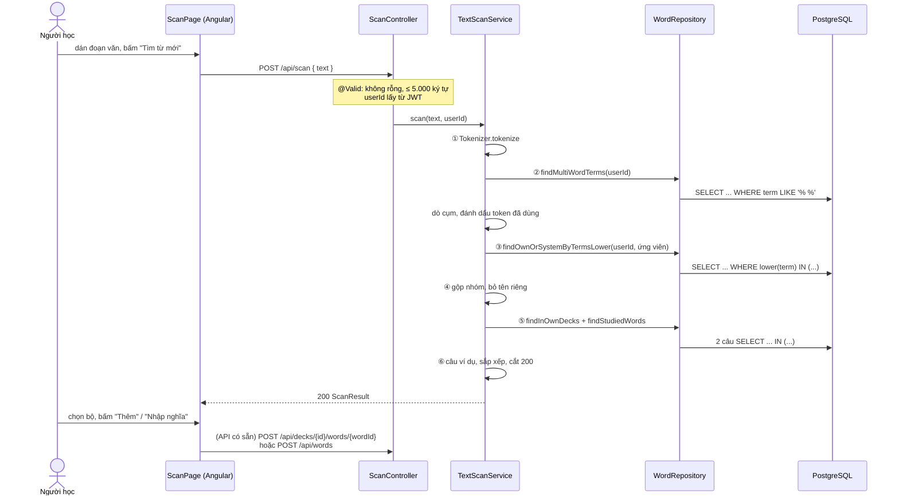

# Quét đoạn văn tìm từ mới — luồng thực thi & thuật toán

Tài liệu đi kèm package `com.cassin.scan` (backend) và trang `/scan` (frontend).
Đọc phần **1–2** để nắm toàn cảnh, phần **3–5** để hiểu từng bước và **lý do** chọn cách làm, phần **6–8** khi sửa code hoặc ôn phỏng vấn.

**Mục lục**

1. [Bài toán](#1-bài-toán)
2. [Luồng thực thi từ đầu đến cuối](#2-luồng-thực-thi-từ-đầu-đến-cuối)
3. [Sáu bước của TextScanService](#3-sáu-bước-của-textscanservice)
4. [Tách câu, tách từ — Tokenizer](#4-tách-câu-tách-từ--tokenizer)
5. [Đưa về dạng gốc — Lemmatizer (cách A)](#5-đưa-về-dạng-gốc--lemmatizer-cách-a)
6. [Các quyết định thiết kế và lý do](#6-các-quyết-định-thiết-kế-và-lý-do)
7. [Giới hạn đã biết và hướng mở rộng](#7-giới-hạn-đã-biết-và-hướng-mở-rộng)
8. [Test, file liên quan, câu hỏi ôn tập](#8-test-file-liên-quan-câu-hỏi-ôn-tập)

---

## 1. Bài toán

Người học dán một đoạn tiếng Anh (bài báo, email, phụ đề...), hệ thống trả về những từ **chưa có trong sổ từ** của họ.
Với mỗi từ, người học chọn **thêm vào một bộ** hoặc **bỏ qua**.

"Sổ từ" dùng đúng định nghĩa đã có trong dự án (`WordRepository.findNotebook`):

```
sổ từ = từ CỦA TÔI
      + từ HỆ THỐNG nằm trong một bộ của tôi
      + từ HỆ THỐNG tôi đã học ít nhất một nghĩa (có CardProgress)
```

Mỗi từ tìm được rơi vào đúng **một** trong ba nhóm:

| Nhóm | Điều kiện | Trả về FE | Thêm vào bộ bằng |
|---|---|---|---|
| Đã biết | Có trong sổ từ | Chỉ đếm (`knownCount`) | — |
| `LIBRARY` | Là từ hệ thống nhưng chưa học | Có, kèm `wordId` + các nghĩa để xem trước | 1 chạm: `POST /api/decks/{deckId}/words/{wordId}` |
| `NEW` | Không có ở đâu | Có, `wordId = null` | Người học nhập nghĩa: `POST /api/words` |

Ví dụ: người học đã có *late* và đang học *work*. Dán:

> He was running late, so he ran to the station. Breaking the ice at work is hard!

| Kết quả | Vì sao |
|---|---|
| `run` — LIBRARY, gặp 2 lần, dạng *running, ran* | *running* và *ran* cùng gốc *run*, *run* có trong từ điển hệ thống |
| `break the ice` — LIBRARY | Cụm thành ngữ (V11) vẫn bắt được dù viết là *Breaking the ice* |
| `station` — LIBRARY | Từ hệ thống, chưa học |
| `hard` — NEW | Không có trong DB |
| *late*, *work* — không hiện | Đã có trong sổ từ → chỉ tăng `knownCount` |
| *he, was, so, to, the, at, is* — không hiện | Từ chức năng (stop words) |

---

## 2. Luồng thực thi từ đầu đến cuối



**Ba tầng, ba trách nhiệm:**

| Tầng | Làm gì | Không làm gì |
|---|---|---|
| `ScanController` | Nhận request, `@Valid`, lấy `userId` từ token | Không có logic |
| `TextScanService` | Điều phối 6 bước, hỏi DB, phân loại, tạo kết quả | Không tự tách từ / đoán gốc |
| `Tokenizer`, `Lemmatizer`, `StopWords` | Xử lý **văn bản thuần**: không Spring, không DB, method `static` | Không biết gì về người dùng hay DB |

Tách phần xử lý văn bản ra class thuần Java để **test không cần mock** (`TokenizerTest`, `LemmatizerTest`) và để FE mock dùng lại được cùng thuật toán (bản TypeScript `mock-scan-text.ts`).

**Quét chỉ ĐỌC dữ liệu.** Không có bảng mới, không migration. Thêm từ dùng lại 2 API đã có từ trước:

- `LIBRARY` → `DeckApi.addWord` → `POST /api/decks/{deckId}/words/{wordId}` (204, thêm trùng không lỗi).
- `NEW` → `WordApi.createWord` → `POST /api/words` với `{ term, senses: [{ partOfSpeech, definition, examples: [example] }], deckIds: [deckId] }`. Câu ví dụ đã đánh dấu `[ ]` nên từ mới **luyện "Điền từ" được ngay**.

---

## 3. Sáu bước của TextScanService

Toàn bộ nằm trong `TextScanService.scan(text, userId)`, chạy trong `@Transactional(readOnly = true)`.

Đối tượng trung gian xuyên suốt:

```java
record Occurrence(String key, int first, int last, Word word)
//                 │           │          │         └─ từ khớp trong DB, null nếu NEW
//                 │           └──────────┴─ index token đầu / cuối (cụm: nhiều token)
//                 └─ khóa gộp nhóm: term viết thường, hoặc dạng gốc đoán được
```

### ① Tách câu, tách từ

`Tokenizer.tokenize(text)` → danh sách câu + danh sách `Token` (vị trí trong câu, có viết hoa không...). Chi tiết ở [phần 4](#4-tách-câu-tách-từ--tokenizer).

Một mảng `boolean[] used` đi kèm: token nào đã thuộc một cụm thì bước ③ bỏ qua.

### ② Dò cụm nhiều chữ (thành ngữ, cụm động từ) — TRƯỚC từ đơn

```
SQL 1: findMultiWordTerms(userId)
  select w from Word w
  where w.term like '% %' and (w.owner is null or w.owner.id = :userId)
```

Chỉ lấy từ **có dấu cách** của hệ thống và của tôi: vài chục dòng (18 cụm ở V11 + cụm người dùng tự thêm).

Thuật toán (`findPhrases` + `matchesAt`):

```
sắp cụm theo số chữ GIẢM DẦN          ("run out of" trước "run out")
với mỗi vị trí i trong token:
    với mỗi cụm (dài trước):
        cụm khớp tại i nếu với MỌI chữ thứ k của cụm:
            - token i+k chưa thuộc cụm khác    (!used[i+k])
            - token i+k cùng câu với token i   (cụm không vắt qua 2 câu)
            - chữ thứ k ∈ Lemmatizer.candidates(token i+k)
        khớp → đánh dấu used[i..i+n-1], ghi Occurrence(cụm), dừng thử các cụm khác
```

Điều kiện thứ ba là chỗ quan trọng: so chữ của cụm với **ứng viên dạng gốc** của token, không so nguyên văn.

| Đoạn văn | Token | `candidates` chứa | Khớp cụm |
|---|---|---|---|
| *Breaking the ice* | breaking, the, ice | break, the, ice | `break the ice` ✅ |
| *She gave up* | gave, up | give, up | `give up` ✅ |
| *She gave. Up the hill* | gave \| up (2 câu) | — | ❌ khác câu |

**Vì sao cụm phải dò trước từ đơn?** Nếu tách từ đơn trước, *break the ice* sẽ thành *break* (LIBRARY hoặc NEW) + *ice* (NEW): người học nhận 2 từ rời rạc, mất nghĩa thành ngữ. Dò cụm trước rồi "khóa" các token đó lại thì mỗi token chỉ thuộc đúng một mục.

**Vì sao cụm dài thử trước?** Có cả *run out* và *run out of* thì đoạn "run out of milk" phải khớp cụm dài (nghĩa cụ thể hơn). Thử ngắn trước sẽ khóa mất "run out", "of" thành từ chức năng bị bỏ.

### ③ Từ đơn — một câu SQL cho cả đoạn văn

```
SQL 2: findOwnOrSystemByTermsLower(userId, ứng viên)
  select w from Word w
  where lower(w.term) in :termsLower and (w.owner is null or w.owner.id = :userId)
```

Hai vòng lặp:

```
Vòng 1: với mỗi token chưa dùng, không phải stop word:
            gom Lemmatizer.candidates(token) vào MỘT Set
        Set rỗng → không gọi SQL (đoạn chỉ có "it is what it is")
        gọi SQL 2 MỘT lần → Map<term viết thường, Word>  (ưu tiên từ CỦA TÔI, xem preferOwn)

Vòng 2: với mỗi token:
            hit = ứng viên ĐẦU TIÊN có trong Map
            có  → Occurrence(key = hit, word = Map[hit])          → LIBRARY hoặc đã biết
            không → Occurrence(key = Lemmatizer.guess(token), word = null)  → NEW
```

**Vì sao gom rồi hỏi một lần?** Đoạn 900 từ mà hỏi từng từ là 900 câu SQL (lỗi **N+1**). Gom lại thành một câu `IN (...)` vài nghìn tham số vẫn nằm xa dưới giới hạn tham số của driver PostgreSQL (hàng chục nghìn), và chỉ tốn **một** lượt đi về DB.

**Vì sao "ứng viên đầu tiên"?** `candidates` luôn bắt đầu bằng **chính từ đó**. Có từ *rose* (hoa hồng) trong DB thì *rose* khớp *rose*, không bị kéo về *rise* (quá khứ của *rise* cũng là *rose*). Dạng nguyên văn luôn được ưu tiên.

**Vì sao không gọi SQL khi Set rỗng?** `IN ()` rỗng là lỗi cú pháp ở nhiều DB; và gọi DB để nhận về rỗng là thừa.

### ④ Gộp nhóm, bỏ tên riêng

```java
occurrences.sort(Comparator.comparingInt(Occurrence::first));   // theo vị trí xuất hiện
Map<String, List<Occurrence>> groups = new LinkedHashMap<>();    // giữ thứ tự chèn
for (Occurrence o : occurrences) groups.computeIfAbsent(o.key(), k -> new ArrayList<>()).add(o);
groups.values().removeIf(group -> isProperNoun(group, tokens));
```

- **Sắp theo `first`**: bước ② và ③ tạo `Occurrence` theo hai lượt khác nhau; sắp lại để nhóm và câu ví dụ đúng thứ tự trong đoạn văn.
- **`LinkedHashMap`** (không phải `HashMap`): giữ thứ tự xuất hiện → khi `count` bằng nhau, từ gặp trước đứng trước.
- **Tên riêng** (`isProperNoun`), bỏ nhóm khi thỏa **cả ba**:
  1. không khớp DB (`word == null`) — tên riêng có trong từ điển thì vẫn giữ;
  2. lần nào cũng **viết hoa**;
  3. ít nhất một lần viết hoa **giữa câu** (`capitalizedMidSentence`).

  | Đoạn văn | Kết quả | Vì sao |
  |---|---|---|
  | *Visiting **London** was fun.* | bỏ | Viết hoa giữa câu |
  | ***Anna** loves cities. … with **Anna** …* | bỏ | Luôn viết hoa, có một lần giữa câu |
  | ***Coffee** is hot. I like **coffee**.* | giữ | Có lần viết thường → là từ thường, chỉ viết hoa vì đứng đầu câu |
  | ***Anna** said hello.* (chỉ một lần, đầu câu) | giữ | Không phân biệt được với từ thường đầu câu → thà báo thừa |

### ⑤ Phân loại "đã biết"

```
SQL 3: findInOwnDecks(userId, systemIds)      -- có sẵn từ tính năng Thư viện
SQL 4: findStudiedWords(userId, systemIds)    -- có sẵn từ tính năng Thư viện
```

Gom `id` các **từ hệ thống** đã khớp vào một `Set`, gọi mỗi câu **một lần** (không gọi trong vòng lặp → không N+1). Không có từ hệ thống nào thì không gọi.

```
đã biết = word != null && ( !word.isSystem()                 ← từ CỦA TÔI
                          || id ∈ findInOwnDecks              ← từ hệ thống trong bộ của tôi
                          || id ∈ findStudiedWords )          ← từ hệ thống đã học
```

**`preferOwn` — trùng term thì giữ từ của tôi.** Người học có thể tự tạo từ *station* trong khi hệ thống cũng có *station*. Câu SQL trả về cả hai. Nếu lấy nhầm bản hệ thống (chưa học) thì *station* bị báo là LIBRARY dù người học đã có nó. `preferOwn` sắp từ của tôi lên trước (`Comparator.comparing(Word::isSystem)`: `false < true`) rồi bỏ bản trùng phía sau.

### ⑥ Tạo kết quả

Với mỗi nhóm **chưa biết** → một `ScanItem`:

| Field | Lấy từ đâu |
|---|---|
| `term` | LIBRARY: `word.getTerm()` (đúng chữ hoa/thường trong DB). NEW: khóa nhóm = `Lemmatizer.guess` |
| `forms` | Đoạn văn gốc của mỗi lần xuất hiện, viết thường, `distinct()`: `["running", "ran"]` |
| `count` | Số lần xuất hiện |
| `example` | `buildExample` cho lần xuất hiện **đầu tiên** |
| `source`, `wordId`, `senses` | LIBRARY: id + các nghĩa (đọc `word.getSenses()`). NEW: `null`, `[]` |

**Câu ví dụ (`buildExample`):**

```
câu gốc         : Anna [said] she gave up.
① đổi [ ] → ( )  : Anna (said) she gave up.        ← độ dài KHÔNG đổi → vị trí token vẫn đúng
② bao token      : Anna ([said]) she gave up.
③ > 500 ký tự?   : → null (cột sense_examples.example là VARCHAR(500))
```

Bước ① cần thiết vì `ExampleMarkup` chỉ cho **một** cặp `[ ]` mỗi câu. Đổi sang `( )` (cùng 1 ký tự) thay vì xóa để không làm lệch vị trí `start/end` đã tính.

**Sắp xếp và cắt:**

```java
items.sort(Comparator.comparingInt(ScanItem::count).reversed());   // List.sort là sắp xếp ỔN ĐỊNH
```

`List.sort` của Java (TimSort) **ổn định**: hai phần tử bằng nhau giữ nguyên thứ tự cũ. Vì danh sách đã theo thứ tự xuất hiện (nhờ `LinkedHashMap`), chỉ cần sắp theo `count` là có luôn "bằng nhau thì từ gặp trước đứng trước", không cần so sánh phụ.

Hơn 200 mục → trả 200 mục đầu, `truncated = true`. `uniqueCount` vẫn đếm đủ.

**Số liệu tổng:**

| Field | Ý nghĩa |
|---|---|
| `wordCount` | Tổng số lần xuất hiện của mọi nhóm (sau khi bỏ stop word, tên riêng; một cụm tính 1) |
| `uniqueCount` | Số nhóm |
| `knownCount` | Số nhóm đã biết; `uniqueCount - knownCount` = số từ chưa học |

---

## 4. Tách câu, tách từ — Tokenizer

```java
SENTENCE_END = "(?<=[.!?][\"'”’)]?)\\s+|\\R\\s*\\R"
WORD         = "[A-Za-z]+(?:['’][A-Za-z]+)?"
```

**Tách câu** — ranh giới là một trong hai:

| Mẫu | Đọc là | Ví dụ |
|---|---|---|
| `(?<=[.!?]["'”’)]?)\s+` | khoảng trắng đứng **sau** `. ! ?` (có thể kèm dấu nháy / ngoặc đóng) | `He ran.␣She smiled!` |
| `\R\s*\R` | một **dòng trống** (2 lần xuống dòng) | đoạn văn mới |

`(?<=...)` là **lookbehind**: kiểm tra phía trước mà không "ăn" ký tự, nên dấu chấm vẫn ở lại trong câu.

**Xuống dòng đơn KHÔNG tách câu.** Văn bản copy từ PDF / email hay bị ngắt dòng giữa câu:

```
Breaking the ice at        → một câu: "Breaking the ice at work is hard"
work is hard
```

Tách theo từng dòng sẽ cắt đôi câu, và cụm *break the ice* nằm sát chỗ ngắt có thể bị lỡ.

Sau khi tách, khoảng trắng trong câu được **gom về một dấu cách** (`replaceAll("\\s+", " ")`) *trước* khi tách từ, để vị trí từ khớp với câu ví dụ trả về.

**Tách từ:**

- Chuỗi chữ cái, có thể có **một** dấu nháy ở giữa: *don't, it's, teacher's*. Gạch nối tách thành 2 từ (*well-known* → *well*, *known*). Số và ký hiệu bị bỏ qua.
- Chuẩn hóa: viết thường (`Locale.ROOT`, tránh lỗi chữ i của tiếng Thổ Nhĩ Kỳ), đổi `’` → `'`.
- Bỏ đuôi sở hữu: *teacher's* → *teacher*, **trừ** khi cả từ là stop word (*it's, he's, that's* giữ nguyên để bị lọc).

**`Token`** nhớ đủ thông tin cho các bước sau:

| Field | Dùng ở |
|---|---|
| `lower` | Tra stop word, sinh ứng viên |
| `sentenceIndex` | Cụm không vắt qua 2 câu; lấy câu ví dụ |
| `start`, `end` | Chèn `[ ]` vào câu ví dụ; lấy `forms` |
| `upper`, `sentenceStart` | Nhận diện tên riêng |

**StopWords** — khoảng 220 từ chức năng: mạo từ, đại từ, trợ động từ (*be, have, do, will, can...*), giới từ, liên từ, dạng rút gọn (*don't, I'm...*). Chúng xuất hiện trong mọi câu, ai cũng biết; đưa vào danh sách "từ mới" chỉ làm nhiễu. Lưu ý: stop word **vẫn là token** để dò cụm (*break **the** ice*, *give **up***), chỉ bị bỏ ở bước từ đơn.

---

## 5. Đưa về dạng gốc — Lemmatizer (cách A)

### 5.1 Vì sao cần

DB lưu **dạng gốc** (*run, study, break the ice*). Đoạn văn chứa **dạng đã biến đổi** (*running, ran, studied, breaking*). Không đưa về gốc thì:

- *running* không khớp *run* → báo nhầm là từ mới;
- *running* và *ran* thành 2 mục khác nhau.

### 5.2 Vì sao chọn quy tắc (cách A) thay vì thư viện NLP (cách B)

| | Cách A — quy tắc + danh sách bất quy tắc | Cách B — thư viện NLP (OpenNLP, CoreNLP) |
|---|---|---|
| Phụ thuộc | Không (1 file Java ~200 dòng) | Thêm thư viện + file mô hình vài MB đến vài trăm MB |
| Tốc độ / bộ nhớ | Vài micro giây, không nạp gì | Nạp mô hình lúc khởi động, tốn RAM |
| Độ chính xác | Đủ tốt cho **biến tố** thông dụng; đoán sai một số từ hiếm | Cao hơn, hiểu ngữ cảnh (POS tagging) |
| Giải thích / test | Đọc và test từng quy tắc được | Hộp đen |
| Sai thì sao | Chỉ ảnh hưởng `guess` của từ NEW; người học sửa được | — |

Với một tính năng phụ trợ học từ, sai sót của cách A rẻ (người học sửa ô "Từ" trước khi thêm), còn chi phí của cách B (dung lượng, khởi động, độ phức tạp) phải trả mọi lúc → chọn A.

### 5.3 Hai method, hai mục đích — ý tưởng quan trọng nhất

```
candidates("running") = [running, runn, runne, run]   → đưa HẾT vào câu SQL
guess("running")      = run                           → chỉ dùng khi KHÔNG khớp gì trong DB
```

| | `candidates` | `guess` |
|---|---|---|
| Trả về | Mọi dạng gốc **có thể** | **Một** dạng gốc **khả dĩ nhất** |
| Dùng cho | Hỏi DB (bước ②, ③) | Khóa nhóm + `term` của từ NEW |
| Đoán thừa / sai | **Vô hại**: *runne* không tồn tại trong DB nên không khớp | Có hại nhẹ: người học thấy *term* sai, phải sửa |

Nhờ tách đôi như vậy, **DB đóng vai từ điển kiểm chứng**: thuật toán không cần biết chắc *running* là *run* hay *rune*; cứ đưa cả hai vào câu SQL, từ nào thật sự tồn tại thì khớp. Chỉ khi DB không có gì mới phải "đoán".

### 5.4 Quy tắc chỉ xử lý BIẾN TỐ

| Loại | Xử lý? | Ví dụ |
|---|---|---|
| **Biến tố** (inflection): số nhiều, quá khứ, -ing | ✅ | books → book, studied → study, running → run |
| **Phái sinh** (derivation): -er, -ly, -ness, -tion... | ❌ | teacher ≠ teach, quickly ≠ quick, family ≠ "fami" |

Vì sao không cắt -er / -ly? Từ phái sinh là **từ khác nghĩa**. Cắt *teacher* → *teach* thì người học đã biết *teach* sẽ bị coi là đã biết *teacher*: **báo thiếu** từ mới. Báo thiếu tệ hơn báo thừa (người học không bao giờ thấy từ đó), nên chọn an toàn.

### 5.5 `candidates(word)`

```
out = [word]                                   ← luôn đứng đầu
+ IRREGULAR[word]                              ← went → go, children → child, better → good (~140 mục)
nếu word KHÔNG thuộc KEEP:
  -ies (dài > 4)  → bỏ "ies" + "y"             studies   → study
  -es  (dài > 3)  → bỏ "es"                    boxes     → box
  -s   (dài > 3, không phải -ss) → bỏ "s"      books     → book
  -ied (dài > 4)  → bỏ "ied" + "y"             studied   → study
  -ed  (dài > 3)  → biến thể của gốc           walked, liked, stopped
  -ing (dài > 4)  → biến thể của gốc           walking, making, running
                    + -ying → "ie"             lying     → lie
bỏ các ứng viên dài < 2
```

"Biến thể của gốc" (`addStemVariants`) — sau khi cắt -ed/-ing, thêm **cả ba** khả năng:

| stem | + stem | + stem + "e" | + bỏ phụ âm đôi | Gốc đúng |
|---|---|---|---|---|
| walk(ed) | walk ✅ | walke | — | walk |
| lik(ed) | lik | like ✅ | — | like |
| stopp(ed) | stopp | stoppe | stop ✅ | stop |
| travell(ed) | travell | travelle | travel ✅ | travel (l kép kiểu Anh) |

**KEEP** — từ *trông như* có đuôi nhưng đã là gốc: *news, bus, physics, morning, nothing, building, need, bed, red...* (~60 từ). Không có danh sách này, *morning* → *morn*, *needed* xử lý đúng nhưng *need* → *ne*...

### 5.6 `guess(word)` — chọn MỘT gốc

Thứ tự kiểm tra (gặp quy tắc nào trước thì dùng):

```
1. IRREGULAR                        went → go
2. KEEP                             morning → morning
3. -ies / -ied (dài > 4)            cities → city, studied → study
4. -ying, đúng 5 chữ                lying → lie, dying → die   (playing dài hơn → quy tắc -ing thường)
5. -ing (dài > 4) → restoreStem     running → run, making → make, walking → walk
6. -ed  (dài > 3) → restoreStem     stopped → stop, used → use, opened → open
7. -es sau s/x/z/ch/sh/o (dài > 4)  watches → watch, boxes → box
8. -s (không phải -ss/-us/-is)      makes → make, books → book
9. giữ nguyên
```

`restoreStem(stem)` — bỏ -ing/-ed xong, chữ còn lại cần sửa thế nào:

| Điều kiện | Làm gì | Ví dụ |
|---|---|---|
| Phụ âm đôi ở cuối (trừ l, s, z) | Bỏ một chữ | runn → run, stopp → stop (nhưng fill, pass, buzz giữ) |
| Kết thúc bằng e | Thêm e | agre(ed) → agree, fre(ed) → free |
| `needsE` đúng | Thêm e | mak → make, us → use, improv → improve |
| Còn lại | Giữ | walk, open, visit, play |

`needsE(stem)` — gốc đã mất chữ e khi thêm -ing/-ed?

1. Kết thúc bằng **v, z, c, dg, rg** → có (tiếng Anh gần như không có từ gốc kết thúc như vậy: *improv, realiz, produc, judg, charg*).
2. Hoặc **một âm tiết** dạng phụ âm–nguyên âm–phụ âm (CVC), chữ cuối không phải w/x/y:
   *mak, lik, writ, hop, us* → thêm e; *walk* (2 phụ âm cuối), *read* (2 nguyên âm), *open* (2 âm tiết), *fix* (x), *play* (y) → không.

"Một âm tiết" đếm bằng **số nhóm nguyên âm** (`vowelGroups`): *mak* = 1, *open* = 2, *visit* = 2. Quy tắc CVC chỉ áp cho từ một âm tiết vì từ dài như *open, visit, happen* kết thúc CVC nhưng không có e.

### 5.7 Bảng kết quả (đã chốt trong `LemmatizerTest`)

| Đúng | Ví dụ |
|---|---|
| Số nhiều | books → book, boxes → box, watches → watch, cities → city, children → child |
| -ed / -ing, bỏ phụ âm đôi | stopped → stop, running → run, sitting → sit, beginning → begin |
| -ed / -ing, trả lại e | making → make, used → use, writing → write, improving → improve, judging → judge |
| -ed / -ing, giữ nguyên | walked → walk, opened → open, visited → visit, played → play, reading → read |
| Bất quy tắc | went → go, ran → run, gave → give, lying → lie, fed → feed |
| Không cắt nhầm | morning, news, bus, needed → need, teacher, family, quickly |

---

## 6. Các quyết định thiết kế và lý do

| # | Quyết định | Lý do | Đánh đổi |
|---|---|---|---|
| 1 | **Không có bảng mới**, chỉ đọc | Kết quả quét là tạm thời, phụ thuộc sổ từ lúc quét; lưu lại sẽ lỗi thời ngay khi người học thêm từ | Quét lại phải tính lại (rẻ: tối đa 4 câu SQL) |
| 2 | **Dùng lại API thêm từ có sẵn** | Không viết lại luật thêm từ (trùng từ, quyền, giới hạn nghĩa); một nơi duy nhất giữ luật | FE gọi 2 API khác nhau cho 2 nhóm |
| 3 | `POST /api/scan` thay vì `GET ?text=` | Đoạn 5.000 ký tự vượt giới hạn độ dài URL của nhiều server/proxy; URL bị ghi vào log, lịch sử trình duyệt | Không cache được bằng HTTP cache (không cần) |
| 4 | Trả **200** không phải 201 | Không tạo tài nguyên nào | — |
| 5 | **Tối đa 4 câu SQL** mỗi lần quét, không phụ thuộc độ dài | Tránh N+1: gom ứng viên vào `Set`, gom id vào `Set` | Câu `IN (...)` dài (vài nghìn tham số) |
| 6 | **`@Transactional(readOnly = true)`** | Đọc `word.getSenses()` (LAZY) an toàn; Hibernate bỏ theo dõi thay đổi → nhanh hơn. `default_batch_fetch_size: 50` gom các lần tải nghĩa thành `WHERE word_id IN (...)` | — |
| 7 | Xử lý văn bản là **class thuần, static** | Test không cần Spring/mock; port sang TypeScript cho mock FE | Không inject được (không cần) |
| 8 | **Cụm trước, dài trước** | Giữ nguyên nghĩa thành ngữ; cụm cụ thể thắng cụm chung | Thêm một vòng lặp O(token × cụm), với vài chục cụm là không đáng kể |
| 9 | **`candidates` vs `guess`** | DB kiểm chứng ứng viên → đoán thừa vô hại | `guess` có thể sai với từ hoàn toàn mới |
| 10 | Chỉ xử lý **biến tố** | Phái sinh là từ khác nghĩa; báo thiếu tệ hơn báo thừa | *teachers* → *teacher* nhưng *teacher* ≠ *teach* (đúng ý) |
| 11 | **Từ của tôi thắng từ hệ thống** khi trùng term | Từ của tôi luôn là "đã biết" | — |
| 12 | Tên riêng: **cần ≥ 1 lần viết hoa giữa câu** | Từ đầu câu viết hoa không chứng minh gì | Tên riêng chỉ xuất hiện ở đầu câu vẫn bị báo (báo thừa, chấp nhận) |
| 13 | Câu ví dụ: `[ ]` → `( )` | Chỉ một chỗ đánh dấu (luật `ExampleMarkup`), giữ nguyên vị trí token | Dấu `[ ]` gốc trong câu đổi thành `( )` |
| 14 | Cắt **200 mục**, giới hạn **5.000 ký tự** | Giới hạn kích thước response và thời gian xử lý; 200 từ mới đã quá nhiều cho một lần học | `truncated = true` để FE báo |
| 15 | Sắp **ổn định** theo `count` | Từ hay gặp quan trọng hơn; bằng nhau giữ thứ tự đọc | — |

**Độ phức tạp** (n = số token, p = số cụm, c = số ứng viên mỗi token ≤ ~6):

| Bước | Thời gian |
|---|---|
| ① Tách | O(độ dài văn bản) |
| ② Dò cụm | O(n × p × độ dài cụm) — p vài chục |
| ③ Ứng viên + tra Map | O(n × c) |
| ④ Gộp | O(n log n) (sắp theo vị trí) |
| ⑥ Sắp kết quả | O(k log k), k ≤ số nhóm |
| SQL | 4 câu, cố định |

---

## 7. Giới hạn đã biết và hướng mở rộng

**Giới hạn của `guess`** (chỉ ảnh hưởng từ NEW; `candidates` vẫn chứa dạng đúng nên từ CÓ trong DB vẫn khớp):

| Từ | `guess` | Đúng | Vì sao sai |
|---|---|---|---|
| changing | chang | change | -ng không nằm trong quy tắc thêm e (vì *singing → sing*) |
| increasing | increas | increase | 2 âm tiết → không áp quy tắc CVC |
| exploring | explor | explore | Như trên |
| tasting | tast | taste | 2 phụ âm cuối → không thêm e (vì *testing → test*) |
| travelled | travell | travel | Bỏ phụ âm đôi không áp cho l (vì *filled → fill*) |

Người học sửa được ô "Từ" trước khi thêm. Mọi trường hợp trên đều có test chốt hành vi (`guess_knownLimitations`): đổi thuật toán làm chúng thay đổi thì test báo ngay.

**Giới hạn khác:**

- Một từ có nhiều từ loại (*light* danh từ / tính từ) gộp chung một mục — đúng với cách Cassin lưu (một Word nhiều nghĩa).
- Cụm bị chen chữ (*give it **up***) không khớp *give up*.
- Tên riêng chỉ xuất hiện ở đầu câu vẫn bị báo là từ mới.
- Chỉ hỗ trợ chữ Latinh không dấu (đúng với tiếng Anh).

**Hướng mở rộng:**

| Ý tưởng | Cách làm |
|---|---|
| Ưu tiên từ phổ biến | Thêm bảng tần suất (CEFR / danh sách 5.000 từ thông dụng), sắp theo độ khó thay vì `count` |
| Gợi ý nghĩa cho từ NEW | Tra từ điển ngoài (API) hoặc bảng từ điển nội bộ |
| Cụm có chen chữ | Cho phép khoảng trống 1–2 token trong cụm động từ tách được (*give X up*) |
| Thêm hàng loạt từ NEW | Endpoint batch `POST /api/words/batch` (hiện FE gọi từng từ) |
| Chống lạm dụng | Rate limit theo người dùng (Bucket4j) cho `/api/scan` |
| Lemmatizer chính xác hơn | Đổi sang OpenNLP (cách B) khi cần; `Lemmatizer` là class riêng nên chỉ thay một chỗ |

---

## 8. Test, file liên quan, câu hỏi ôn tập

### File

| File | Vai trò |
|---|---|
| `scan/ScanController.java` | `POST /api/scan` |
| `scan/TextScanService.java` | 6 bước |
| `scan/Tokenizer.java`, `scan/dto/Token.java` | Tách câu, từ |
| `scan/Lemmatizer.java` | `candidates`, `guess` |
| `scan/StopWords.java` | Từ chức năng |
| `scan/ScanSource.java` | `LIBRARY`, `NEW` |
| `scan/dto/ScanRequest.java`, `ScanResult.java`, `ScanItem.java` | Hợp đồng API với FE |
| `vocab/WordRepository.java` | `findMultiWordTerms`, `findOwnOrSystemByTermsLower` (+ `findInOwnDecks`, `findStudiedWords` có sẵn) |
| FE `features/scan/scan-page.*` | Trang `/scan` |
| FE `core/mock/mock-scan-text.ts`, `mock-scan.api.ts` | Cùng thuật toán bằng TypeScript cho chế độ mock |

> Sửa `Tokenizer` / `Lemmatizer` / `StopWords` thì sửa luôn `mock-scan-text.ts` để chế độ mock cho cùng kết quả.

### Test

| Test | Kiểm tra |
|---|---|
| `TokenizerTest` | Tách câu theo `. ! ?` và dòng trống; xuống dòng đơn không tách; vị trí token; bỏ 's; dạng rút gọn; viết hoa đầu / giữa câu; số và gạch nối |
| `LemmatizerTest` | ~45 cặp từ → gốc; từ không được cắt; giới hạn đã biết; `candidates` bắt đầu bằng chính từ đó; không cắt -er / -ly |
| `StopWordsTest` | Từ chức năng bị bỏ, từ có nghĩa thì không |
| `TextScanServiceTest` | Gộp *running/ran*; đã biết (của tôi, đang học, trong bộ, trùng term); NEW; cụm *Breaking the ice*, *gave up*; token cụm không đếm 2 lần; cụm không vắt 2 câu; tên riêng; đầu câu không phải tên riêng; `[ ]` → `( )`; câu > 500 ký tự; không gọi SQL khi toàn stop word; chỉ 1 câu SQL từ đơn; sắp xếp; cắt 200 |

`TextScanServiceTest` mock `WordRepository` nhưng mock **trả lời như DB thật** (lọc một danh sách `Word` theo đúng điều kiện SQL), nên kiểm tra được cả thuật toán lẫn **số lần gọi DB** (`verify(..., times(1))`, `never()`).

### Câu hỏi ôn tập

1. Vì sao `POST` mà không phải `GET` dù endpoint không lưu gì?
2. Vì sao gom ứng viên vào một `Set` rồi hỏi DB một lần? Nếu hỏi từng từ thì gọi là lỗi gì?
3. `candidates` sinh ra *runne, walke* — có làm sai kết quả không? Vì sao?
4. Vì sao không cắt -er / -ly? Cắt thì điều gì xảy ra với *teacher*?
5. Vì sao dò cụm trước từ đơn, và cụm dài trước cụm ngắn?
6. `word.getSenses()` là LAZY — vì sao không bị N+1, và vì sao phải đọc trong `@Transactional`?
7. Vì sao dùng `LinkedHashMap` thay vì `HashMap`? Vì sao chỉ cần sắp theo `count` mà vẫn đúng thứ tự xuất hiện khi bằng nhau?
8. Vì sao đổi `[ ]` thành `( )` mà không xóa đi?
9. Người học có từ *station* riêng, hệ thống cũng có *station* — kết quả là gì, và code nào đảm bảo điều đó?
10. Nếu muốn thay cách A bằng thư viện NLP, phải sửa những file nào? Vì sao thiết kế hiện tại làm việc đó dễ?
