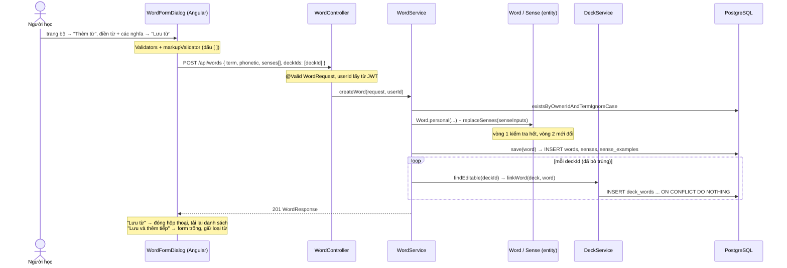

# Thêm từ mới vào bộ — luồng thực thi & mô hình dữ liệu

Tài liệu đi kèm `vocab/WordService.java`, `vocab/Word.java`, `vocab/Sense.java` (backend) và `features/decks/word-form-dialog/*` (frontend).
Đọc phần **1–2** để nắm toàn cảnh, phần **3–5** để hiểu mô hình dữ liệu, luồng lưu và **lý do** chọn cách làm, phần **6–8** khi sửa code hoặc ôn phỏng vấn.

**Mục lục**

1. [Bài toán và mô hình dữ liệu](#1-bài-toán-và-mô-hình-dữ-liệu)
2. [Luồng thực thi từ đầu đến cuối](#2-luồng-thực-thi-từ-đầu-đến-cuối)
3. [Bốn lớp kiểm tra](#3-bốn-lớp-kiểm-tra)
4. [Lưu từ — WordService.createWord](#4-lưu-từ--wordservicecreateword)
5. [Word.replaceSenses — kiểm tra hết rồi mới đổi](#5-wordreplacesenses--kiểm-tra-hết-rồi-mới-đổi)
6. [Các quyết định thiết kế và lý do](#6-các-quyết-định-thiết-kế-và-lý-do)
7. [Giới hạn đã biết và hướng mở rộng](#7-giới-hạn-đã-biết-và-hướng-mở-rộng)
8. [Test, file liên quan, câu hỏi ôn tập](#8-test-file-liên-quan-câu-hỏi-ôn-tập)

---

## 1. Bài toán và mô hình dữ liệu

Người học thêm một từ (kèm phiên âm, nhiều nghĩa, mỗi nghĩa vài câu ví dụ) và đặt nó vào bộ đang mở.

```
users ──< words (sổ từ)                          decks
            │  owner_id NULL = từ HỆ THỐNG          │
            │                                       │
            ├──< senses (MỘT nghĩa = MỘT thẻ ôn)    │
            │      ├──< sense_examples              │
            │      └──< card_progresses (tiến độ Leitner, theo từng user)
            │                                       │
            └──<> deck_words >──────────────────────┘   (một từ nằm trong NHIỀU bộ)
```

Ví dụ một từ hai nghĩa:

```
commute  /kəˈmjuːt/
  ├─ (n) quãng đường đi làm hằng ngày   "My [commute] takes an hour."     → thẻ ôn #1
  └─ (v) đi làm (đi về đều đặn)         "I [commute] by bus."             → thẻ ôn #2
```

| Khái niệm | Bảng | Ghi chú |
|---|---|---|
| **Từ** (`Word`) | `words` | `owner_id` = chủ; `NULL` = từ hệ thống (admin quản lý, ai cũng học được) |
| **Nghĩa** (`Sense`) | `senses` | Loại từ + nghĩa tiếng Việt + vị trí. **Đơn vị được ôn** |
| **Câu ví dụ** | `sense_examples` | Lưu nguyên văn, kể cả dấu `[ ]` đánh dấu từ đích |
| **Bộ** (`Deck`) | `decks` + `deck_words` | Chỉ là **nhãn chủ đề**: xóa bộ thì từ vẫn còn trong sổ |

**Vì sao tách Từ → Nghĩa?** Từ tiếng Anh hay nhiều nghĩa, và người học có thể nhớ nghĩa này mà quên nghĩa kia. Tiến độ Leitner (`card_progresses`) gắn với **nghĩa**, nên quên "nhẹ" thì chỉ nghĩa "nhẹ" về hộp 1, nghĩa "ánh sáng" vẫn ở hộp cao.

**Vì sao bộ là nhiều-nhiều?** Một từ như *deadline* hợp cả bộ "Công sở" lẫn "IELTS". Trước V10, thẻ thuộc đúng một bộ → phải nhập trùng. V10 đổi `cards` thành `senses` **giữ nguyên id** nên tiến độ ôn cũ không mất.

---

## 2. Luồng thực thi từ đầu đến cuối



**Ba tầng, ba trách nhiệm:**

| Tầng | Làm gì | Không làm gì |
|---|---|---|
| `WordController` | Nhận request, `@Valid`, lấy `userId` từ token | Không có logic |
| `WordService` | Kiểm tra trùng từ, điều phối lưu, gắn vào bộ, đổi lỗi entity → HTTP | Không tự kiểm tra từng nghĩa |
| `Word`, `Sense`, `ExampleMarkup` | **Luật dữ liệu**: ít nhất 1 nghĩa, tối đa 10, không trùng nghĩa, câu ví dụ đúng định dạng | Không biết HTTP, không truy vấn DB |
| `DeckService` | Luật **quyền** của bộ: đọc được / sửa được / bộ này chứa được từ này không | — |

---

## 3. Bốn lớp kiểm tra

| Lớp | Ở đâu | Bắt được | Lỗi trả về |
|---|---|---|---|
| ① FE | `Validators`, `markupValidator` | Trống, quá dài, `[` thiếu `]` | Hiện ngay dưới ô, **không gửi request** |
| ② DTO | `@Valid WordRequest` / `SenseRequest` | `@NotBlank`, `@Size`, ≤ 10 nghĩa, ≤ 5 câu, câu ≤ 500 ký tự | `400 VALIDATION_ERROR` + `fieldErrors` (`"senses[1].definition"`) |
| ③ Entity | `Word.replaceSenses`, `Sense.cleanExamples`, `ExampleMarkup.validate` | 2 nghĩa trùng nhau, đánh dấu `[ ]` sai, từ rỗng sau khi cắt khoảng trắng | `IllegalArgumentException` → `guard()` → `400 INVALID_WORD` |
| ④ DB | `uq_words_owner_term`, `uq_senses_word_definition` | Hai request cùng tạo một từ **đúng cùng lúc** | `409 DATA_CONFLICT` |

**Vì sao lặp lại ở nhiều lớp?**

- Lớp ① cho trải nghiệm (báo ngay, không chờ mạng) — nhưng ai cũng gọi API trực tiếp được.
- Lớp ② chặn dữ liệu sai **trước khi vào service**; annotation không diễn tả được "hai nghĩa không trùng" hay "đúng một cặp `[ ]`".
- Lớp ③ là luật **của chính dữ liệu**: dù gọi từ `WordService`, `WordImportService` (nhập CSV) hay `AdminDeckService`, luật vẫn chạy vì nằm trong entity.
- Lớp ④ là chốt cuối: chỉ DB mới thấy được hai transaction chạy song song.

### Đánh dấu từ đích bằng `[ ]`

```
"Her English has [improved] a lot."
   plain  = "Her English has improved a lot."   ← hiển thị ở mặt sau thẻ ôn
   target = "improved"
   blanked = "Her English has ____ a lot."      ← bài luyện "Điền từ"
```

**Vì sao người dùng tự đánh dấu, không để máy tự dò theo `term`?** Từ trong câu thường đã chia: *improve → improved*, *go → went*, *child → children*. Dò theo `term` sẽ che sai chỗ hoặc không thấy. Đánh dấu tay → bài "Điền từ" luôn che đúng, chấm đúng.

Luật (`ExampleMarkup.validate`): không có `[ ]` thì hợp lệ (chỉ không dùng được cho "Điền từ"); có thì **đúng một** cặp, không rỗng.

| Câu | Kết quả |
|---|---|
| `I [commute] by bus.` | ✅ |
| `I commute by bus.` | ✅ (không dùng cho "Điền từ") |
| `I [commute by bus.` | ❌ ngoặc lẻ |
| `[I] [commute] by bus.` | ❌ hai đánh dấu |
| `I [] by bus.` | ❌ rỗng |

FE có bản TypeScript cùng luật (`core/util/example-markup.ts` → `exampleMarkupError`) để báo trước khi gửi.

---

## 4. Lưu từ — `WordService.createWord`

```java
@Transactional
public WordResponse createWord(WordRequest r, Long userId) {
  if (wordRepository.existsByOwnerIdAndTermIgnoreCase(userId, r.term().strip()))   // ①
    throw wordExists(r.term());                                                   //    409 WORD_EXISTS
  Word word = guard(() -> {                                                       // ②
    Word w = Word.personal(r.term(), r.phonetic(), userRepository.getReferenceById(userId));
    w.replaceSenses(r.senseInputs());
    return w;
  });
  wordRepository.save(word);                                                      // ③
  if (r.deckIds() != null)
    for (Long deckId : new HashSet<>(r.deckIds()))                                // ④
      deckService.linkWord(deckService.findEditable(deckId, userId), word);
  return toResponse(word, userId);
}
```

| Bước | Chi tiết | Vì sao |
|---|---|---|
| ① Trùng từ | So **không phân biệt hoa thường**: *Light* = *light* | Mỗi người một dòng cho mỗi từ. Câu báo gợi ý: "Hãy thêm nghĩa mới vào từ đó" |
| ② Dựng entity trong `guard` | `IllegalArgumentException` của entity → `400 INVALID_WORD` kèm đúng câu báo | Entity không biết HTTP; service đổi lỗi sang mã HTTP |
| `getReferenceById` | Proxy `User` chỉ có id, **không SELECT** bảng `users` | Chỉ cần khóa ngoại `owner_id` |
| ③ `save` **trước** khi gắn bộ | Cần `word.id` để chèn dòng `deck_words` | `IDENTITY` → INSERT chạy ngay khi `save` |
| Cascade | `Word.senses` có `cascade = ALL` → INSERT luôn `senses` và `sense_examples` | Nghĩa không tồn tại độc lập với từ |
| ④ Gắn vào bộ | `new HashSet<>(deckIds)` bỏ id trùng; `findEditable` kiểm tra quyền; `linkWord` kiểm tra `Deck.canContain` | Dùng lại đúng luật của API "thêm từ vào bộ" |
| Rollback | Một `deckId` không hợp lệ → exception → **cả từ không được lưu** | `@Transactional` trên cả method: tất cả hoặc không gì cả |

### Luật quyền của bộ

| Bộ | `findEditable` | Mã lỗi |
|---|---|---|
| Bộ của tôi | ✅ | — |
| Bộ hệ thống | ❌ | `403 DECK_READ_ONLY` (bộ hệ thống ai cũng thấy, nói rõ là không sửa được) |
| Bộ của người khác / không tồn tại | ❌ | `404 DECK_NOT_FOUND` (**không** trả 403 để không lộ "bộ này có tồn tại") |

`Deck.canContain(word)`: bộ hệ thống chỉ chứa từ hệ thống; bộ cá nhân chứa từ của chủ bộ hoặc từ hệ thống → sai thì `400 WORD_NOT_ALLOWED`.

`DeckRepository.addWord` là SQL thuần `INSERT ... ON CONFLICT DO NOTHING`: thêm lại từ đã có trong bộ không lỗi, và **không cần tải cả bộ** (danh sách từ) lên bộ nhớ.

### Sau khi lưu

Mỗi nghĩa mới **chưa có** dòng `card_progresses` → được đếm là "thẻ mới" của bộ (`SenseRepository.countNewInDeck`) và xuất hiện ở "Học thẻ mới". Tiến độ chỉ được tạo ở **lần ôn đầu tiên** (xem `review-leitner.md`).

---

## 5. `Word.replaceSenses` — kiểm tra hết rồi mới đổi

Dùng chung cho **tạo** và **sửa** từ (cả bản admin và nhập CSV):

```
input có id    → sửa nghĩa đó tại chỗ        (giữ id → giữ tiến độ ôn)
input không id → thêm nghĩa mới
nghĩa cũ không có trong input → bị xóa      (orphanRemoval, kéo theo tiến độ của nghĩa đó)
thứ tự trong input = position 0, 1, 2...
```

**Hai vòng:**

```
Vòng 1 — CHỈ KIỂM TRA, không đổi gì:
    1 ≤ số nghĩa ≤ 10
    id (nếu có) phải thuộc từ này, không lặp
    loại từ có, nghĩa không rỗng
    nghĩa không trùng (so lowercase)
    câu ví dụ: cắt khoảng trắng, bỏ câu trống, đúng định dạng [ ], ≤ 5 câu
Vòng 2 — ÁP DỤNG: tạo / sửa / sắp lại, rồi senses.clear() + addAll(next)
```

**Vì sao hai vòng?** Nếu kiểm tra và sửa xen kẽ, nghĩa thứ nhất đã bị sửa rồi nghĩa thứ hai mới báo lỗi → entity ở trạng thái **nửa cũ nửa mới**. Transaction sẽ rollback DB, nhưng object trong bộ nhớ vẫn bẩn. Hai vòng đảm bảo: input sai thì từ **giữ nguyên** (test `replaceSenses_errorInLaterSense_leavesEarlierUntouched`).

**Word là aggregate root.** `Sense` có constructor và `change(...)` **package-private**; `getSenses()` trả danh sách **chỉ đọc**. Bên ngoài không thể thêm / sửa / xóa nghĩa mà bỏ qua `replaceSenses` → luật "ít nhất 1 nghĩa, không trùng nghĩa" không bao giờ bị lách.

---

## 6. Các quyết định thiết kế và lý do

| # | Quyết định | Lý do | Đánh đổi |
|---|---|---|---|
| 1 | **Từ → Nghĩa**, ôn theo nghĩa | Nhớ nghĩa này quên nghĩa kia là chuyện thường | Một từ nhiều nghĩa = nhiều thẻ, hàng đợi dài hơn |
| 2 | **Bộ là nhãn** (nhiều-nhiều) | Một từ hợp nhiều chủ đề, không nhập trùng | Truy vấn "từ trong bộ" cần join `deck_words` |
| 3 | Một request tạo **từ + mọi nghĩa + gắn bộ** | FE chỉ cần một lần gọi; một transaction | Body lớn hơn |
| 4 | Luật dữ liệu nằm trong **entity** | Nhập tay, nhập CSV, admin đều qua cùng luật | Service phải đổi `IllegalArgumentException` → HTTP (`guard`) |
| 5 | **Kiểm tra hết rồi mới đổi** | Không có trạng thái nửa vời | Duyệt input hai lần (≤ 10 phần tử, không đáng kể) |
| 6 | Trùng từ **không phân biệt hoa thường**, chặn ở cả code và **index `lower(term)`** | *Light* và *light* là một | Muốn từ khác nghĩa cùng cách viết thì thêm nghĩa |
| 7 | **Partial unique index** riêng cho từ cá nhân / từ hệ thống | `UNIQUE (owner_id, term)` coi các `NULL` là khác nhau → từ hệ thống trùng vẫn lọt | Hai index thay vì một |
| 8 | Đánh dấu `[ ]` **do người dùng** | Từ trong câu đã chia, máy dò theo `term` hay sai | Người dùng phải học cú pháp (có placeholder gợi ý) |
| 9 | Bộ người khác → **404**, bộ hệ thống → **403** | 404 không lộ sự tồn tại; bộ hệ thống công khai nên nói rõ lý do | Hai mã cho "không sửa được" |
| 10 | `addWord` bằng **SQL `ON CONFLICT DO NOTHING`** | Không tải cả bộ lên; thêm lặp không lỗi | Bỏ qua dirty checking, phải tự `deck.touch()` |
| 11 | Sửa từ: nghĩa **giữ id** thì giữ tiến độ | Sửa lỗi chính tả trong nghĩa không làm mất tiến độ ôn | Xóa nghĩa là mất tiến độ của nghĩa đó |

---

## 7. Giới hạn đã biết và hướng mở rộng

| Giới hạn | Ghi chú | Hướng xử lý |
|---|---|---|
| Tạo cùng một từ **đúng cùng lúc** (double click, 2 tab) nhận `409 DATA_CONFLICT` thay vì `WORD_EXISTS` | `existsBy...` và INSERT không nguyên tử; index chặn được nhưng mã lỗi chung | Bắt `DataIntegrityViolationException` quanh `save` rồi ném `WORD_EXISTS` (giống `ReportService.create` dùng `saveAndFlush`) |
| **Sửa** từ ở hai tab: tab lưu sau ghi đè tab trước | `Word` chưa có `@Version` (V13 chỉ thêm cho `card_progresses`, `content_reports`) | Thêm cột `version` cho `words`, FE gửi kèm version |
| Không gợi ý nghĩa / phiên âm | Người học tự nhập | Tra từ điển ngoài, hoặc gợi ý từ hệ thống cùng `term` |
| Trùng với **từ hệ thống** vẫn tạo được từ cá nhân | Có chủ đích: người học muốn nghĩa riêng | Gợi ý "từ này đã có trong thư viện" trước khi lưu |
| Đánh dấu `[ ]` chỉ một chỗ mỗi câu | Đủ cho "Điền từ" | — |

---

## 8. Test, file liên quan, câu hỏi ôn tập

### File

| File | Vai trò |
|---|---|
| `vocab/WordController.java` | `POST /api/words` (và GET / PUT / DELETE) |
| `vocab/WordService.java` | `createWord`, `updateWord`, `guard` |
| `vocab/Word.java` | Aggregate root, `replaceSenses`, `isReadableBy` / `isOwnedBy` |
| `vocab/Sense.java` | Một nghĩa, `cleanExamples`, `plainExamples` |
| `vocab/ExampleMarkup.java` | Đọc / kiểm tra / làm trống dấu `[ ]` |
| `vocab/SenseInput.java`, `vocab/PartOfSpeech.java` | Đầu vào domain, loại từ (có `IDIOM`, `PHRASAL_VERB`) |
| `vocab/dto/WordRequest.java`, `SenseRequest.java`, `WordResponse.java` | Hợp đồng API |
| `vocab/DeckService.java` | `findEditable`, `linkWord`, `findReadableWord` |
| `vocab/DeckRepository.java` | `addWord` (`ON CONFLICT DO NOTHING`) |
| `db/migration/V10__words_senses.sql` | Tách thẻ → từ / nghĩa, `deck_words`, các unique index |
| FE `features/decks/word-form-dialog/*` | Form nhiều nghĩa, "Lưu và thêm tiếp", lỗi theo ô |
| FE `core/util/example-markup.ts` | Luật `[ ]` bản TypeScript |

### Test

| Test | Kiểm tra |
|---|---|
| `WordTest` | Tạo từ kèm nghĩa; giữ id khi sửa và xóa nghĩa bị bỏ; trùng nghĩa bị từ chối **mà không đổi gì**; lỗi ở nghĩa sau không làm hỏng nghĩa trước; input không hợp lệ; câu ví dụ được làm sạch và kiểm tra; quyền sở hữu; `Deck.canContain` |
| `ExampleMarkupTest` | Câu có đánh dấu; dạng đã chia; câu không đánh dấu; bỏ ngoặc khi hiển thị; định dạng sai; thành ngữ / cụm động từ nhiều chữ |
| `WordImportServiceTest` | Nhập CSV đi qua **cùng** `replaceSenses` / `linkWord` |

### Câu hỏi ôn tập

1. Vì sao tách Từ và Nghĩa thành hai bảng? Tiến độ ôn gắn với cái nào, vì sao?
2. Vì sao Bộ và Từ là quan hệ nhiều-nhiều? Xóa một bộ thì từ có mất không?
3. Kể bốn lớp kiểm tra khi thêm từ. Vì sao không chỉ kiểm tra ở FE? Ở DTO?
4. "Hai nghĩa không trùng nhau" được kiểm tra ở đâu? Vì sao không dùng annotation?
5. `replaceSenses` vì sao kiểm tra hết rồi mới đổi?
6. Vì sao `Sense` có constructor package-private và `getSenses()` trả danh sách chỉ đọc?
7. Vì sao phải `save(word)` trước khi gắn vào bộ?
8. Thêm từ vào bộ của người khác trả 404, vào bộ hệ thống trả 403 — vì sao khác nhau?
9. Vì sao cần **hai** partial unique index cho `words` thay vì `UNIQUE (owner_id, lower(term))`?
10. Hai tab cùng tạo từ *deadline* đúng cùng lúc — điều gì xảy ra? Sửa thế nào để trả `WORD_EXISTS`?
11. Vì sao người dùng tự đánh dấu `[ ]` thay vì hệ thống tự tìm từ trong câu?
