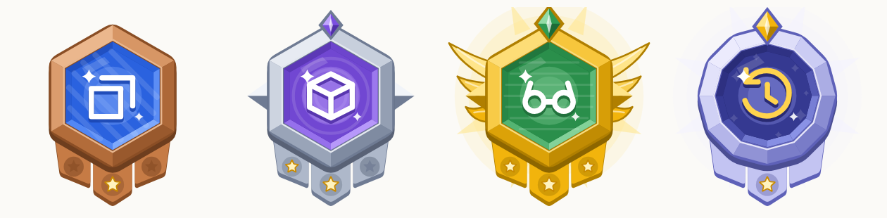
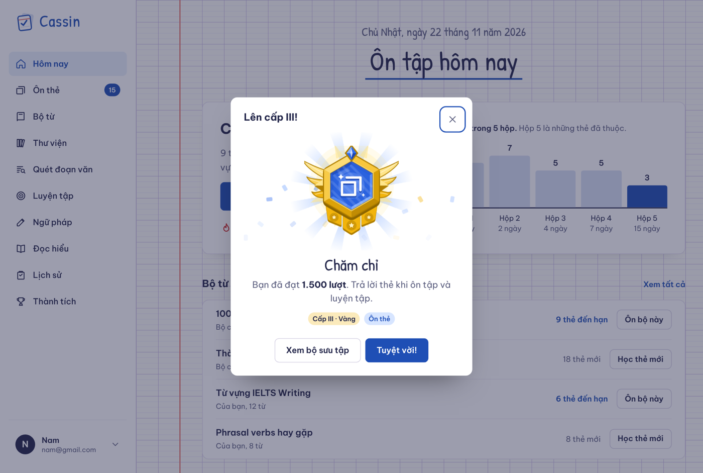
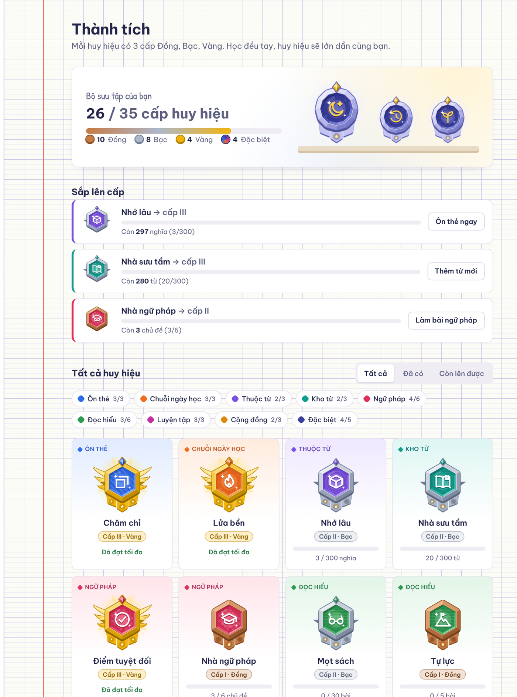
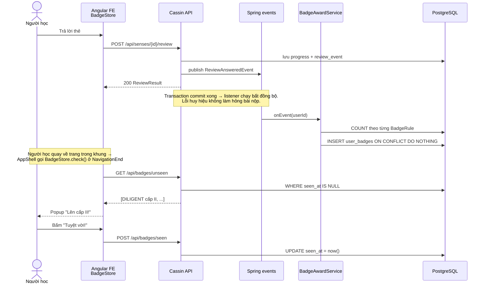
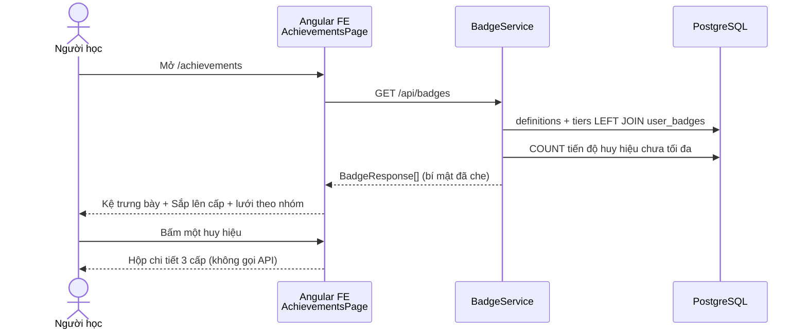

# Huy hiệu (Badge) · Design pattern

Tài liệu gốc của module huy hiệu: luật nghiệp vụ, hệ thống hình ảnh, bảng màu, hợp đồng API và luồng xử lý.
Sửa thiết kế thì sửa **code** (bảng màu, hình, danh mục), rồi chạy `npm run docs:badges` trong `frontend/`
để sinh lại [`badge-gallery.html`](./badge-gallery.html) (mở bằng trình duyệt để xem mọi huy hiệu ở mọi cấp).



| Trạng thái | |
| --- | --- |
| Frontend | Xong, chạy bằng `npm run start:mock` (dữ liệu giả trong trình duyệt) |
| Backend | Chưa có: package `com.cassin.badge`, migration V18, 3 endpoint (mục 5, 6) |
| Nối BE | Không sửa FE: `provideApi(false)` đã trỏ `BadgeApi` sang `HttpBadgeApi` |

---

## 1. Nguyên tắc thiết kế

Rút ra từ Duolingo Achievements, Microsoft Learn và các bài viết về thiết kế badge
(Yu-kai Chou: *one badge with visible tiers*; Designmodo: *một khuôn chung, đổi icon cho từng thành tích*).

1. **Một huy hiệu, ba cấp** thay vì nhiều huy hiệu rời rạc ("100 lượt", "1.000 lượt").
   Người học luôn thấy mục tiêu kế tiếp trên chính huy hiệu đang có.
2. **Không phát huy hiệu cho không.** Không có "trả lời thẻ đầu tiên". Cấp I cần 1-3 ngày học thật,
   cấp III là mục tiêu dài hạn.
3. **Huy hiệu dẫn tới hành động.** Mỗi nhóm có nút "Ôn thẻ ngay", "Làm bài đọc"...; trang Thành tích mở đầu
   bằng mục *Sắp lên cấp*.
4. **Có bất ngờ.** Huy hiệu đặc biệt ghi nhận khoảnh khắc hệ thống tự nhận ra; 2 cái bí mật.
5. **Nhìn dáng là biết cấp.** Cấp càng cao càng nhiều chi tiết (mục 3), không cần đọc chữ.
6. **Đạt rồi giữ mãi.** Chuỗi ngày bị đứt cũng không mất cấp.
7. **Backend là nguồn sự thật duy nhất.** Không có API "cấp huy hiệu"; frontend chỉ hiển thị.

## 2. Danh mục

Định nghĩa trong code: `frontend/src/app/core/mock/mock-badge-catalog.ts`
(backend seed đúng nội dung này vào `badge_definitions` + `badge_tiers`).

### 2.1 Huy hiệu có cấp (TIERED)

| Mã | Tên | Nhóm | Đếm gì | I · Đồng | II · Bạc | III · Vàng |
| --- | --- | --- | --- | ---: | ---: | ---: |
| `DILIGENT` | Chăm chỉ | Ôn thẻ | Lượt trả lời (ôn + luyện) | 30 | 300 | 1.500 |
| `ON_FIRE` | Lửa bền | Chuỗi ngày học | Ngày học liên tiếp | 3 | 14 | 60 |
| `MEMORY_KEEPER` | Nhớ lâu | Thuộc từ | Nghĩa ở hộp 5 | 5 | 50 | 300 |
| `COLLECTOR` | Nhà sưu tầm | Kho từ | Từ tự thêm | 20 | 100 | 300 |
| `PERFECTIONIST` | Điểm tuyệt đối | Ngữ pháp | Bài kiểm tra đúng hết | 1 | 5 | 20 |
| `GRAMMARIAN` | Nhà ngữ pháp | Ngữ pháp | Chủ đề đã nộp bài | 3 | 6 | 10 |
| `BOOKWORM` | Mọt sách | Đọc hiểu | Bài đọc hoàn thành | 3 | 10 | 30 |
| `SELF_RELIANT` | Tự lực | Đọc hiểu | Bài đọc đúng hết, không mở gợi ý | 1 | 5 | 15 |
| `WORDSMITH` | Thợ rèn câu | Luyện tập | Câu điền từ + xếp câu | 30 | 300 | 1.000 |
| `SHARP_EYE` | Mắt tinh | Cộng đồng | Báo lỗi được admin sửa | 1 | 5 | 20 |

### 2.2 Huy hiệu đặc biệt (SPECIAL)

| Mã | Tên | Điều kiện | Nguồn dữ liệu |
| --- | --- | --- | --- |
| `ALL_ROUNDER` | Đa năng | Thử đủ lật thẻ, điền từ, xếp câu | `review_events.mode` |
| `NEVER_GIVE_UP` | Không bỏ cuộc | Thuộc một nghĩa từng quên ≥ 3 lần | `card_progresses.lapse_count` |
| `COMEBACK` | Trở lại | Quay lại học sau ≥ 7 ngày nghỉ | `study_days` |
| `NIGHT_OWL` | Cú đêm *(bí mật)* | Ôn thẻ sau 23 giờ | `review_events.reviewed_at` |
| `EARLY_BIRD` | Chim sớm *(bí mật)* | Ôn thẻ trước 6 giờ sáng | `review_events.reviewed_at` |

Giờ của Cú đêm / Chim sớm tính theo múi giờ người học (cột `users.time_zone`, mặc định `Asia/Ho_Chi_Minh`).

### 2.3 Thêm một huy hiệu mới

1. Thêm mã vào `BadgeCode` (`badge.models.ts`).
2. Thêm định nghĩa + mốc + hàm `progress` vào `BADGE_CATALOG`.
3. Thêm hình vào `BADGE_GLYPHS` (`badge-glyphs.ts`): path SVG lưới 24×24, 2-4 nét lớn.
4. Backend: thêm dòng seed + một bean `BadgeRule`.
5. `npm run docs:badges` để cập nhật trang xem trước.

## 3. Hệ thống hình ảnh

Toàn bộ huy chương do **một hàm thuần** `buildMedal()` sinh ra
(`frontend/src/app/shared/ui/badge-medal/badge-art.ts`). Component `app-badge-medal` chỉ vẽ danh sách lớp
nó trả về; script sinh tài liệu gọi đúng hàm này → hình trong app và trong tài liệu luôn giống nhau.

Không dùng gradient / clipPath (`url(#id)` dễ hỏng khi app có `<base href>` và nhiều huy chương cùng trang):
độ khối tạo bằng các lớp màu phẳng.

### 3.1 Cấu tạo (từ sau ra trước)

| # | Lớp | Màu |
| --- | --- | --- |
| 1 | Hào quang + tia (cấp III, đặc biệt) | Kim loại `light`, mờ |
| 2 | Đôi cánh 3 lông, có gân sáng (cấp III) | Kim loại |
| 3 | Tấm đế 3 tấm, mỗi tấm một ô sao | Kim loại; sao sáng `#FFF3BF` |
| 4 | Mũi nhọn hai bên (cấp II+) | Kim loại `light` / `dark` |
| 5 | Bóng khối + viền ngoài bo tròn | Kim loại `dark` |
| 6 | **Khung cắt 6 mặt** như đá quý, sáng từ góc trên trái | Kim loại, trộn tự động |
| 7 | **Lòng lõm**: vòng mặt cắt chiếu ngược (trên tối, dưới sáng) | Màu nhóm |
| 8 | Họa tiết nhóm, trắng 13% | Trắng |
| 9 | Vầng sáng + hình nét trắng dày có bóng | Nhóm `light` / `dark` |
| 10 | Vệt phản chiếu + 2 điểm lấp lánh | Trắng |
| 11 | Viên ngọc trên đỉnh (II nhỏ, III lớn) | Màu nhóm (đặc biệt: vàng) |
| 12 | Ổ khóa (chưa đạt) | Trắng / mực |

### 3.2 Cấp → hình dáng

| Cấp | Khung | Trang trí thêm | Sao sáng |
| --- | --- | --- | --- |
| Chưa đạt | Lục giác, xám giấy | Ổ khóa; bí mật: dấu hỏi | 0 |
| I · Đồng | Lục giác cắt mặt | Tấm đế | 1 |
| II · Bạc | Như trên | + mũi nhọn hai bên + ngọc nhỏ | 2 |
| III · Vàng | Như trên | + ngọc lớn + đôi cánh + hào quang | 3 |
| Đặc biệt | **12 mặt**, bạc ánh tím, lòng màu đêm | Hình + ngọc màu vàng, hào quang | 1 |

### 3.3 Mặt cắt được tô thế nào

Mỗi mặt có pháp tuyến `n`; nguồn sáng từ góc trên trái `L = (-0.55, -0.83)`; `k = n · L`.

- `k ≥ 0` → trộn `base` → `light` theo `0.85·k`
- `k < 0` → trộn `base` → `dark` theo `0.75·|k|`
- Lòng huy chương đảo dấu `k` nên trông lõm xuống.

Vì vậy mỗi bảng màu chỉ cần 3 tông; mọi mặt cắt tự suy ra.

## 4. Bảng màu

Định nghĩa trong code: `frontend/src/app/core/models/badge.models.ts`.
Hai lớp màu, vai trò tách bạch:

- **Màu chung** = **cấp**. Dùng cho khung, tấm đế, mũi nhọn, cánh, chip cấp. Không bao giờ làm màu lòng.
- **Màu riêng** = **nhóm**. Dùng cho lòng huy chương, họa tiết, viên ngọc, nền thẻ, thanh tiến độ.

### 4.1 Màu chung (`BADGE_METALS`, `BADGE_NEUTRALS`, `SPECIAL_RIM`)

| Vai trò | light | base | dark |
| --- | --- | --- | --- |
| Cấp I · Đồng | `#F2C29A` | `#C67B45` | `#8A4E25` |
| Cấp II · Bạc | `#F1F4F9` | `#AEB8CA` | `#6F7B93` |
| Cấp III · Vàng | `#FFE58A` | `#F2B40C` | `#B07F00` |
| Viền đặc biệt | `#F4F3FF` | `#C3C4F2` | `#5E61B8` |
| Chưa đạt | `#F3F1F7` | `#DEDAE8` | `#B9B3CB` |

Hình huy hiệu đặc biệt: `#FFD34D`. Hình huy hiệu có cấp: trắng.

### 4.2 Màu riêng theo nhóm (`BADGE_CATEGORY_THEMES`)

9 sắc độ trải đều vòng màu để hai nhóm cạnh nhau không lẫn; mỗi nhóm thêm một họa tiết riêng
(phân biệt được cả với người khó nhìn màu).

| Nhóm | light | base | dark | Họa tiết |
| --- | --- | --- | --- | --- |
| Ôn thẻ `REVIEW` | `#8DB4FF` | `#2F6BED` | `#1B47B3` | Sọc chéo |
| Chuỗi ngày học `STREAK` | `#FFB27A` | `#F26B1D` | `#B4460B` | Đốm lửa |
| Thuộc từ `MASTERY` | `#C2A6FF` | `#7B4FE0` | `#5130A8` | Vòng đồng tâm |
| Kho từ `COLLECTION` | `#7FDCCF` | `#119C8E` | `#0A6B62` | Chấm lưới |
| Ngữ pháp `QUIZ` | `#FF9BAE` | `#E0315A` | `#A31B3D` | Ô cờ |
| Đọc hiểu `READING` | `#93DCA6` | `#2E9B52` | `#1D6B37` | Dòng kẻ vở |
| Luyện tập `PRACTICE` | `#F2A0E6` | `#C2309F` | `#88206F` | Răng cưa |
| Cộng đồng `COMMUNITY` | `#FFD58A` | `#D98A0B` | `#9A5F05` | Tia sáng |
| Đặc biệt `SPECIAL` | `#9AA3F5` | `#3B3F9E` | `#23256A` | Lấp lánh |

## 5. Giao diện

| Nơi | Nội dung |
| --- | --- |
| Popup (`badge-unlock-dialog`) | 3 kiểu tiêu đề: *Huy hiệu mới!* (cấp I) · *Lên cấp II/III!* · *Huy hiệu đặc biệt!*; tia sáng + giấy màu theo màu nhóm; nhiều huy hiệu thì lần lượt "2 / 3" |
| Trang `/achievements` | Kệ trưng bày 3 huy hiệu mới nhất, đếm Đồng / Bạc / Vàng / Đặc biệt; *Sắp lên cấp* + nút hành động; lưới chung lọc theo nhóm; hộp chi tiết lộ trình 3 cấp |
| Điều hướng | Mục "Thành tích" trên sidebar (máy tính) và menu tài khoản (điện thoại) |





Tiến độ tới cấp kế tiếp tính **từ mốc cấp trước** (cấp II: từ 30 → 300, không phải từ 0),
để thanh tiến độ không đứng yên lâu sau khi vừa lên cấp.

## 6. Backend đề xuất

```
com.cassin.badge
├── event/          ReviewAnsweredEvent, QuizSubmittedEvent, ReadingSubmittedEvent,
│                   DeckCreatedEvent, WordCreatedEvent, ReportResolvedEvent   (record, mang userId)
├── rule/           BadgeRule (interface) + 1 bean / huy hiệu: codes(), triggers(), progress(userId)
├── BadgeEventListener   @TransactionalEventListener(AFTER_COMMIT) + @Async
├── BadgeAwardService    chạy rule khớp event, INSERT ... ON CONFLICT DO NOTHING
├── BadgeService         đọc danh mục + tiến độ, che huy hiệu bí mật, đánh dấu đã xem
└── BadgeController      3 endpoint bên dưới
```

Module cũ chỉ thêm **một dòng** `publisher.publishEvent(...)`, không phụ thuộc ngược vào Badge.

### 6.1 API

| Method | Endpoint | Trả về | Ghi chú |
| --- | --- | --- | --- |
| GET | `/api/badges` | `BadgeResponse[]` | `kind`, `level` (0-3), `progress`, `unit`, `tiers[{level, target, earnedAt}]`; bí mật chưa đạt: name `???`, progress 0 |
| GET | `/api/badges/unseen` | `EarnedBadgeResponse[]` | Mỗi cấp vừa đạt một dòng, cũ nhất trước; nhảy nhiều cấp chỉ trả cấp cao nhất |
| POST | `/api/badges/seen` | 204 | `{ "items": [{ "code": "DILIGENT", "level": 2 }] }`; đánh dấu mọi cấp ≤ level; cặp lạ bị bỏ qua |

DTO khớp 1-1 với `frontend/src/app/core/models/badge.models.ts`.

### 6.2 Schema (Flyway V18)

```sql
CREATE TABLE badge_definitions (
    code        VARCHAR(40) PRIMARY KEY,
    kind        VARCHAR(10)  NOT NULL CHECK (kind IN ('TIERED','SPECIAL')),
    name        VARCHAR(80)  NOT NULL,
    description VARCHAR(200) NOT NULL,
    unit        VARCHAR(30)  NOT NULL,
    category    VARCHAR(20)  NOT NULL,
    secret      BOOLEAN      NOT NULL DEFAULT FALSE,
    sort_order  INT          NOT NULL
);

CREATE TABLE badge_tiers (
    badge_code VARCHAR(40) NOT NULL REFERENCES badge_definitions(code),
    level      SMALLINT    NOT NULL CHECK (level BETWEEN 1 AND 3),
    target     INT         NOT NULL CHECK (target > 0),
    PRIMARY KEY (badge_code, level)
);

CREATE TABLE user_badges (
    user_id    BIGINT      NOT NULL REFERENCES users(id) ON DELETE CASCADE,
    badge_code VARCHAR(40) NOT NULL,
    level      SMALLINT    NOT NULL,
    earned_at  TIMESTAMPTZ NOT NULL DEFAULT now(),
    seen_at    TIMESTAMPTZ,
    PRIMARY KEY (user_id, badge_code, level),
    FOREIGN KEY (badge_code, level) REFERENCES badge_tiers(badge_code, level)
);

CREATE INDEX idx_user_badges_unseen ON user_badges (user_id) WHERE seen_at IS NULL;
```

## 7. Luồng xử lý

### 7.1 Cấp huy hiệu và popup



Quiz, bài đọc, tạo bộ từ, báo lỗi xử lý y hệt, chỉ đổi tên event.
Vì popup do `unseen` quyết định, đăng nhập máy khác vẫn thấy huy hiệu chưa xem.

### 7.2 Trang Thành tích



Tiến độ tính lúc đọc (không lưu), nên đổi mốc thì trang tự đúng ngay; chỉ việc **đã đạt** được ghi cố định.

## 8. Bản đồ file

| File | Vai trò |
| --- | --- |
| `core/models/badge.models.ts` | DTO + **bảng màu** (`BADGE_METALS`, `BADGE_NEUTRALS`, `BADGE_CATEGORY_THEMES`) |
| `core/api/badge.api.ts`, `api/http/http-badge.api.ts` | Hợp đồng 3 endpoint + bản HTTP |
| `core/mock/mock-badge-catalog.ts`, `mock-badge.api.ts` | Danh mục, mốc, luật tiến độ; giả lập BadgeAwardService |
| `core/mock/mock-db.ts` | Bảng `userBadges` (tự khởi tạo, không xóa dữ liệu mock đang có) |
| `core/state/badge.store.ts` | Hàng đợi popup theo cặp (mã, cấp) |
| `shared/ui/badge-medal/badge-art.ts` | **`buildMedal()`**: toàn bộ hình học + tô màu |
| `shared/ui/badge-medal/badge-shapes.ts` | Đa giác bo góc, ngôi sao, họa tiết nhóm |
| `shared/ui/badge-medal/badge-glyphs.ts` | 15 hình giữa huy chương |
| `shared/ui/badge-medal/badge-medal.*` | Component vẽ danh sách lớp |
| `features/badges/badge-unlock-dialog/*` | Popup mở khóa / lên cấp |
| `features/badges/achievements-page.*`, `badge-view.ts` | Trang Thành tích + hàm hiển thị |
| `scripts/badge-gallery.ts` | Sinh `docs/badges/badge-gallery.html` |
